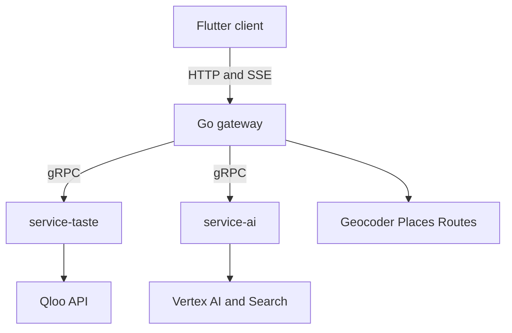

# Karum implementation plan

This is the build checklist for the whole system, not only infra. The product is the vacancy-to-tenant leasing agent in [PRODUCT.md](PRODUCT.md). The shape is the five-repo split in [TECH.md](TECH.md): Flutter client, Go gateway, `service-taste`, `service-ai`, and this infra repo for protos, Compose, and Cloud Run.

Today is 16 Oct 2026. The Devpost deadline is 30 Oct 2026, 11:45pm EDT. Submit on 29 Oct. The old Oct 4–8 coverage window has passed, so the checklist follows dependencies, with fixtures unblocking the team until the hackathon key is verified.

**Status — 16 Oct 2026.** Completed items are ticked below. The five repos exist as private `karum-labs` repositories; local folders carry the `karum-` prefix so they match their remotes (`karum-infra`, `karum-server`, `karum-service-taste`, `karum-service-ai`, `karum-client`). Done so far: repository scaffolding (MIT licences, READMEs, gitignores, CI on each repo), toolchain pins, a `GET /health` endpoint on all three backends, the shared `karum/health/v1` proto placeholder with buf lint and breaking checks, and the five-service Compose stack booting green on fixtures. **Section 0 closed 14 Oct:** the decision record lives in [DECISIONS.md](DECISIONS.md) (service map, stack deltas, non-goals, kill rules with the Shelfwise fallback, two-person split), every README carries an ownership note, and the gitleaks secret scan runs in all five repos. Epics 2 onward — the Qloo spike, domain protos, scoring, drafts, and the product screens — are untouched. **Docs synced 16 Oct:** [QLOO_APIS.md](QLOO_APIS.md) was rebuilt against the 16 Oct docs snapshot — parameter catalogue, a 22-item spike checklist, and the DI-1…DI-20 register — and [PRODUCT.md](PRODUCT.md) was re-aligned; epic 9 below maps onto that checklist, and no completed build item changed status. **Key in hand 16 Oct 2026:** the hackathon key has arrived and the monthly quota is recorded as 10,000 requests (epic 9, first checklist item).

Service ownership:

- **infra:** protos, Compose, Cloud Run, fixture pack, Makefile, CI glue
- **service-taste:** Qloo client, resolution, tags, insights, the three-part score, Redis cache
- **service-ai:** Gemini, search grounding, bounded probes, autopilot, memo, outreach, listing blurb, LLM-only baseline
- **server:** geocoding, job orchestration, confirmation pause, Places enrichment, optional site-visit route, Postgres, rate limits, SSE
- **client:** judge-ready Flutter web UI, plus the same screens on desktop

Each epic below has a short implementation note, then a short checklist in implementation order. After the local stack boots on fixtures, client shell work can run in parallel with taste and AI — start epics 34–38 against fixture mode as soon as the domain protos land (4–7), because the schedule assumes that overlap. If the calendar tightens, cut in this order without touching the three-minute judge path: MCP tool (49), brand-side view (48), saved vacancies and magic-link sign-in (43), the compare chart (16), the site-visit route (32), then diff and scheduled watch (30).

## 0. Lock the shape

### 1. Record decisions

Write a one-page service map that assigns every PRODUCT.md must-build to infra, `server`, `service-taste`, `service-ai`, or `client`. Record the stack deltas already chosen: Flutter web, server-rendered PDF, map tiles in the client, Places as pin enrichment, Routes as an optional broker site visit. List the non-goals (login wall on the demo, payments, footfall, scraping, multi-floor planner, custom ML, undocumented Qloo parameters) and the kill rules plus Shelfwise fallback, which keeps the same gRPC boundaries if the coverage gate fails. Name the split: taste, score, agent, and eval on one side; UI, map, drafts, deploy, and Devpost on the other.

- [x] Write a one-page service map that assigns every PRODUCT.md must-build feature to one service — recorded in [`DECISIONS.md`](DECISIONS.md) §1
- [x] Record the stack adaptations: Flutter web instead of Next.js, server-rendered PDF, Map tiles in the client, Places as pin enrichment, Routes as an optional broker site visit — `DECISIONS.md` §2
- [x] Record the out-of-scope list: login wall on the demo, payments, footfall feeds, listing-site scraping, multi-floor mall planner, custom ML, undocumented Qloo parameters — `DECISIONS.md` §3
- [x] Record the kill rules and the Shelfwise fallback so a failed coverage gate has a named exit that keeps the same service boundaries — `DECISIONS.md` §4, all seven criteria plus the fallback
- [x] Name the two-person split: taste, score, agent, and eval on one side; UI, map, drafts, deploy, and Devpost on the other — `DECISIONS.md` §5

### 2. Repositories and legal surface

Create `client`, `server`, `service-taste`, and `service-ai` as siblings of this repo, each with an MIT `LICENSE` and a README whose run path and licence line can be pasted into the host About section. Add gitignores for `.env`, key files, notebook outputs, and build artifacts, plus an ownership note that matches the two-person split. Add a secret scan (gitleaks or equivalent) so a committed Qloo `X-Api-Key` or GCP credential fails before it lands on the remote.

- [x] Create `client`, `server`, `service-taste`, and `service-ai` next to infra, each with an MIT `LICENSE` — done as `karum-client`, `karum-server`, `karum-service-taste`, `karum-service-ai`, all private on `karum-labs`
- [x] Add a README run path and a licence line suitable for the host's About section
- [x] Add gitignores for env files, keys, notebook outputs, and build artifacts
- [x] Add an ownership note matching the two-person split — an `## Ownership` section naming each repo's side now sits in all five READMEs, pointing at `DECISIONS.md`
- [x] Add a secret scan so Qloo and GCP credentials cannot be committed — gitleaks config and workflow live in infra and are now byte-identical copies in all four service repos

### 3. Toolchains

Pin Go, Python, and Flutter versions in infra so the other four repos read one source of truth. Check in gofmt, ruff, and `flutter analyze` config, plus buf lint and `buf breaking` against `main` for `infra/proto`. The infra Makefile exposes `up`, `down`, `test`, `prewarm`, and `eval`. Each repo’s CI runs its linter and unit tests on push.

- [x] Pin Go, Python, and Flutter versions in infra — `versions.env` (Go 1.26.0, Python 3.13, uv 0.13.1, Flutter 3.47.6, Dart 3.13.5, buf 1.73.0)
- [x] Add gofmt, ruff, and `flutter analyze` config — enforced in each repo's CI
- [x] Add buf lint and breaking-change checks for protos — both run in `proto.yml`
- [x] Add an infra Makefile with `up`, `down`, `test`, `prewarm`, and `eval` — `prewarm` and `eval` are TODO stubs until fixtures exist
- [x] Add CI that runs lint and unit tests on each repo

## 1. Contracts and local platform

### 4. Shared domain protos

In `infra/proto`, define the messages every service shares: vacancy, constraint, geopoint, entity ref, tag, sub-score, ranked candidate, do-not-lease, evidence call, and trace event. Add the job-state enum (`resolving`, `awaiting_confirmation`, `running`, `ready`, `degraded`, `failed`) and the error codes (`unresolved`, `empty`, `rate_limited`, `implausible_brand`, `upstream`, `validation`). Version the package and enforce buf breaking against `main`. Comment each field as a Qloo fact or a model inference so the UI and the memo can split them without guessing.

- [ ] Define vacancy, constraint, geopoint, entity ref, tag, sub-score, ranked candidate, do-not-lease, evidence call, and trace event
- [ ] Define job states: resolving, awaiting confirmation, running, ready, degraded, failed
- [ ] Define error codes: unresolved, empty, rate limited, implausible brand, upstream, validation
- [x] Version the proto package and enforce buf breaking checks against main — `buf breaking` runs in CI; only the `karum/health/v1` placeholder exists so far, domain messages still to define
- [ ] Mark each field as a Qloo fact or a model inference in the proto comments

### 5. Taste RPCs

Define the `service-taste` gRPC service the gateway calls. `ResolveEntities` returns ranked place or brand candidates plus a confidence. `ResolveTags` maps a constraint phrase to tag URNs. `GetBlockProfile` returns taste tags, brand candidates, saturation, and demographics for confirmed neighbour ids. `ScoreCandidates` returns the shortlist, the do-not-lease list, and the evidence bundle. `GetHeatmap` and `CompareSets` are optional RPCs behind a capability flag so the client can hide them when the spike marks an endpoint unavailable.

- [ ] `ResolveEntities` for places and brands, with ranked candidates and a confidence
- [ ] `ResolveTags` for constraint phrases
- [ ] `GetBlockProfile` for taste tags, brand candidates, saturation, and demographics
- [ ] `ScoreCandidates` returning the shortlist, the do-not-lease list, and the evidence bundle
- [ ] `GetHeatmap` and `CompareSets` as optional RPCs behind a capability flag

### 6. AI RPCs

Define the `service-ai` gRPC service. `ProbeShortlist` checks contradictions and may request a bounded number of follow-up taste calls. `LlmOnlyBaseline` is the counterfactual for the same inputs with no Qloo payload. `DraftMemo`, `DraftOutreach`, and `DraftListing` return the three judge-facing texts. `CheckRetailPresence` is the search-grounded physical-retail check. Every response message carries `model_id`, `prompt_version`, and cited evidence ids so the gateway can persist provenance without parsing prose.

- [ ] `ProbeShortlist` for contradiction checks and bounded follow-up probes
- [ ] `LlmOnlyBaseline` for the counterfactual panel
- [ ] `DraftMemo`, `DraftOutreach`, and `DraftListing`
- [ ] `CheckRetailPresence` via search grounding
- [ ] Every response carries model id, prompt version, and cited evidence ids

### 7. Stubs and fixtures

`buf generate` emits Go stubs for the gateway and Python stubs for taste and AI, and CI runs that generate step inside Docker so laptop and CI stubs match. Ship a redacted fixture pack of recorded Qloo and model payloads for two sample blocks — **redacted, not raw**: Qloo's terms forbid storing their response data in a public repository, and the Devpost submission requires public repos, so strip anything Qloo considers their data down to the fields Karum consumes (see [QLOO_APIS.md](QLOO_APIS.md) §1). Fixture mode serves those recordings and makes no outbound network calls. A contract test round-trips the sample messages through both generated stubs.

- [ ] Generate Go and Python stubs from `infra/proto` in CI
- [ ] Generate inside Docker so local and CI stubs match
- [ ] Ship a redacted fixture pack for two sample blocks
- [ ] Add a fixture mode that serves those recordings with no network
- [ ] Add a contract test that round-trips the sample messages through both stubs

### 8. Local Compose

`docker compose` brings up the Go gateway, taste, AI, Redis, and Postgres, with healthchecks and a fixed startup order so gRPC clients do not dial a process that is still booting. `.env.example` lists every variable and which process reads it. One Make target posts the sample vacancy in fixture mode and prints the shortlist JSON. Document host ports, where logs go, and the Flutter base-URL setting that points web at the gateway.

- [x] Compose gateway, taste, AI, Redis, and Postgres — all five containers boot healthy
- [x] Add healthchecks and a deterministic startup order — `service_healthy` gates plus a `-healthcheck` flag for the distroless gateway
- [x] Add `.env.example` listing every variable and which process reads it
- [ ] Add one command that runs the sample vacancy on fixtures and prints the shortlist JSON
- [x] Document ports, logs, and how Flutter web points at the gateway

## 2. Coverage gate

### 9. Qloo spike

Hit `https://hackathon.api.qloo.com` with the `X-Api-Key` header and work the spike checklist in [QLOO_APIS.md](QLOO_APIS.md) §5 — its 22 items are the script. Time-box it: items 1, 2, 4–8, 10, and 11 gate the must-builds and settle the names client code may use — run them first; 3 and 16 follow for the heatmap and card hydration; 9 and 12–22 run only when a feature depends on them (trending is already out). Settle the open questions before any client code: which location parameter narrows `urn:entity:brand`, probing `filter.location=POINT(<lon> <lat>)`, `signal.location`, `signal.location.query`, `filter.location.query`, then `filter.location.metro` in that order (the entity-type guide omits location for brands while the location use case advertises it — §3.4); whether `urn:tag` and `urn:demographics` return data or a 403 (both enum-absent, DI-2; `urn:entity:destination` is enum-absent too, while `urn:heatmap` is enum-confirmed); whether `feature.explainability=true` is accepted and what shape it returns; and that `filter.location.radius=400` genuinely filters at 400 m, which settles the kill-rule-1 granularity question. Mind the unit split — `/search` takes `filter.radius` in miles, Insights takes `filter.location.radius` in metres, WKT is longitude-first while a bare pair is latitude-first. Expect silently ignored parameters: a 200 is not proof. Record 429 headers and quota headroom, and the density of `filter.popularity` and `filter.price_level` for retail brands in the demo cities. Save the redacted raw JSON as the first fixture files the later replay tests load.

- [x] Confirm the hackathon key is in hand — received 16 Oct 2026; monthly quota is 10,000 requests. Observed 16 Oct by probe: 5 req/s (`X-Second-RateLimit-Limit`) and a month reset that counts down ≈ 30 days (rolling window, not a calendar month); 429 behaviour still to probe (spike 7)
- [ ] Confirm the hackathon base URL, header, and allowed endpoints — `GET /` answers as the key-liveness probe; all documented endpoints are live; `/recs` and `/recommendations` are forbidden; one POST attempt confirms the GET-only surface (spike 10, DI-3)
- [ ] Spike search, tags, and insights for place, brand, tag, and demographics — `urn:tag` and `urn:demographics` are the 403 risks (enum-absent, DI-2); note `urn:entity:destination` is also enum-absent
- [ ] Spike location filtering: brand candidates at point/radius granularity and the `filter.location.radius` behaviour, writing down the real granularity
- [ ] Spike heatmap, compare, and `feature.explainability`, recording availability and response shape — heatmap boundary literals (DI-12) and the compare parameters (spike 19) included
- [ ] Settle the §9 name-variant conflicts with paired calls: the Resy triple (DI-4), `price_range.from/.to` vs `.min/.max` (DI-5), `operator.filter.exclude.tags` vs `operator.exclude.tags` (DI-13), and legacy `filter.entities` vs `filter.results.entities` (DI-14)
- [ ] Verify each parameter against a no-parameter baseline before it reaches client code — unsupported parameters are silently ignored, so a 200 is not proof
- [ ] Record each settled answer: tick the §5 item, close the §9 row with a date, and carry the result into the dependent epic (11–16)
- [ ] Save redacted raw responses as the first fixtures — never raw Qloo JSON, since fixtures ship public with the Devpost submission
- [ ] Keep a running quota ledger — requests used per day against the 10,000/month (the ledger lives in [spike/RECORDING.md](spike/RECORDING.md)) — and check it before the eval run and again before the judging window

### 10. City choice

Script three cities by five blocks and measure entity resolution rate, how brand rank shifts when the neighbour set changes, and whether resolved tags are ones the product can explain. Score each block against the kill rules for signal, resolution, and retail plausibility, then lock two demo cities and two sample blocks. If location is only city-level, record the neighbour-entity fallback the profile query will use instead of a radius. If the gate fails, point the same gRPC services at Shelfwise before any feature work continues.

- [ ] Run three cities by five blocks for resolution rate, brand shift when neighbours change, and tag usefulness
- [ ] Score each block against the kill rules for signal, resolution, and retail plausibility
- [ ] Pick two demo cities and two sample blocks that pass
- [ ] Record the neighbour-entity fallback if location is only city-level
- [ ] If the gate fails, switch the same services to Shelfwise before feature work continues

## 3. service-taste

### 11. Qloo HTTP client

Build the taste-service HTTP client with one typed method per endpoint the spike verified, and no method for an unverified parameter. Set timeouts, retries with backoff, and honor of Qloo rate-limit headers. Logs redact the API key; metrics expose status, latency, and call count. Map timeouts, 429s, and 5xx onto the shared proto error codes. Replay tests load the fixture pack and assert the typed structs, with no live network.

- [ ] Typed methods for verified endpoints only
- [ ] Timeouts, retries, backoff, and honor of rate-limit headers
- [ ] Redacting logs plus metrics for status, latency, and call count
- [ ] Map upstream failures onto the shared error codes
- [ ] Replay tests from the fixture pack

### 12. Entity resolution

`ResolveEntities` calls `GET /search` for places using the neighbour name plus the vacancy point — `filter.location=<lat>,<lon>` with `filter.radius` in **miles**, disambiguated by `filter.address` (recipe: [QLOO_APIS.md](QLOO_APIS.md) §3.1) — and returns the top five candidates with a derived confidence — rank, distance, and name match, marked as a model inference in the proto because `/search` publishes no score ([QLOO_APIS.md](QLOO_APIS.md) §3.1). The same RPC searches brands when the caller passes a user shortlist. Low-confidence and ambiguous hits are flagged so the gateway can pause for confirmation instead of guessing an entity id. A total miss is an explicit `unresolved` error, not an empty success. Cache both hits and negative lookups under a short TTL.

- [ ] Search places with neighbour name plus vacancy point (`filter.location` + `filter.radius` in miles) and return the top five
- [ ] Search brands for a user shortlist
- [ ] Mark low-confidence and ambiguous hits for confirmation
- [ ] Return an explicit miss when nothing resolves
- [ ] Cache successful and negative lookups with a short TTL

### 13. Tag and constraint resolution

`ResolveTags` maps the product chips (no F&B, fitness, eyewear, and the other sample-block chips) onto tag URNs the spike verified. Free-text constraints are accepted only when tag search returns a confident hit — the score is derived from the typo/semantic hit and name similarity and marked as an inference, since `/v2/tags` publishes no score ([QLOO_APIS.md](QLOO_APIS.md) §3.2); otherwise the constraint is returned unresolved for the UI to show. An allow-list of tag types limits what scoring and the memo will try to explain. Fixture tests cover every chip the two sample blocks send.

- [ ] Map product chips such as no F&B, fitness, and eyewear to verified tag URNs
- [ ] Accept free-text constraints only when tag search returns a confident hit
- [ ] Return unresolved constraints to the caller
- [ ] Keep an allow-list of tag types the product knows how to explain
- [ ] Fixture-test every chip the sample blocks use

### 14. Block profile queries

`GetBlockProfile` takes confirmed neighbour entity ids and fans out the verified insights calls: taste tags, brand affinities with the location filter the spike settled, category presence for the saturation check, and demographics for the top candidates. The brand call sends `feature.explainability=true` so each candidate carries Qloo's own per-input contribution scores for the evidence drawer. The saturation call keeps the documented radius semantics — an omitted `filter.location.radius` pads the boundary by the lesser of 10% of the locality diameter or ~2.4 km, and `0` means strictly inside ([QLOO_APIS.md](QLOO_APIS.md) §3.5). If spike 2 confirms the `urn:tag` 403, the block-taste panel degrades to descriptors derived from the resolved entities' payloads, labeled as inference, instead of failing the run ([QLOO_APIS.md](QLOO_APIS.md) §3.3). Independent calls run in parallel under a fan-out cap so one block cannot stampede Qloo. The response is the raw-enough payload scoring needs, plus the evidence-call records the drawer will list. Recipes: [QLOO_APIS.md](QLOO_APIS.md) §3.

- [ ] Fetch taste tags from confirmed neighbour ids, with the derived-descriptor fallback if `urn:tag` 403s (spike 2)
- [ ] Fetch brand affinities with the location filter the spike settled, with `feature.explainability=true`
- [ ] Fetch category presence for the saturation check — `filter.location` + `filter.location.radius` in metres
- [ ] Fetch demographics for the top candidates
- [ ] Run independent calls in parallel under a fan-out cap

### 15. Scoring

`ScoreCandidates` computes catchment fit, co-tenancy complement, and the cannibalisation penalty from documented Qloo fields only. Normalize each sub-score to a stable 0–1 and write the formula and the inputs into the evidence payload. Return five ranked candidates and three do-not-lease items with machine-readable reasons, and break ties deterministically so the same inputs always produce the same order. Unit-test saturation, empty neighbours, an all-saturated block, and ties.

- [ ] Compute catchment fit, co-tenancy complement, and cannibalisation penalty from documented fields only
- [ ] Normalize to a stable 0–1 scale and put the formula in the evidence payload
- [ ] Return five ranked candidates and three do-not-lease items with machine-readable reasons
- [ ] Tie-break deterministically and keep the inputs beside each score
- [ ] Unit-test saturation, empty neighbours, an all-saturated block, and ties

### 16. Optional graph extras

`GetHeatmap` runs only when the capability flag is on and a signal tag is present; the flag turns on only when the spike settles the heatmap boundary literals (DI-12, spike 3). Qloo accepts any entity or tag as the heatmap signal ([QLOO_APIS.md](QLOO_APIS.md) §3.7) — Karum deliberately anchors on a place-genre tag such as `urn:tag:genre:place:restaurant` as a design choice for interpretability, not because Qloo requires it. `CompareSets` runs the neighbour set against a candidate only when the spike settled its parameters (spike 19). If either call is missing, the response degrades to the pins plus the radius the saturation check already used. Demographic mismatch warnings attach beside the rubric. With the flag off, neither RPC is invoked and the client hides both widgets. `/v2/trending` (momentum badge and outreach line, [QLOO_APIS.md](QLOO_APIS.md) §3.11) is deliberately out of the MVP — revisit only after the must-build list is green.

- [ ] Call heatmap only when the capability flag is on and a signal tag is present (Karum's choice: a place-genre tag)
- [ ] Call compare for the neighbour set versus a candidate when that endpoint is verified
- [ ] Degrade to pins plus a radius when either call is missing
- [ ] Attach demographic mismatch warnings beside the rubric
- [ ] Hide both features from the client when the flag is off

### 17. Cache and prewarm

Cache Qloo responses in Redis under a canonical hash of the request parameters, with a 24h TTL. A single-flight lock makes concurrent refreshes of the same key share one upstream call. If Redis is down, fall back to an in-process cache and flip the degraded health bit. A prewarm RPC loads the two sample blocks. Eval requests set a bypass flag that is never written back into the demo cache.

- [ ] Redis cache keyed by a canonical parameter hash with a 24h TTL
- [ ] Single-flight lock so a refresh cannot stampede Qloo
- [ ] In-memory fallback when Redis is down, with a degraded health bit
- [ ] Prewarm RPC for the two sample blocks
- [ ] Eval bypass that is never served back as a cached demo response

### 18. Taste edge cases

Before scoring, collapse neighbours that resolve to the same entity id. Reject a neighbour whose resolved entity is the vacancy address itself, with a specific error the UI can show. Flag a neighbour that resolves outside the geocoded city so confirmation can drop or swap it. If zero neighbours are confirmed, return before `ScoreCandidates` and explain the miss. A partial confirmation is allowed, and the evidence payload states the reduced confidence.

- [ ] Collapse duplicate neighbours to one entity
- [ ] Reject a neighbour that is the vacancy address itself, with a specific error
- [ ] Flag a neighbour that resolves outside the geocoded city
- [ ] Stop before scoring when zero neighbours are confirmed, and explain the miss
- [ ] Allow a partial confirmation at reduced confidence, stated in the evidence

## 4. service-ai

### 19. Vertex client

Call Gemini 2.5 Flash through `google-genai`, with one Pydantic response model per RPC so invalid JSON fails closed. Set a timeout, a max output token cap, and a single retry when schema validation fails. Logs include model, region, and prompt version, and never the credentials. Failures return a typed error the gateway maps onto `degraded`. Replay tests inject a fake model that returns the fixture schemas.

- [ ] Pin Gemini 2.5 Flash through `google-genai` with a Pydantic schema per RPC
- [ ] Set timeouts, max output tokens, and one retry on invalid JSON
- [ ] Log model, region, and prompt version, and keep credentials out of logs
- [ ] Return a typed error the gateway can degrade on
- [ ] Replay tests with a fake model that returns the fixture schemas

### 20. Grounded retail check

`CheckRetailPresence` uses Google Search grounding to test whether a shortlisted brand has a physical store. Online-only brands and implausible megabrands are demoted, and the grounding source is attached to the evidence. If grounding is unavailable, keep the Qloo rank and set presence to unknown. Cap grounding calls to the shortlist, not the full candidate pool. Grounded prose may name a brand only when that brand id is already in the Qloo payload.

- [ ] Use Google Search grounding to check physical retail for a shortlisted brand
- [ ] Demote online-only and implausible megabrands and attach the source
- [ ] When grounding is unavailable, keep the Qloo rank and label presence unknown
- [ ] Cap grounding calls to the shortlist
- [ ] Cite a brand in grounded prose only when it appears in the Qloo payload

### 21. Probe loop

`ProbeShortlist` sends the model only entity ids, tags, and scores, not raw user text. The prompt checks contradictions such as a high catchment fit on a saturated category, and may request a bounded number of extra taste calls for borderline candidates. When the probe budget is spent, return the deterministic shortlist unchanged. Drop any candidate the model names that is not in the Qloo set, so the model cannot invent a tenant.

- [ ] Pass only entities, tags, and scores into the prompt
- [ ] Check contradictions such as high fit plus a saturated category
- [ ] Allow a bounded number of follow-up taste calls for borderline candidates
- [ ] Stop at the probe budget and return the deterministic shortlist
- [ ] Drop any candidate the model adds that is absent from the Qloo set

### 22. Deterministic autopilot

If Vertex errors, times out, or returns JSON that fails the Pydantic schema, rank from the taste rubric alone and still emit do-not-lease items from the penalty rules. Mark the run `degraded` and skip any prose that would invent a reason. Fallback sentences are templates that interpolate evidence fields only. The test stops the AI process and asserts the gateway still returns a shortlist.

- [ ] Rank from the rubric alone when Vertex errors, times out, or returns invalid output
- [ ] Still return do-not-lease items from the penalty rules
- [ ] Mark the run degraded and skip prose that would invent reasons
- [ ] Use template sentences that only interpolate evidence fields
- [ ] Test with the AI process stopped

### 23. Drafts

`DraftMemo` returns a one-page memo where every number cites an evidence id. `DraftOutreach` returns one email per shortlisted brand with a body that is safe to drop into a `mailto:` link. `DraftListing` returns a blurb aimed at the winning category. `LlmOnlyBaseline` is stored beside the Qloo result and labeled ungrounded so the client toggle cannot mix the two. Length caps keep each draft short enough that a non-technical judge can finish it.

- [ ] One-page memo that cites an evidence id for every number
- [ ] Outreach email per shortlisted brand, with a mailto-safe body
- [ ] Listing blurb aimed at the winning category
- [ ] LLM-only baseline stored beside the Qloo result and labeled ungrounded
- [ ] Length caps a non-technical judge can finish quickly

### 24. Draft edge cases

Pass venue and brand names into the prompt as data, delimited so an instruction-shaped name cannot change the Pydantic schema. Drop any sentence whose cited evidence id is missing from the payload. Render broker notes in a separate field from Qloo facts. Regenerating one draft calls only that draft RPC and does not rerun Qloo. If a draft RPC fails, the shortlist response is still returned and the failed draft is the only error.

- [ ] Treat venue and brand names as data so instruction-shaped names cannot change the schema
- [ ] Drop a sentence whose evidence id is missing
- [ ] Render broker notes as notes, separate from Qloo facts
- [ ] Regenerate one draft without rerunning Qloo
- [ ] Leave the shortlist available when a draft fails

## 5. Gateway

### 25. HTTP API and jobs

The Gin gateway exposes `POST /api/v1/analyses`, which creates a job from address, neighbour text, and constraints and returns a job id. `GET` on that job returns the state and, while paused, the confirmation payload. `POST` confirm resumes with the chosen entity ids and the clarifying answers. Result `GET` and the draft `POST`s cover memo, outreach, and blurb. `GET /events` is an SSE stream keyed by a cursor so a refresh replays from the last trace event.

- [ ] `POST /api/v1/analyses` creates a job from address, neighbour text, and constraints
- [ ] `GET` returns state and the confirmation payload while paused
- [ ] `POST` confirm resumes with chosen entity ids and the clarifying answers
- [ ] `GET` result plus `POST` draft endpoints for memo, outreach, and blurb
- [ ] SSE `/events` with a cursor so a refresh can resume the trace

### 26. Geocoding

Geocode the vacancy in the gateway before any taste RPC, and return candidate points when the address is ambiguous instead of picking one. Reject empty, non-street, and unusable coordinates with the `validation` error. Cache geocode results and follow the provider’s attribution rules in the API response. Persist a single lat/lng on the vacancy and reuse that point for the map pin, the saturation radius, and the Qloo location filter.

- [ ] Geocode the vacancy before any taste call
- [ ] Return candidates when the address is ambiguous
- [ ] Reject empty, non-street, and unusable points with a specific error
- [ ] Cache geocodes and follow the provider's attribution rules
- [ ] Store one lat/lng and reuse it for the map, the radius, and location filters

### 27. Orchestration

The job runner calls resolve, pauses in `awaiting_confirmation`, then runs block profile, score, probe, and the LLM-only baseline. When a Places key is set, enrich pins with address, hours, and website; otherwise skip that hop. Independent taste RPCs run in parallel, and each completion writes a trace event the SSE stream emits. Persist the exact Qloo payloads on the run so a later cache refresh cannot rewrite history. A client abort cancels the downstream gRPC calls.

- [ ] Run resolve, pause for confirmation, then block profile, score, probe, and baseline
- [ ] Enrich pins with Places address, hours, and website when a key exists
- [ ] Parallelize independent taste calls and emit a trace event as each finishes
- [ ] Persist the exact Qloo payloads on the run so later cache updates cannot rewrite history
- [ ] Cancel downstream RPCs when the client aborts the job

### 28. Clarifying questions

The confirmation payload includes rent tier and whether F&B is allowed only when intake did not already send those constraints. Cap the interview at those two questions, apply defaults when the user skips them, and return the defaults in the payload so the UI can show them. Write the answers into the tag filters and the memo header. Editing an answer invalidates only the downstream stages, not the geocode. The sample-block path skips the questions because the seed already has answers.

- [ ] Ask rent tier and whether F&B is allowed only when the user has not already answered
- [ ] Cap the interview at those two questions, apply defaults, and show the defaults
- [ ] Feed the answers into tag filters and the memo header
- [ ] Let the user change an answer and invalidate only downstream stages
- [ ] Skip the questions on the sample-block path

### 29. Persistence

Add Postgres tables for vacancies, runs, evidence snapshots, and drafts, applied with forward-only migrations. The HTTP API lists, gets, duplicates, and deletes a vacancy. Re-run inserts a new run row and a diff against the previous run rather than updating the old one. A seed migration or script loads the two sample blocks so fixture and live modes share the same ids.

- [ ] Postgres schema for vacancies, runs, evidence snapshots, and drafts
- [ ] Forward-only migrations
- [ ] List, get, duplicate, and delete a vacancy
- [ ] Re-run creates a new run and a diff against the previous one
- [ ] Seed the two sample blocks

### 30. Diff and watch

Diff two runs on rank, the three sub-scores, saturation, and the top pick, and return that struct for the client diff view. A manual re-run reads the taste cache unless the request sets a force-refresh flag. Leave scheduled re-run off in the public demo config. Raise an alert only when the recommended pick’s entity id changes. Runs stay immutable: a re-run never updates a previous row.

- [ ] Diff rank, scores, saturation, and the top pick
- [ ] Manual re-run uses the cache unless the user forces a refresh
- [ ] Keep scheduled re-run off in the public demo
- [ ] Surface an alert only when the recommended pick changes
- [ ] Keep each run immutable

### 31. Gateway resilience

Set a deadline on every taste and AI gRPC call and a circuit breaker per dependency. Per-IP and global rate limits return a JSON error the client can map to copy. Require `Idempotency-Key` on create and confirm so a double-submit returns the original job. Validate neighbour count, text length, unit size, and rent band before any RPC. `GET /health` reports gateway, taste, AI, Redis, Postgres, and Qloo mode as `live`, `fixture`, or `degraded`.

- [ ] Deadlines on every gRPC call and a circuit breaker per dependency
- [ ] Per-IP and global rate limits with a clear JSON error
- [ ] `Idempotency-Key` on create and confirm
- [ ] Validation limits for neighbour count, text length, size, and rent band
- [ ] `/health` reports gateway, taste, AI, Redis, Postgres, and Qloo mode: live, fixture, or degraded

### 32. Site-visit route

When a Routes key is set, the gateway orders the vacancy and the confirmed neighbour pins and returns legs the Flutter map can draw as a polyline. Skip the call when the key is missing or there are fewer than two stops. A Routes error is isolated: the job still reaches `ready` with the shortlist. Include the Google attribution fields the response is required to carry.

- [ ] Optional Routes call that orders the vacancy and the confirmed neighbours
- [ ] Return legs the map can draw
- [ ] Skip routing when the key is missing or there are fewer than two stops
- [ ] Keep the shortlist ready when routing fails
- [ ] Attribute Google data as required

### 33. Leave-one-out harness

A CLI in infra or the gateway assembles about twenty blocks, each with a known strong tenant category held out of the neighbour list. It runs Karum and `LlmOnlyBaseline` on each block and scores whether the hidden category ranks above the baseline’s picks. Write the table, including the blocks that lose — time-box the run against the remaining monthly quota (a full 20-block run is roughly 200–250 calls against the 10,000/month budget), reuse the taste cache, and publish the completed table in the README and Devpost text (epic 56). If fewer than twelve of twenty win, change the rubric in `ScoreCandidates` before any UI polish.

- [ ] Assemble about twenty blocks with a known strong tenant hidden
- [ ] CLI-run Karum and the LLM-only baseline on each
- [ ] Score whether the hidden category ranks above the baseline picks
- [ ] Write the table, including the failures
- [ ] If fewer than twelve of twenty win, fix the rubric before UI polish

## 6. Flutter client

### 34. App shell

Ship Flutter web as the judge target and keep the same screens on desktop. The shared theme defines type scale, cards, chips, banners, and drawers, and every screen implements loading, empty, and error states against the gateway’s job states. Sample and free-entry analyses run with no account. The gateway base URL is a compile-time or env config so local Compose and the production host are a switch, not a code change.

- [x] Ship Flutter web as the judge target, with the same screens on desktop — web + windows targets build and analyse clean
- [ ] Add theme, type scale, cards, chips, banners, and drawers — theme, type scale, cards, chips, and the mode banner exist; drawers still to add
- [x] Add loading, empty, and error states on every screen — shared widgets wired into the app shell
- [ ] Let a sample and a free-entry analysis run with no account
- [x] Configure the gateway base URL for local and production — `--dart-define=GATEWAY_URL`

### 35. Accessibility and layout

The intake-to-memo path is operable from the keyboard, with focus order, labels, and contrast set for a short audit. The trace timeline honors the reduced-motion media query and stops nonessential animation. Layout breakpoints cover a laptop width and a narrow window. A list renders the same unit, neighbour, and competitor pins when the map is not the view being used.

- [ ] Support a keyboard path from address to memo
- [ ] Set focus order, labels, and contrast for a quick audit
- [ ] Honor reduced motion on the trace
- [ ] Lay out for a laptop width and a narrow window
- [ ] Provide a non-map list of the same pins

### 36. Intake

The address field calls the gateway geocode suggestions and requires the user to confirm the selected point before submit. Neighbour typeahead calls `ResolveEntities` through the gateway cache, debounced with a minimum query length so keystrokes cannot burn the quota, and renders matches as confirm chips. Constraint chips cover size, rent, F&B, category include and exclude, and shortlist versus surprise me, and they serialize into the `POST /api/v1/analyses` body. Inline validation mirrors the gateway’s validation limits. Two “Try a sample block” actions post the seeded vacancy ids and skip typing.

- [ ] Address field with geocode suggestions and a selected-point confirmation
- [ ] Neighbour typeahead backed by resolve — debounced and cached — shown as confirm chips
- [ ] Chips for size, rent, F&B, category include and exclude, and shortlist versus surprise me
- [ ] Inline validation before submit
- [ ] Two “Try a sample block” actions that skip typing

### 37. Confirmation

While the job is `awaiting_confirmation`, render ambiguous place and brand candidates with category and city, and send confirm, swap, or remove back on the confirm `POST`. Show the rent-tier and F&B questions only when the payload still marks them unanswered. Back-edit returns to intake but keeps the geocoded address. Sample blocks arrive pre-confirmed so this screen is skipped on the judge path.

- [ ] Show ambiguous place and brand matches with category and city
- [ ] One-click confirm, swap, or remove
- [ ] Show the two clarifying questions only when they are still unanswered
- [ ] Allow back-edit while keeping the address
- [ ] Deliver sample blocks pre-confirmed

### 38. Live trace

Subscribe to `GET /events` and render each trace event as a timeline row with stage name, elapsed time, and whether the step was a cache hit. On refresh, resume from the stored cursor instead of replaying the whole job. Cancel calls the abort endpoint and stops the stream. If `/health` or the job state says fixture or degraded autopilot, show that banner above the timeline.

- [ ] Render SSE events as a timeline
- [ ] Show stage, elapsed time, and whether the step was cached
- [ ] Resume from the event cursor after refresh
- [ ] Cancel aborts the job
- [ ] Show a banner when the run is on fixtures or degraded autopilot

### 39. Map

Draw pins for the vacancy, confirmed neighbours, and competitor entities, with a legend tied to those three types. Draw the radius ring from the lat/lng and radius the saturation check used. Render the heatmap layer only when the capability flag is on and `GetHeatmap` returned cells. Render the site-visit polyline only when the Routes legs are present. Use OSM or CARTO tiles and keep the attribution visible.

- [ ] Pins for the unit, neighbours, and competitors, with a legend
- [ ] Radius ring used by the saturation check
- [ ] Optional heatmap when the capability flag is on
- [ ] Optional site-visit polyline
- [ ] OSM or CARTO tiles with visible attribution

### 40. Shortlist and do-not-lease

Render the five `RankedCandidate`s as cards with three labeled sub-score bars (catchment fit, co-tenancy complement, cannibalisation penalty) and the shared tags. Call out the recommended pick inside those five; do not re-sort on the client. The do-not-lease column reads the reason codes, including saturation distance when the payload has it. Demographic and retail-presence warnings come from those fields on the card. Display order is the server rank. Any card field the insights payload lacks — image, description — hydrates via `GET /entities` by entity id or external-ID namespace ([QLOO_APIS.md](QLOO_APIS.md) §3.12).

- [ ] Five cards with three labeled sub-score bars and shared tags
- [ ] Call out the recommended pick separately within the five
- [ ] Do-not-lease column with the reason, including saturation distance when known
- [ ] Demographic and retail-presence warnings on the card
- [ ] Match the server rank exactly
- [ ] Hydrate missing card fields via `GET /entities` (id or external-ID namespace — spike 16 confirms the round-trip)

### 41. Evidence and counterfactual

The evidence drawer lists each `EvidenceCall`: the Qloo endpoint, the parameters, and the result count, plus which neighbour audiences carried the affinity — read straight from `query.explainability` when the spike confirms `feature.explainability=true` (see [QLOO_APIS.md](QLOO_APIS.md) §3.8), falling back to derived attribution only if it is unavailable. Style Qloo-fact fields and model-inference fields differently, using the split marked in the proto comments. The LLM-only toggle requests `LlmOnlyBaseline` for the same inputs and labels it ungrounded. Copy-evidence writes the drawer as plain text.

- [ ] Drawer listing each Qloo call, its parameters, and its result count
- [ ] Show which neighbour audiences carried the affinity
- [ ] Split Qloo facts from model inferences visually
- [ ] LLM-only toggle for the same prompt
- [ ] Copy-evidence as plain text

### 42. Deliverable actions

The memo action calls the draft endpoint and downloads the server-rendered PDF. Outreach supports copy-to-clipboard and a `mailto:` link built from the mailto-safe body. The listing blurb supports copy. The broker note is rendered in the memo footer, separate from Qloo facts. If a later draft request fails, the actions that already succeeded stay enabled.

- [ ] Generate and download the memo PDF
- [ ] Draft outreach with copy and mailto
- [ ] Listing blurb with copy
- [ ] Include the broker note in the memo footer
- [ ] Keep completed actions available when a later draft fails

### 43. Saved vacancies

Magic-link sign-in is optional: the sample and free-entry paths stay usable with no session. Once signed in, the client calls list, get, duplicate, and delete, then re-run and the diff endpoint. A finished run exposes a read-only share link. Logged-out users can still export the current run’s shortlist and drafts without creating an account.

- [ ] Magic-link sign-in that leaves the demo path open
- [ ] Save, list, open, duplicate, and delete
- [ ] Re-run and a diff view
- [ ] Shareable read link for a finished run
- [ ] Logged-out export of the current run

### 44. Client edge cases

Put the job id in the URL and, on load, `GET` the job so a refresh restores an in-flight analysis. Double-submit sends the same `Idempotency-Key` and renders the one job the gateway returns. Map HTTP 429, 409, and validation errors to specific copy rather than a generic failure. An `empty` shortlist explains the miss and routes the user back to constraint edit. If the SSE stream drops, poll `GET` job until the state is terminal.

- [ ] Restore an in-flight job from the URL after refresh
- [ ] Collapse double-submit into one job
- [ ] Map 429, 409, and validation errors to specific copy
- [ ] Explain an empty shortlist and offer a constraint edit
- [ ] Fall back from a dead SSE stream to job polling

## 7. Demo quality

### 45. Judge-path copy

The landing line states that a wrong tenant is a multi-year mistake, and the button labels match the three-minute script the team will click during judging. The generic-LLM contrast renders only the live `LlmOnlyBaseline` text, never a hardcoded sample paragraph. The second sample block is the other chosen city. The free-entry form still reaches a shortlist without using a seeded vacancy.

- [ ] Landing line: a wrong tenant is a multi-year mistake
- [ ] Button labels that match the three-minute script
- [ ] Show the generic-LLM contrast only from the live baseline text
- [ ] Second sample in the other chosen city
- [ ] Free-entry path that still reaches a shortlist

### 46. Comprehension

Use one set of plain-English names for the three sub-scores in the Flutter cards, the memo template, and the outreach template, matching the fields `ScoreCandidates` returns. A dismissible sixty-second coach runs on the first sample only. The formula tooltip reads the same expression the scoring code writes into the evidence payload. Radius and area use one unit system end to end. Three non-technical read-throughs produce a punch list of lines to rewrite.

- [ ] Use the same plain-English score names in the UI, the memo, and the email
- [ ] Add a dismissible sixty-second coach on the first sample only
- [ ] Add a formula tooltip that matches the scoring code
- [ ] Show radius and area in one consistent unit system
- [ ] Run three non-technical read-throughs and fix any line they cannot explain

### 47. Prewarm and latency

Call the taste prewarm RPC for both sample blocks on deploy and again before the 24h cache TTL expires. Target a cached sample in a few seconds and an uncached run under twenty seconds, and keep SSE trace events emitting on the slow path so the timeline does not look stuck. Set Cloud Run min instances above zero during the judging window to avoid cold starts. Record p50 and p95 for the sample path and for free entry.

- [ ] Prewarm both samples on deploy and again inside the cache TTL
- [ ] Aim for a cached sample in a few seconds and an uncached run under twenty seconds
- [ ] Keep the trace moving on the slow path
- [ ] Set Cloud Run min instances during the judging window to avoid cold starts
- [ ] Record p50 and p95 for the sample and for free entry

### 48. Brand-side view

Given a brand entity id, rank the user’s saved vacancies with the same `ScoreCandidates` rubric and reuse the do-not-lease reason codes as why a unit is a poor fit. The evidence drawer is the same widget as the landlord view. Matches stay in-app; this path does not send email. Ship it behind a flag that is off in the default judge build.

- [ ] Given a brand, rank saved vacancies with the same rubric
- [ ] Reuse do-not-lease reasons as why this unit is a poor fit
- [ ] Use the same evidence drawer
- [ ] Keep matches in-app, with no outbound email blast
- [ ] Ship the flag off in the default judge build

### 49. Optional MCP tool

Expose one MCP tool whose input is an address plus neighbours and whose output is the shortlist JSON. The tool calls `POST /api/v1/analyses` on the gateway so resolution, scoring, and evidence rules are not reimplemented. Protect it with a documented demo token and the same rate limits as the HTTP API. The README states that the judge path is the Flutter web app. The tool’s flag stays off until the core demo is green.

- [ ] Expose one tool that accepts an address and neighbours and returns the shortlist JSON
- [ ] Call the gateway so evidence rules stay in one place
- [ ] Protect it with a documented, rate-limited demo token
- [x] State in the README that the judge path is the web app
- [ ] Ship the flag off until the core demo is green

## 8. Proof and failure

### 50. Automated tests

`service-taste` owns the scoring unit tests and the Qloo fixture replay tests. `service-ai` owns the Pydantic schema tests and the autopilot tests that run with Vertex stubbed out. The gateway tests dial in-process fakes of taste and AI and assert job state, confirmation pause, and error mapping. Flutter widget tests cover intake, confirmation, trace, the shortlist board, and the error copy. A Compose smoke script posts one sample block and asserts a five-item shortlist.

- [ ] Keep scoring unit tests and taste fixture tests in `service-taste`
- [ ] Keep AI schema tests and autopilot tests in `service-ai`
- [ ] Add gateway tests with fake taste and AI
- [ ] Add Flutter tests for intake, confirmation, trace, board, and errors
- [ ] Add a Compose smoke script for one sample block

### 51. Failure drills

Run the sample block with taste down, AI down, Redis down, and Postgres down, and with Qloo returning 429 and 500 through the fixture mode. Also run invalid model JSON and a venue name that looks like an instruction, plus cancel mid-flight and a browser refresh. For each case, write the expected job state and the expected Flutter copy into a one-page runbook so judging week has a known-good response.

- [ ] Drill taste down, AI down, Redis down, and Postgres down
- [ ] Drill Qloo 429 and Qloo 500
- [ ] Drill invalid model JSON and an instruction-shaped venue name
- [ ] Drill cancel mid-flight and refresh
- [ ] Write the expected UI for each drill into a one-page runbook

### 52. Honesty rules

An `unresolved` or `empty` result is rendered as a miss in the API and in the UI, with no filled-in guess. Undocumented Qloo parameters stay out of taste client code, fixtures, and prompts — every parameter used resolves to a [QLOO_APIS.md](QLOO_APIS.md) §6/§7 catalogue row, with any §9 conflict behind it closed and dated. Numbers that appear only as examples in PRODUCT.md stay out of live screens and drafts. Degraded autopilot is visible both as the job state and in `GET /health`. When a run reaches `ready`, its evidence snapshot is frozen and later cache updates do not rewrite it.

- [ ] Label every miss as a miss
- [ ] Keep undocumented Qloo parameters out of every repo — every parameter used maps to a [QLOO_APIS.md](QLOO_APIS.md) §6/§7 row
- [ ] Keep illustrative numbers from the product brief out of live screens
- [ ] Make degraded mode visible in the UI and in `/health`
- [ ] Freeze evidence snapshots when the run completes

## 9. Ship and submit

### 53. Containers and Cloud Run

Write Dockerfiles for the Go gateway, taste, and AI, and publish the Flutter web build on the public demo host. Infra holds the Cloud Run service manifests and the env wiring that points each service at the others, and provisions a managed Postgres for the demo — the Compose container does not follow to Cloud Run, while Redis stays optional behind epic 17's in-process fallback. Secrets live in a secret manager; a preview revision can boot in fixture mode with no Qloo key. CORS allows only the client origin, and the Qloo key is injected into taste, never into the browser.

- [x] Dockerfiles for gateway, taste, and AI — all three build and run in Compose (distroless gateway, uv multi-stage Python images)
- [ ] Publish the Flutter web build on the public demo host
- [ ] Add Cloud Run manifests and env wiring in infra
- [ ] Provision a managed Postgres for the demo (Redis optional behind the epic 17 fallback)
- [ ] Store secrets in a secret manager, and allow preview to run on fixtures
- [ ] Restrict CORS to the client origin and keep the Qloo key server-side

### 54. Security pass

The gateway enforces the same length limits as intake validation and does not fetch a URL supplied by the client. Magic-link tokens are short-lived, single-purpose, and stored hashed. Delete cascades from vacancy to runs, drafts, and notes. CI runs dependency and container scans on gateway, taste, and AI. A short rotation note covers the Qloo key and the GCP service account used by Cloud Run.

- [ ] Enforce input length limits and block user-controlled URL fetch on the gateway
- [ ] Make magic-link tokens short-lived and single-purpose
- [ ] Delete a vacancy along with its runs, drafts, and notes
- [ ] Run dependency and container scans in CI
- [ ] Write a rotation note for the Qloo key and the GCP service account

### 55. Observability

Generate a trace id on `POST /api/v1/analyses` and propagate it from Flutter through the gateway into taste and AI log lines. Record latency and error rate per outbound dependency: Qloo, Vertex, Places, Routes, Redis, and Postgres. Keep a dashboard or a saved log query scoped to the judging window. Alert when the Qloo error rate spikes. Point an uptime check at `GET /health`.

- [ ] Propagate a trace id from Flutter through taste and AI logs
- [ ] Record latency and error rate per outbound dependency
- [ ] Keep a dashboard or saved log query for the judging window
- [ ] Alert on a Qloo error spike
- [ ] Point an uptime check at `/health`

### 56. Docs and Devpost

The public README covers the five-repo layout, the Compose run path, the honesty rules, and the MIT licence line. Devpost text maps the build onto the four judging criteria and includes the leave-one-out table. Screenshots show the sample shortlist, a do-not-lease card, the evidence drawer, and the baseline toggle. Team size, originality, and key terms were checked against the rules on 16 Oct 2026 — no team cap, the Qloo integration must be new, judges keep free access until Nov 16 — recorded in [PRODUCT.md](PRODUCT.md) §1. Submit at least 24 hours before 30 Oct 2026, 11:45pm EDT.

- [x] README with architecture, local run, honesty rules, and licence — lives in the infra README; adapt it for the public submission when the demo ships
- [ ] Devpost text mapped to the four judging criteria, including the eval result
- [ ] Screenshots of the sample, the do-not-lease card, the evidence drawer, and the baseline toggle
- [x] Check team size, originality, and key terms against the rules page — done 16 Oct 2026; findings in [PRODUCT.md](PRODUCT.md) §1 (no team cap, Qloo integration must be new, originality clause, judging Nov 2–16)
- [ ] Make the submitted repositories public with an open-source licence visible in each About section, and put the live demo URL in the README and the Devpost text
- [ ] Keep the demo free and reachable through Nov 16, 2026 (judging end), with every submission material in English
- [ ] Submit at least 24 hours before 30 Oct 2026, 11:45pm EDT

### 57. Judging week

Re-run entity resolution against the live hackathon key for both sample blocks and confirm the seeded entity ids still hit. Re-run prewarm and the Compose smoke script pointed at production. Click the three-minute script on a clean browser profile, then the second sample and one free-entry address. Keep the previous Cloud Run revision available so a bad deploy can roll back without a rebuild.

- [ ] Re-verify both sample blocks still resolve
- [ ] Re-run prewarm and the smoke script against production
- [ ] Click the three-minute script on a clean browser profile
- [ ] Check the second sample and one free-entry address
- [ ] Keep a rollback to the previous Cloud Run revision
- [ ] Leave the demo live and no-login through Nov 16, 2026 — the judging window runs Nov 2–16
