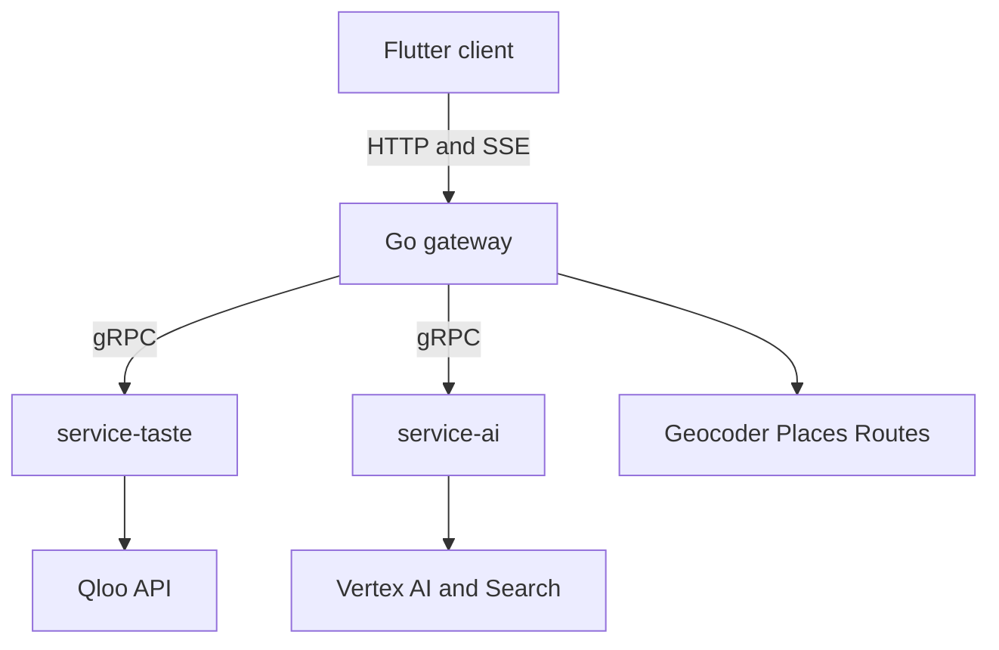

# Karum implementation plan

This is the build checklist for the whole system. The product is the brand-operated expansion agent in [PRODUCT.md](PRODUCT.md). The shape is the five-repo split in [TECH.md](TECH.md): Flutter client, Go gateway, `service-taste`, `service-ai`, and this infra repo for protos, Compose, and Cloud Run.

Today is 18 Oct 2026. The Devpost deadline is 30 Oct 2026, 11:45pm EDT. Feature freeze is 27 Oct, the public build is up on 28 Oct with the hackathon banner signing judges into the preseeded account, and the submission goes in on 29 Oct. Cloud Run and the pre-warmed cache stay up through 23 Nov; judging runs 2–16 Nov.

On 17 Oct the product became the brand agent: a brand seed and a city go in, and doors, flagship corridors, collab partners, skip reasons, menu audits, and a field route come out. This checklist is that build. Platform work finished before the pivot stays ticked. The domain protos and the stub toolchain landed 18 Oct (sections 1–4); service-taste now resolves seeds, tags, doors, scores, heatmaps, and compare, while the gateway, the AI service's transport, and the product screens remain unbuilt, and they follow the sections below. [DECISIONS.md](DECISIONS.md) records the earlier leasing shape; where it disagrees with this file, this file wins. Qloo parameter facts stay in [QLOO_APIS.md](QLOO_APIS.md) and [spike/RECORDING.md](spike/RECORDING.md) — that catalogue still cites the old epic numbers, so new work cites section numbers and DI ids.

**Status — 18 Oct 2026 (audited).** The five repos exist as private `karum-labs` repositories; local folders carry the `karum-` prefix (`karum-infra`, `karum-server`, `karum-service-taste`, `karum-service-ai`, `karum-client`). Done for all five: MIT licences, READMEs, gitignores, CI, gitleaks, toolchain pins in `versions.env`, `GET /health` on the three backends, and Dockerfiles. **Verified complete:** infra sections 1–3 and 6, plus the stub and fixture tooling in §4 — protos frozen with provenance markers (`doccheck`: 209 fields), `make contract-test` passes through both stub sets, and the 80-file fixture pack verifies (`redact.py --verify`); taste sections 7–12 — 336 tests pass, with one local cache test failing only because `redis` is not installed in this venv. **Partially complete:** taste §13 has the cache, single-flight, fallback, and eval bypass but no prewarm path; taste §14 has dedupe, the outside-city flag, the unresolved stop, and partial-seed confidence, but no seed-entity filter on the door board; service-ai §15–§18 now carry a real request timeout, Google Search grounding, a shortlist cap, shelf-unknown fallback results, sourced-incumbent filtering, citation filtering, brand-list SKU enforcement, and delimited names (34 tests pass), but there is still no gRPC servicer, no run store for the baseline, no baseline-to-skip-list handoff, and no gateway orchestration. **Not built:** `karum-server` is still the scaffold — only `/health`; `orchestrator.Run` and the geocoder return not-implemented; there are no gRPC clients, no Postgres, Places, Routes, PDF, SSE, or scout routes. `karum-client` is still the health-screen scaffold — no design system for this product, seed builder, trace, map, door board, or pitch. Sections 19–26 and the product-screen work in §27–§36 are unchecked (only the `GATEWAY_URL` define is done); §37–§47 stay open except the READMEs, licences, Dockerfiles, and the rules check. Nothing has been pushed.

| Window | Sections | Outcome |
| --- | --- | --- |
| 17–18 Oct | 1–2 | Domain protos, stubs, and the three campaign seeds |
| 18–21 Oct | 3–4 | Taste and AI, in parallel |
| 21–26 Oct | 5–6 | Gateway and Flutter, overlapping once the protos land |
| 26–28 Oct | 7 and 9 | Pre-warm, Cloud Run, the public client |
| 28–29 Oct | 8–9 | Proof, Devpost, submit |

Service ownership:

- **infra:** protos, Compose, Cloud Run, fixture pack, Makefile, CI
- **service-taste:** Qloo client, seed and tag resolution, door scouting, heatmap, compare, the affinity and demographic terms, Redis cache
- **service-ai:** Gemini, search grounding, menu audit, SKU choice, pitch, battlecard, site brief, collab proposal, LLM-only baseline
- **server:** city geocode, job orchestration, score assembly, Places, Routes, PDF, Postgres, rate limits, SSE
- **client:** judge-ready Flutter web UI, plus the same screens on desktop

After the domain protos land, client work (sections 27–38) runs in parallel with taste and AI against fixture mode. Design tokens, mockups, and the preseeded judge account come before the screens. If the calendar tightens, cut in this order and leave the three-minute path alone: the compare chart, run history beyond the live job, the sixty-second coach, then the observability dashboard. The path that stays is the Austin wholesale preset, a door card with citations, the evidence drawer, the skip list, the LLM toggle, the pitch and the route, then the Brooklyn flagship heatmap and its collab toggle.

## 1. Contracts and local platform

### 1. Shared domain protos

In `infra/proto`, beside `karum/health/v1`, define `karum.taste.v1` and `karum.agent.v1`. Shared messages: brand seed, entity ref, tag, geopoint, sub-score, door candidate, skip reason, heatmap point, locality cluster, evidence call, and trace event. Campaign mode is `WHOLESALE`, `FLAGSHIP`, or `COLLAB`. Job states are `resolving`, `running`, `ready`, `degraded`, and `failed`. Error codes are `unresolved`, `empty`, `rate_limited`, `upstream`, and `validation`. The seed builder confirms entity ids before `POST`, so a job has no confirmation pause. Comment each field as a Qloo fact or a model inference. Buf breaking stays enforced against `main`.

- [x] Define brand seed, entity ref, tag, geopoint, sub-score, door candidate, skip reason, heatmap point, locality cluster, evidence call, and trace event — `karum.common.v1` (primitives and evidence), `karum.taste.v1` (seed, door, skip, heatmap, locality), and `karum.agent.v1` (trace event) in `proto/`
- [x] Define job states: resolving, running, ready, degraded, failed — `JobState` in `karum.agent.v1`; the seed builder confirms ids before `POST`, so no confirmation pause
- [x] Define error codes: unresolved, empty, rate limited, upstream, validation — `ErrorCode` in `karum.common.v1`; every response that can miss carries one
- [x] Version the proto packages and enforce buf breaking against main — `buf breaking` runs in CI against `main`; covers `karum.common.v1`, `karum.taste.v1`, and `karum.agent.v1`
- [x] Mark each field as a Qloo fact or a model inference in the proto comments — four-marker convention (Qloo fact / Google fact / model inference / Input) enforced by `make check-proto-docs` across 209 fields

### 2. Taste RPCs

`ResolveBrandSeed` returns ranked brand, place, or artist candidates and a derived confidence. `ResolveTags` maps a category or lifestyle chip to tag URNs. `ScoutDoors` takes confirmed seed ids, tags, the city point, an explicit metre radius, and a category tag, and returns recommended doors, the skip list, demographics, and the evidence bundle. `GetLocalityHeatmap` returns cells and, when requested, locality polygons. `CompareAudiences` returns the compare payload for one door, the emerging brand, and an incumbent. Heatmap is first-class for flagship and compare for the wholesale displacement case; the client hides a widget when that RPC reports itself unavailable. The contracts are defined in `proto/karum/taste/v1/taste.proto`; the service-taste implementations follow in §7–§14.

- [x] `ResolveBrandSeed` with ranked candidates and a confidence — contract defined; a total miss is `unresolved`, never an empty success
- [x] `ResolveTags` for venue-category and lifestyle chips — contract defined; chips come back resolved or explicitly unresolved
- [x] `ScoutDoors` returning recommended doors, the skip list, demographics, and the evidence bundle — contract defined; radius is explicit in metres
- [x] `GetLocalityHeatmap` for cells and locality polygons — contract defined; carries `available` so the client can hide the layer
- [x] `CompareAudiences` for a door, the brand, and an incumbent — contract defined; `matchEntities` presence is surfaced for the degradation rule

### 3. AI RPCs

`AuditMenu` is the search-grounded menu and shelf read. `DraftDoorPitch` returns the script, the battlecard, the recommended SKU, and the mode-specific paragraph (activation proposal or site-brief line). `LlmOnlyBaseline` is the counterfactual with no Qloo payload. Every response carries `model_id`, `prompt_version`, and cited evidence ids. The contracts are defined in `proto/karum/agent/v1/agent.proto`; the service-ai implementations follow in §15–§18.

- [x] `AuditMenu` for menu verification, incumbents, shelf inputs, and grounding URLs — contract defined; incumbents are only named when a source carries them
- [x] `DraftDoorPitch` for the script, battlecard, SKU, and the mode-specific paragraph — contract defined; the battlecard is optional and the wholesale mode paragraph stays empty
- [x] `LlmOnlyBaseline` for the counterfactual panel — contract defined; the response is labeled ungrounded
- [x] Every response carries model id, prompt version, and cited evidence ids — `ModelAttribution` on every `AgentService` response

### 4. Stubs and fixtures

`buf generate` emits Go stubs for the gateway and Python stubs for taste and AI. CI runs that generate step inside Docker so laptop and CI stubs match. The fixture pack holds redacted recordings for the judge campaigns — Austin wholesale, Brooklyn flagship and collab, and Mumbai wholesale. Redacted means the fields Karum consumes, never raw Qloo JSON ([QLOO_APIS.md](QLOO_APIS.md) §1). Fixture mode serves those recordings and makes no outbound calls. A contract test round-trips one campaign through both generated stubs.

- [x] Generate Go and Python stubs from `infra/proto` in CI — `contract` job in `.github/workflows/proto.yml`; plugin versions pinned in `proto/buf.gen.yaml`
- [x] Generate inside Docker so local and CI stubs match — CI runs the pinned `bufbuild/buf` container (`make generate-docker` is the local equivalent)
- [x] Ship a redacted fixture pack for the four presets (three cities; Brooklyn carries flagship and collab) — `fixtures/` holds 76 redacted recordings plus the four preset payloads and a sha256 manifest; `make check-fixtures` / `make test-fixtures` verify (CI job `Fixture Pack`)
- [ ] Add a fixture mode that serves those recordings with no network — service-taste replays the pack; service-ai reports `fixture` mode but has no replay, so the stack cannot yet serve `AuditMenu` or a draft offline
- [x] Add a contract test that round-trips a campaign through both stubs — `make contract-test` round-trips six Austin payloads through the Go and Python stubs (`contract/`); the verifier is itself tested against corruption

### 5. Local Compose

`docker compose` brings up the gateway, taste, AI, Redis, and Postgres, with healthchecks and a fixed startup order. `.env.example` lists every variable and which process reads it. One Make target posts the Austin preset in fixture mode and prints the campaign JSON. Host ports, logs, and the Flutter base URL are documented.

- [x] Compose gateway, taste, AI, Redis, and Postgres — all five services are defined with healthchecks; the stack was not re-booted in this audit
- [x] Add healthchecks and a deterministic startup order
- [x] Add `.env.example` listing every variable and which process reads it
- [ ] Add one command that runs the Austin preset on fixtures and prints the campaign JSON — `make test` is still a TODO; the gateway has no scout route to call
- [x] Document ports, logs, and how Flutter web points at the gateway

## 2. Sample campaigns

### 6. Lock the three presets

The judge buttons are fixed: Austin (Sola: mezcal brand + Aesop + Khruangbin; wholesale), Brooklyn (ceramics and matcha; flagship and collab), Mumbai Colaba (specialty cacao and coffee; wholesale). Colaba already resolved on 16 Oct — 10 of 10 venue names landed within 2 km of the block point. The 17 Oct extension confirmed the Austin door direction — a brand-typed seed returns ranked door rows at the downtown point with explainability and stable affinity (RECORDING.md extension) — and found one coverage miss: **Madre Mezcal does not resolve in Qloo** (brand-typed and any-type searches both miss; only same-name places in other cities). The locked Austin seed therefore swaps in Qloo-verified substitutes — Ilegal Mezcal, Aesop, and Khruangbin all resolve — and presets lock seed ids only after they resolve. Entity-level misses swap like the Austin seed; if the city fails the 70% resolution check or the point returns no heatmap cells, the flagship toggle moves to the best verified alternative in the same pass, with the backup city's heatmap probed during it (1 call). This pass still resolves the Brooklyn reference entities and writes down the preset ids, the lat/lng, the radius, the category tags, and the skip-candidate ids the fixtures will replay. Door and collab queries use `filter.location` as WKT plus an explicit radius in metres (8 km unless a preset overrides; heatmap 10 km). A brand-type insights call, if any preset needs one, uses `signal.location` (DI-11). Spend is logged against the 9,801 requests remaining after the preset lock pass before anyone starts feature traffic.

- [x] Colaba venue resolution measured 16 Oct — 10 of 10 within 2 km
- [x] Location behaviour settled — place calls use WKT plus an explicit metre radius; brand-type insights use `signal.location` (DI-11, DI-21)
- [x] Austin door query confirmed 17 Oct — a brand seed returns door rows at the downtown point; Madre Mezcal is a coverage miss and the seed swaps in Qloo-verified substitutes (Ilegal Mezcal, Aesop, Khruangbin)
- [x] Resolve the Brooklyn seed entities and confirm a point returns doors and heatmap cells — 7 of 7 candidate entities resolve (5 seeds + 2 alternates); the point returns 25 door rows (0.910–0.931) and 5,523 heatmap cells (plus 83 locality polygons)
- [x] Decide the flagship fallback in this pass — no fallback needed: Brooklyn cleared both gates (8 of 10 venues, all New York; cells at the point), so the toggle stays on Brooklyn
- [x] Measure the western demo city's venue-resolution rate while resolving its venues (kill rule 2's 10-of-10-style check, [DECISIONS.md](DECISIONS.md) §4) — Brooklyn 8 of 10, every resolved row the New York entity (80% ≥ 70%); Austin 10 of 10 resolved
- [x] Confirm the Colaba door shape under its preset category tag — the 17 Oct Colaba calls were unfiltered and topped out with event venues (1–2 calls); the cafe tag returns 25 door rows (0.930–0.968, Suzette top, the incumbent's own Nariman Point outlet at rank 2) while the unfiltered seed drifts to dining and anchors
- [x] Write the four preset payloads (ids, points, radii, category tags, skip-candidate ids) into the fixture seeds — `fixtures/presets/{austin-wholesale,brooklyn-flagship,brooklyn-collab,mumbai-colaba-wholesale}.json`
- [x] Update the quota ledger in [spike/RECORDING.md](spike/RECORDING.md) after this pass — 55 calls; 9,801 remaining

## 3. service-taste

### 7. Qloo HTTP client

One typed method per endpoint the spike verified, and no method for an unverified parameter. Timeouts, retries with backoff, and honour of the rate-limit headers (observed limit 5 requests/second). Logs redact the API key. Metrics expose status, latency, and call count. Timeouts, 429s, and 5xx map onto the shared error codes. Replay tests load the fixture pack and assert the typed structs, with no live network.

- [x] Typed methods for verified endpoints only — `qloo/client.py`: `/search`, `/v2/tags`, four `/v2/insights` surfaces (places, heatmap cells, localities, demographics), and `/v2/analysis/compare`; no method for an unverified parameter
- [x] Timeouts, retries, backoff, and honour of rate-limit headers — httpx timeouts, exponential backoff, `X-Second-` and `X-Month-RateLimit-*` honoured at the observed 5 rps ceiling, 429 `Retry-After` respected, and a month-budget guard that stops before burning the reserve
- [x] Redacting logs plus metrics for status, latency, and call count — the key only ever rides the `X-Api-Key` header (URLs and logs stay clean, backend filter covers stray attributes); `CallRecord` per call plus per-endpoint metrics surfaced on `/health` with the active transport
- [x] Map upstream failures onto the shared error codes — timeouts, 429s, and 5xx map onto `unresolved`, `empty`, `rate_limited`, `upstream`, `validation` from `karum.common.v1`
- [x] Replay tests from the fixture pack — all 76 recordings replay end-to-end through the typed client with no network; a request the pack has not recorded is an error, never a synthetic payload

### 8. Brand seed resolution

`ResolveBrandSeed` calls `GET /search` for the brand query and each fallback vibe query. Types are `urn:entity:brand`, `urn:entity:place`, and `urn:entity:artist` — all three verified resolving on 17 Oct (Khruangbin resolves as an artist; brand coverage is thin, so a total miss is an expected outcome). Name lookup leaves `sort_by` at the default — `sort_by=distance` turns a name query into nearest venues ([QLOO_APIS.md](QLOO_APIS.md) §3.1). The RPC returns the top candidates with a derived confidence marked as a model inference. Low-confidence and ambiguous hits are flagged so the seed builder asks the operator to pick before scout starts — common names collide across cities (Perry's resolved to San Antonio, Uchi to London, Blind Pig to Kharkiv on 17 Oct), so the candidate carries the geocode city and the pick prefers the row in the preset city. A total miss is `unresolved`, not an empty success. Hits and negative lookups are cached under a short TTL.

- [x] Search the brand query and each fallback vibe query, and return ranked candidates — `taste/seed.py` issues the recorded `/search` spelling (take 5, page 1, one entity type per call) and escalates brand → place → artist, vibes place-first, only when a stage returns nothing
- [x] Derive confidence from rank and name match, and mark it as an inference — a pinned similarity cascade decayed by rank; the response carries the derived value beside the row, never as a Qloo score
- [x] Flag low-confidence and ambiguous hits for the seed builder — below 0.6 or a name colliding across cities (Lilia: New York vs Rio) sets `ambiguous`; the candidate carries the geocode city, and the in-city flag is computed by distance from the preset point (Brooklyn rows geocode as New York)
- [x] Return an explicit miss when nothing resolves — per-query notes list what was tried; a seed with no hits is `unresolved` with `ERROR_CODE_UNRESOLVED` (validation is its own code), never an empty success
- [x] Cache successful and negative lookups with a short TTL — the canonical call signature is the key, empty results cache too, and the store sits behind an interface the section 13 Redis cache replaces

### 9. Tag resolution

`ResolveTags` maps the preset chips (bars and restaurants, specialty retail, apparel, vinyl, galleries, and the other campaign categories) onto tag URNs the spike verified. Free-text chips are accepted only when tag search returns a confident hit; the score is derived and marked as an inference, because `/v2/tags` publishes no score (§3.2). Otherwise the chip comes back unresolved. An allow-list of tag types limits what the pitch will try to explain. Fixture tests cover every chip the three campaigns send.

- [x] Map the campaign category chips to verified tag URNs — the catalogue pins each chip to its recorded probe spelling and URN (bar at take 15, the rest at 25); aliases cover the campaign phrasings, and literal URN chips validate without a call
- [x] Accept a free-text chip only when tag search returns a confident hit — the derived confidence must clear 0.6; otherwise the chip comes back unresolved, never guessed
- [x] Return unresolved chips to the caller — `unresolved[]` with a machine-readable reason: no confident hit, outside the allow-list, or an empty chip
- [x] Keep an allow-list of tag types the pitch knows how to explain — `urn:tag:genre` only; off-namespace rows are refused even when the name matches
- [x] Fixture-test every chip the three campaigns use — bar, cafe, ceramics, and gallery (plus aliases) replay from the locked pack, and the off-namespace refusal is tested

### 10. Door scouting

`ScoutDoors` fans out the verified insights calls for a confirmed seed: place ranking with `signal.interests.entities`, `signal.interests.tags`, `filter.location` as WKT, an explicit `filter.location.radius` in metres, the category tag, and `feature.explainability=true` (§3.5, §3.8). A point with no radius returns zero rows, and `0` falls back to the ~15 km default, so the radius is always the preset value. The 17 Oct extension verified this exact fan-out: a brand-seeded call returns ranked door rows with per-row affinity and explainability contributions, and the category tag is what keeps the board door-shaped — unfiltered, the top slots are taste anchors (landmarks, hotels, retail), while `filter.tags=urn:tag:genre:place:restaurant:bar` returns bars on the same seed (RECORDING.md extension). Taste tags and demographics are fetched for the top doors, not the full `take=25` (§3.3, §3.6). Collab mode sends the non-competing category tags on the same place call. Independent calls run in parallel under a fan-out cap. The response includes the evidence-call records the drawer lists.

- [x] Rank places from the seed with explainability, WKT, and an explicit metre radius — `taste/doors.py` issues the recorded `/v2/insights` spelling (place type, seed signal, `POINT(lon lat)` WKT, `filter.location.radius=8000`, `take=25`, `feature.explainability=true`); the flagship, Austin, and Colaba boards replay and ranks freeze 1–25 in encounter order
- [x] Fetch taste tags for the top doors — every ranked row already carries its shared tags with the seed, so the card cites them without a second call; the top-door window narrows only the demographics batch
- [x] Fetch demographics for the top doors — one batch call for the top eight doors (the widest signal a recording carries), rows mapped back by entity id; partial coverage stays a missing profile, never zeros. No preset contains the call, so its tests script the exact request explicitly
- [x] Apply the collab category tags on the same place call — collab sends one place call per category tag with `filter.tags`; the galleries board (25 rows) carries the grade and the empty ceramics call becomes a warning, both replayed from the pack
- [x] Run independent calls in parallel under a fan-out cap, and attach evidence-call records — `asyncio.gather` under a semaphore (default 4; tests pin parallel flight and a serialized cap-of-one), and every call lands in `evidence` with an `ev-NNNN` id the doors cite

### 11. Affinity score and the skip list

From documented Qloo fields, compute `A_taste` and `D_demo` on a stable 0–1 scale and write the inputs beside each score; the gateway computes `S_door = 0.50 · A_taste + 0.30 · O_shelf + 0.20 · D_demo` from the 0–1 sub-scores and displays `100 × S_door` (TECH.md's door score is the canonical definition; every process copy cites it). `A_taste` is the affinity's percentile inside the returned shortlist — raw affinity bands move with the seed and the city (observed 0.84–0.98 on 17 Oct, while per-entity values stay stable across calls), so a raw value is not comparable across campaigns; the raw affinity stays in the evidence. The gateway applies `O_shelf` and the `P_saturation` skip rule later, once the menu audit exists; when the audit is unavailable the shelf term is unknown and the composite renormalizes over affinity and demographics. The skip list is relative: score the skip candidates in one `filter.results.entities` batch ([QLOO_APIS.md](QLOO_APIS.md) §3.14) and place the ones below the returned shortlist's floor (its minimum or bottom decile) on the skip list with a machine-readable reason. Presets carry their verified candidate ids in the fixture seed; a free-entry run takes the venue names from `LlmOnlyBaseline`, resolves each through `/search`, records unresolved names as a miss on the run, and batch-scores the rest. An absolute 0.45 floor never fires — ranked sets observed 0.83–0.98 on 17 Oct — so no absolute threshold ships. Return the top recommended doors and the skip items, and break ties deterministically so the same inputs always produce the same order. Unit-test the relative floor, an empty seed, a category that matches nothing, and ties.

- [x] Compute `A_taste` and `D_demo` from documented fields only — `taste/scoring.py` builds both from recorded rows: the affinity percentile in the returned shortlist and the cosine age-bucket alignment mapped `(cos + 1) / 2`, raw values retained beside the mapped ones; an empty or flat profile yields `None`, never a fabricated zero
- [x] Normalize both to a stable 0–1 scale and put the inputs in the evidence payload — `A_taste` as a percentile within the returned set, raw affinity retained — every door and skip row carries a `SubScoreOut` (`name`, 0–1 `value`, `raw_value`, `inputs` like `rank=1`/`shortlist=25`); the flagship shortlist pins 1.0 → 23/24 → 0.0, and the composite itself never leaves the service
- [x] Batch-score the skip candidates (preset ids or resolved baseline names) via `filter.results.entities` and place those below the shortlist floor on the skip list with a machine-readable reason — the ranked pool probe (take 50) fixes the floor: flagship 0.9218 (Lilia 0.9192 skips, detail pinned), Austin 0.8386 (control Franklin 0.8655 stays on the board); the batch (take 25) scores the candidates in one call and everything strictly below lands in `skip_list` as `low_affinity` with the raw, the floor, and its pool percentile. Equality keeps the door. Free-entry names resolve through one `/search` each (in-city row preferred, misses stay visible as `unresolved`). Colaba has no pool recording, so the run degrades to the board floor 0.9295 with a deterministic warning
- [x] Tie-break deterministically — skip items sort by `(-raw, entity id)` (pinned with equal affinities), ranks freeze in encounter order across merged category boards, and the same inputs reproduce the same order
- [x] Unit-test the relative floor, an empty seed, an empty category, and ties — `tests/test_taste_scoring.py` adds 12 tests (pure percentile/`D_demo`/skip-item units, the recorded floors replayed, the Colaba degradation, the equal-to-floor keep, unresolved names) beside the reworked door suite; the 18 Oct audit runs 337 tests (336 pass locally; the Redis-backed factory test needs the `redis` package in the venv), ruff clean

### 12. Heatmap and audience compare

`GetLocalityHeatmap` calls `urn:heatmap` with the seed and the preset radius (§3.7). Cells are the density layer. `output.heatmap.boundary=urn:entity:locality` supplies the polygons the brief uses to name corridors; anchor neighbours are the strongest places already returned inside those corridors. `CompareAudiences` parses `{tags, a, b, matchEntities}` and degrades cleanly when `matchEntities` is empty (DI-22). If either call fails, the campaign still reaches `ready` with pins and the scout radius. Demographic mismatch warnings ride beside `D_demo`.

- [x] Return heatmap cells for the seed at the preset radius — `taste/heatmap.py` replays the recorded `urn:heatmap` call (seed signal, `POINT(lon lat)` WKT, the preset 10 km radius, `take=50`); the flagship board returns 5,523 cells with the first pinned at affinity 1.0
- [x] Return locality polygons and name the top corridors from them — the `output.heatmap.boundary=urn:entity:locality` call returns 83 polygons; corridors rank by affinity (New York, Brooklyn, Manhattan, Tribeca, Lower East Side) with name and geometry aliases collapsed and a centroid radius check that drops state-sized shapes, and anchors are the already-ranked places falling inside a named corridor
- [x] Parse compare `tags` overlap, and degrade when `matchEntities` is empty — `taste/compare.py` maps `results.tags` onto the chart rows and `results.matchEntities` onto entity refs; the two recorded cross-type pairs come back empty and report a degraded chart rather than an empty one (DI-22)
- [x] Keep the campaign ready when heatmap or compare fails — a failed heatmap call leaves the layer `available=false` with a deterministic reason (the map keeps the pins and the scout radius), a failed polygons call degrades to cells with a warning, and a failed or empty compare leaves the door card without a conquest chart
- [x] Attach demographic mismatch warnings beside `D_demo` — a door whose `D_demo` lands below 0.5 adds a `demographic mismatch at <name>` warning beside its alignment sub-score

### 13. Cache and prewarm

Cache Qloo responses in Redis under a canonical hash of the request parameters, with a 24h TTL. A single-flight lock makes concurrent refreshes of the same key share one upstream call. If Redis is down, fall back to an in-process cache and flip the degraded health bit. Prewarm runs each of the four presets (three buttons, plus Brooklyn collab) end-to-end once — taste, Places, AI (menu audit, drafts, and the `LlmOnlyBaseline` text), and route — and stores the completed run with its drafts, baseline text, and trace events (§25), so a preset click serves the newest ready stored run and its recorded trace instead of re-running the live pipeline (§39). Eval requests set a bypass flag that is never written back into the demo cache.

- [x] Redis cache keyed by a canonical parameter hash with a 24h TTL
- [x] Single-flight lock so a refresh cannot stampede Qloo
- [x] In-memory fallback when Redis is down, with a degraded health bit
- [ ] Prewarm the four presets end-to-end, `LlmOnlyBaseline` included, and store the completed runs with their traces — `make prewarm` posts to `/api/v1/prewarm`, which the gateway does not implement; no prewarm code exists in any repo
- [x] Eval bypass that is never served back as a cached demo response

### 14. Taste edge cases

Before scoring, collapse venues that resolve to the same entity id. Drop a result that is one of the seed entities, so a reference venue used as vibe is not pitched as a door. Flag a venue that resolves outside the geocoded city. If the seed resolves to nothing, return `unresolved` before scoring and explain the miss. A partial seed — some vibe queries hit, one misses — is allowed, and the evidence payload states the reduced confidence. A category filter that matches nothing is `empty`, with the category named.

- [x] Collapse duplicate venues to one entity
- [ ] Drop results that are themselves seed entities — no such filter in `taste/doors.py`; dedupe only collapses repeated candidate ids during seed resolution
- [x] Flag a venue that resolves outside the geocoded city
- [x] Stop before scoring when the seed resolves to nothing, and explain the miss
- [x] Allow a partial seed at reduced confidence, and return `empty` when the category matches nothing

## 4. service-ai

### 15. Vertex client

Call Gemini 2.5 Flash through `google-genai` with `vertexai=True`, and one Pydantic response model per RPC, so invalid JSON fails closed. Set a timeout, a max output token cap, and a single retry when schema validation fails. Logs include model, region, and prompt version, and never the credentials. Failures return a typed error the gateway maps onto `degraded`. Replay tests inject a fake model that returns the fixture schemas.

- [x] Pin Gemini 2.5 Flash through `google-genai` on Vertex, with a Pydantic schema per RPC
- [x] Set timeouts, max output tokens, and one retry on invalid JSON — `http_options.timeout` is the configured `model_timeout_seconds` in milliseconds, `max_output_tokens` is capped, and one schema retry is tested
- [x] Log model, region, and prompt version, and keep credentials out of logs
- [ ] Return a typed error the gateway can degrade on — `VertexError` carries model, prompt version, and cause, and every RPC returns the proto `ErrorCode`, but the gateway has no client or mapping to act on them
- [x] Replay tests with a fake model that returns the fixture schemas

### 16. Menu audit

`AuditMenu` uses Google Search grounding to read the venue website, menu, or delivery listing. It reports whether the audit succeeded, which incumbents are stocked, a short menu summary, the `O_shelf` inputs, and the source URLs. Online-only or unverifiable venues keep their Qloo rank, set shelf opportunity to unknown, and the composite renormalizes over affinity and demographics (§11). Grounding is capped to the working shortlist (the doors that can appear on the board, plus skip candidates the skip rule might cite), not the full `take=25`. Grounded prose names a competitor only when that name is in the grounding sources or the Qloo payload.

- [x] Audit the live menu or shelf with Google Search grounding — the audit call sets `grounded=True`, which attaches the Google Search tool to `GenerateContentConfig`, and a test asserts the tool is on the wire
- [x] Return incumbents, a menu summary, shelf inputs, and source URLs
- [x] When grounding is unavailable, keep the Qloo rank and label the shelf unknown — a Vertex failure returns one result per target with the door row intact, `succeeded=false`, `shelf_unknown=true`, and `O_shelf` at 0.0
- [x] Cap grounding calls to the working shortlist — `grounding_shortlist_cap` (default 5) rejects a larger target list with `validation` before any model call
- [x] Name a competitor in prose only when a grounding source or the Qloo payload contains it — each incumbent is checked against its sources, the result's sources, and `qloo_incumbent_names`; unsourced names are dropped and `O_shelf` is recomputed

### 17. Pitches, SKUs, and briefs

`DraftDoorPitch` returns the shopkeeper script, and every number cites an evidence id. When the audit found an incumbent, it also returns the displacement battlecard, using the compare tags when they exist and the affinity plus menu finding when they do not. The recommended SKU is chosen from the brand's own SKU list by the door's taste tags. Flagship mode adds the site-brief paragraph for the top corridors. Collab mode adds the activation proposal. `LlmOnlyBaseline` is stored beside the Qloo result and labeled ungrounded. Its venue names source the free-entry skip candidates (§11); unresolved names are recorded as misses, never scored. Length caps keep each text short enough that a non-technical judge can finish it.

- [x] Shopkeeper script that cites an evidence id for every number — `enforce_citations` drops every sentence that states a number without an `ev-NNNN` id, and rejects an id outside the run's evidence set; battlecard talking points use the same filter
- [x] Displacement battlecard when an incumbent is present
- [x] One recommended SKU from the brand's list, chosen with the door's taste tags
- [x] Site-brief paragraph in flagship mode, and an activation proposal in collab mode
- [ ] LLM-only baseline stored beside the Qloo result and labeled ungrounded — `llm_only_baseline` labels it ungrounded, but no run store exists to keep it beside the Qloo result
- [ ] Feed the baseline's venue names into the free-entry skip list, recording unresolved names as misses — `scout_doors` accepts `skip_candidate_names` and `resolve_skip_names` records misses, but nothing passes the baseline output in

### 18. Draft resilience

If Vertex errors, times out, or returns JSON that fails the schema, the gateway still returns the taste ranking and the affinity skip list. The run is marked `degraded`, and template sentences interpolate evidence fields only. Venue and brand names enter the prompt as delimited data, so an instruction-shaped name cannot change the schema. A sentence whose cited evidence id is missing is dropped. Regenerating one pitch calls only that draft RPC and does not rerun Qloo. If a draft RPC fails, the door list is still returned and the failed draft is the only error. The test stops the AI process and asserts the gateway still returns doors.

- [ ] Return the taste ranking and the affinity skip list when Vertex fails — no orchestrator exists to keep the taste result when a draft fails
- [ ] Mark the run degraded and use template sentences that only interpolate evidence fields — `render_sentence` exists and is tested; run state and the degraded path are gateway work that is not built
- [x] Treat venue and brand names as data so instruction-shaped names cannot change the schema — `as_data` strips delimiter characters and newlines, wraps each name in `<data>`, and every prompt carries the inert-data rule
- [ ] Drop a sentence whose evidence id is missing, and regenerate one pitch without rerunning Qloo — the drop is implemented and tested (`enforce_citations`); the single-door regenerate endpoint is gateway work under §19
- [ ] Test with the AI process stopped, and leave the door list available when a draft fails — no such test; there is no gateway call path to stop

## 5. Gateway

### 19. HTTP API and jobs

`POST /api/v1/scout` creates a job from the confirmed seed, the city, the mode, and the SKU list, and returns a job id. A request that names a preset serves the newest ready stored run (§13) and replays its recorded trace; if no stored run exists yet, the preset falls back to the live pipeline in live mode and to the fixture recording in fixture mode (§4). A free-entry request always runs the live pipeline. `GET` returns the state and, once ready, the campaign payload. Draft `POST`s cover the run-sheet, the site brief, and a single-door pitch. `GET /events` is an SSE stream keyed by a cursor so a refresh replays from the last trace event.

- [ ] `POST /api/v1/scout` creates a job from seed, city, mode, and SKUs
- [ ] Serve presets from the newest ready stored run, replaying the recorded trace; fall back to live or fixture when none exists, and keep free entry live
- [ ] `GET` returns state and, when ready, the campaign payload
- [ ] `POST` draft endpoints for the run-sheet, the site brief, and a single-door pitch
- [ ] SSE `/events` with a cursor so a refresh can resume the trace

Evidence: `internal/httpapi/router.go` registers only `/health` and the `/api/v1/` index; `orchestrator.Run` is a stub that returns not-implemented.

### 20. City geocode

Geocode the city in the gateway before any taste RPC, and return candidate points when the query is ambiguous instead of picking one. Reject an empty query and unusable coordinates with `validation`. Cache geocode results and follow the provider's attribution rules. Persist a single lat/lng on the campaign and reuse it for the map, the scout radius, the heatmap, and Places. The four presets skip the geocoder and post their stored points.

- [ ] Geocode the city before any taste call
- [ ] Return candidates when the query is ambiguous
- [ ] Reject an empty query and unusable points with a specific error
- [ ] Cache geocodes and follow the provider's attribution rules
- [ ] Store one lat/lng and reuse it; presets post stored points

Evidence: `internal/geocode/geocode.go` defines the interface but ships a `NoopGeocoder` that always returns `ErrNotImplemented`; there is no provider, cache, or point persistence.

### 21. Orchestration and score assembly

The runner calls seed resolution only when the request still has raw queries; presets and confirmed seeds go straight to scout. Flagship adds the heatmap call. After Places and the menu audit, the gateway computes `S_door` from the 0–1 sub-scores (`100 × S_door` displayed), applies the `P_saturation` skip rule (affinity below the returned shortlist's floor — or four or more direct niche competitors), and freezes the ordered doors and the skip list. Compare runs only for doors whose audit found an incumbent. Independent taste RPCs run in parallel, and each completion writes a trace event. The exact Qloo and grounding payloads are stored on the run. A client abort cancels the downstream gRPC calls.

- [ ] Scout from a confirmed seed, and resolve raw queries only when the request has them
- [ ] Add the heatmap call in flagship mode, and compare only after an incumbent is found
- [ ] Compute `S_door` from the 0–1 sub-scores, apply the `P_saturation` skip rule, and freeze the order
- [ ] Emit a trace event as each hop finishes, and persist the payloads on the run
- [ ] Cancel downstream RPCs when the client aborts the job

Evidence: the orchestrator has no runner; the gateway has no gRPC client to either service.

### 22. Places enrichment

When a Places key is set, enrich the working set with address, opening hours, website, and open status. The website is the hint the menu audit searches from. Venues Places reports as closed are skipped with that reason. Missing key or a Places error leaves the Qloo door in the payload with enrichment marked unknown, and the job still reaches `ready`.

- [ ] Enrich the working set with address, hours, website, and open status
- [ ] Pass the website through to the menu audit
- [ ] Skip a venue Places reports as closed, with that reason
- [ ] Keep the door and mark enrichment unknown when the key is missing or Places errors

Evidence: no Places client exists in `karum-server`.

### 23. Field route

When a Routes key is set, order the qualified wholesale or collab doors with `optimizeWaypointOrder` and return legs the Flutter map draws as a polyline. Skip the call in flagship mode, when the key is missing, or when fewer than two doors qualified. A Routes error is isolated: the job still reaches `ready` with the door list. Include the Google attribution fields the response is required to carry.

- [ ] Order qualified wholesale and collab doors with waypoint optimization
- [ ] Return legs the map can draw
- [ ] Skip routing in flagship mode, when the key is missing, or when fewer than two doors qualify
- [ ] Keep the campaign ready when routing fails
- [ ] Attribute Google data as required

Evidence: no Routes client exists in `karum-server`.

### 24. Run-sheet PDF

The gateway renders the PDF. Wholesale and collab produce a field run-sheet: ordered stops, the three sub-scores, the SKU, the pitch, and the citations. Flagship produces a site-selection brief: the top corridors, the anchor neighbours, and the demographic line. Qloo facts and model inferences are visually distinct, using the split marked in the proto comments. A PDF failure leaves the on-screen campaign usable.

- [ ] Render a field run-sheet for wholesale and collab
- [ ] Render a site-selection brief for flagship
- [ ] Keep Qloo facts and model inferences distinct in the PDF
- [ ] Leave the on-screen campaign usable when PDF rendering fails

Evidence: no PDF renderer or dependency exists in `karum-server`.

### 25. Job persistence

Postgres tables for campaigns, runs, evidence snapshots, drafts, and each run's trace events, applied with forward-only migrations. A run's stored payload carries the campaign plus the `LlmOnlyBaseline` text and the recorded trace a stored preset replays (§19, §32). The HTTP API gets a campaign by id so a refresh can restore it. A re-run inserts a new run row and leaves the previous snapshot untouched; the preset path always serves the newest ready run. A seed script loads the four presets so fixture and live modes share the same ids. The judge account is added in §28; this schema stays campaigns, runs, evidence, and drafts.

- [ ] Postgres schema for campaigns, runs, evidence snapshots, drafts, and trace events
- [ ] Forward-only migrations
- [ ] Get a campaign by id
- [ ] Re-run creates a new run and leaves the previous snapshot untouched
- [ ] Store the baseline text and the recorded trace on the run so a stored preset serves without live calls
- [ ] Seed the four presets

Evidence: `POSTGRES_DSN` is read into config and never used; the repo has no SQL, migrations, or database driver.

### 26. Gateway resilience

Set a deadline on every taste and AI gRPC call and a circuit breaker per dependency. Per-IP and global rate limits return a JSON error the client can map to copy. Require `Idempotency-Key` on create so a double-submit returns the original job. Validate seed count (one to four seed entities — a resolved brand plus any vibe chips, or a two-to-four-entity composite of chips; the total never exceeds four, §31), text length, SKU-list length, mode, and radius before any RPC. `GET /health` reports gateway, taste, AI, Redis, Postgres, and Qloo mode as `live`, `fixture`, or `degraded`.

- [ ] Deadlines on every gRPC call and a circuit breaker per dependency
- [ ] Per-IP and global rate limits with a clear JSON error
- [ ] `Idempotency-Key` on create
- [ ] Validation limits for seed count, text length, SKU list, mode, and radius
- [ ] `/health` reports gateway, taste, AI, Redis, Postgres, and Qloo mode

Evidence: no gRPC dialing, middleware, rate limiter, or idempotency store; `GET /health` reports only this process, its mode, version, and uptime.

## 6. Flutter client

### 27. Design tokens and mockups

Before any screen is built, lock the visual system the Flutter theme will consume and the frames the judge path will follow. Tokens cover color, type scale, spacing, radius, and elevation, and they are the values the app-shell theme reads. Mockups cover the login screen with the hackathon banner, the seed builder, the live trace, the map (route, heatmap, and skip pins), the door board with the evidence drawer, and the pitch. Frame both a laptop width and a narrow window. The tokens are checked into the client; the mockups are the reference for the screens in §29–§36.

- [ ] Define color, type, spacing, radius, and elevation tokens
- [ ] Mock the login screen with the hackathon banner, the seed builder, and the trace
- [ ] Mock the map, the door board, the evidence drawer, and the pitch
- [ ] Frame a laptop width and a narrow window
- [ ] Check the tokens into the client for the app-shell theme to consume

Evidence: `lib/src/theme/app_theme.dart` has a colour seed and type scale only, and its semantic colours still name the old leasing scores (`catchmentFit`, `coTenancy`, `cannibalisation`); no mockups or spacing/radius/elevation token set are checked in.

### 28. Preseeded judge account

Create one judge account and attach the four preset campaigns to it. `HACKATHON_MODE=true` (see `.env.example`) makes the login screen show a banner that signs the judge into that account, so judging starts inside the product with the presets already there. `HACKATHON_MODE=false` hides the banner. The account row, its session, and the link from the account to the seeded campaigns live in Postgres. The gateway exposes the flag, and the client renders the banner. Account credentials stay in the secret manager.

- [ ] Add the judge account and attach the four preset campaigns
- [ ] Expose `HACKATHON_MODE` from the gateway to the client
- [ ] Show the login banner only when the flag is true, and sign the judge into the preseeded account
- [ ] Hide the banner when the flag is false
- [ ] Keep the account credentials in the secret manager

Evidence: `HACKATHON_MODE` is written in Compose and `.env.example` but `internal/config/config.go` never reads it; there is no account, session, auth, or banner.

### 29. App shell

Flutter web is the judge target, with the same screens on desktop. The shared theme defines type scale, cards, chips, banners, and drawers, and every screen implements loading, empty, and error states against the gateway job states. With `HACKATHON_MODE` on, the judge is already inside the preseeded account from §28 before a scout starts. The gateway base URL is a compile-time define so local Compose and the production host are a switch.

- [ ] Ship Flutter web as the judge target, with the same screens on desktop
- [ ] Add theme, type scale, cards, chips, banners, and drawers — theme, type scale, cards, and chips exist; there are no drawers and no brand-agent shell
- [ ] Add loading, empty, and error states on every screen
- [ ] Run a preset and a free-entry scout from the preseeded judge session
- [x] Configure the gateway base URL for local and production — `--dart-define=GATEWAY_URL`

### 30. Accessibility and layout

The path from the seed builder to the pitch is operable from the keyboard, with focus order, labels, and contrast set for a short audit. The trace honours the reduced-motion media query. Layout breakpoints cover a laptop width and a narrow window. A list renders the same recommended doors and skip doors when the map is not the view being used.

- [ ] Support a keyboard path from the seed builder to the pitch
- [ ] Set focus order, labels, and contrast for a quick audit
- [ ] Honour reduced motion on the trace
- [ ] Lay out for a laptop width and a narrow window
- [ ] Provide a non-map list of the same doors

Evidence: none of these screens exist; the only screen is the health view.

### 31. Seed builder, modes, and presets

The brand field calls seed resolution through the gateway, debounced, with a minimum query length, and renders matches as confirm chips. Fallback vibe chips build a composite seed of two to four reference entities; a resolved brand plus any added chips still totals four seed entities or fewer (§26). The SKU list is plain text on the seed. Mode pills are Wholesale, Flagship, and Collab, and they serialize into `POST /api/v1/scout`. Three preset buttons load the stored preset runs and skip typing: Sola in Austin, ceramics and matcha in Brooklyn, cacao and coffee in Colaba. Switching Brooklyn from flagship to collab loads the second stored payload.

- [ ] Brand typeahead, debounced and cached, shown as confirm chips
- [ ] Fallback vibe chips (two-to-four-entity composites; four seed entities maximum), plus a SKU list
- [ ] Mode pills for Wholesale, Flagship, and Collab
- [ ] Inline validation before submit
- [ ] Three preset buttons loading the stored runs, with Brooklyn flagship and collab both stored

Evidence: the client has one health screen; `GatewayClient` exposes only `fetchHealth()`.

### 32. Live trace

Subscribe to `GET /events` and render each trace event as a timeline row with stage name, elapsed time, and whether the step was a cache hit. The stages the judge should see are seed resolution, door ranking, Places, menu grounding, and the route. A stored preset run replays its recorded events through the same timeline, cache-hit markers included. On refresh, resume from the stored cursor. Cancel calls the abort endpoint and stops the stream. If `/health` or the job state says fixture or degraded, show that banner above the timeline.

- [ ] Render SSE events as a timeline
- [ ] Show stage, elapsed time, and whether the step was cached
- [ ] Replay the stored preset trace through the same timeline
- [ ] Resume from the event cursor after refresh
- [ ] Cancel aborts the job
- [ ] Show a banner when the run is on fixtures or degraded

Evidence: no SSE client or timeline; the gateway has no `/events` route.

### 33. Map

Draw numbered pins for the qualified doors and red pins for the skip list, with a legend. Draw the scout radius from the lat/lng and the radius the campaign used. Render the heatmap, and locality polygons when the payload has them, in flagship mode. Render the field-route polyline when Routes legs are present. Use OSM or CARTO tiles and keep the attribution visible, including Google attribution for Places and Routes data.

- [ ] Numbered door pins and red skip pins, with a legend
- [ ] Radius ring used by the scout
- [ ] Heatmap and locality polygons in flagship mode
- [ ] Field-route polyline when legs are present
- [ ] OSM or CARTO tiles with visible attribution

Evidence: no map dependency or map widget in the client.

### 34. Door board, evidence, and the baseline

Render the top recommended doors as cards with three labeled sub-score bars — cultural affinity, shelf opportunity, demographic alignment — the shared tags, and the SKU badge. Call out the first stop inside that list; do not re-sort on the client. The skip tab reads the reason codes, including low affinity and competitor count. Menu findings render as clickable grounding URLs. The evidence drawer lists each Qloo call's endpoint, parameters, and result count, plus the explainability weights, and styles Qloo facts differently from model inferences. The LLM-only toggle requests `LlmOnlyBaseline` for the same inputs and labels it ungrounded. Any card field the insights payload lacks hydrates via `GET /entities` ([QLOO_APIS.md](QLOO_APIS.md) §3.12).

- [ ] Cards with three labeled sub-score bars, shared tags, and a SKU badge
- [ ] Skip tab with reason codes, including low affinity and competitor count
- [ ] Menu findings as clickable grounding URLs
- [ ] Evidence drawer listing each Qloo call, its parameters, its result count, and the explainability weights
- [ ] LLM-only toggle labeled ungrounded, and server rank preserved
- [ ] Hydrate missing card fields via `GET /entities`

Evidence: no door board, skip tab, drawer, or baseline toggle exists in the client.

### 35. Pitch and run-sheet actions

The pitch action opens the script and, when present, the battlecard or the activation proposal. The run-sheet action downloads the server-rendered PDF; flagship downloads the site brief instead. Copy-to-clipboard is available on the script. If a later draft request fails, the actions that already succeeded stay enabled.

- [ ] Open the pitch, and the battlecard or activation proposal when the payload has one
- [ ] Download the run-sheet PDF, or the site brief in flagship mode
- [ ] Copy the script
- [ ] Keep completed actions available when a later draft fails

Evidence: no pitch screen or draft action exists; the gateway has neither the draft nor the PDF route.

### 36. Client edge cases

Put the job id in the URL and, on load, `GET` the job so a refresh restores an in-flight scout. Double-submit sends the same `Idempotency-Key` and renders the one job the gateway returns. Map HTTP 429, 409, and validation errors to specific copy. An `empty` result explains the miss and routes the operator back to the seed. If the SSE stream drops, poll `GET` until the state is terminal.

- [ ] Restore an in-flight job from the URL after refresh
- [ ] Collapse double-submit into one job
- [ ] Map 429, 409, and validation errors to specific copy
- [ ] Explain an empty result and offer a return to the seed
- [ ] Fall back from a dead SSE stream to job polling

Evidence: there is no job flow; the only error copy maps a failed `/health` request.

## 7. Demo quality

### 37. Judge-path copy

The landing line states that brands lose the account by knocking on the wrong door, and the button labels match the three-minute script in [PRODUCT.md](PRODUCT.md) §6.2. The generic-LLM contrast renders only the live `LlmOnlyBaseline` text. The three presets are Austin, Brooklyn, and Colaba. The free-entry form runs the live pipeline and reaches a door list when the seed resolves — or shows the honest miss (§42) — without using a seeded campaign. Live screens render scores the API returned; the illustrative percentages in the demo script are not hardcoded.

- [ ] Landing line: brands lose the account by knocking on the wrong door
- [ ] Button labels that match the three-minute script
- [ ] Show the generic-LLM contrast only from the live baseline text
- [ ] Presets for Austin, Brooklyn, and Colaba
- [ ] Free-entry path that reaches a door list or shows the honest miss, with no hardcoded sample scores

### 38. Comprehension

Use one set of plain-English names for the three sub-scores in the Flutter cards, the run-sheet, and the pitch, matching the fields the gateway returns: cultural affinity, shelf opportunity, and demographic alignment. A dismissible sixty-second coach runs on the first preset only. The formula tooltip reads the same expression the gateway writes into the evidence payload. Radius uses metres end to end, and the UI may show a kilometre label for the city-scale ring. Three non-technical read-throughs produce a punch list of lines to rewrite.

- [ ] Use the same plain-English score names in the UI, the run-sheet, and the pitch
- [ ] Add a dismissible sixty-second coach on the first preset only
- [ ] Add a formula tooltip that matches the scoring code
- [ ] Show radius in one consistent unit system
- [ ] Run three non-technical read-throughs and fix any line they cannot explain

### 39. Prewarm and latency

Run the prewarm for all four presets after each deploy: the Make `prewarm` target posts an authenticated prewarm request to the deployed gateway, each preset runs end-to-end once — `LlmOnlyBaseline` included — and its completed run with its recorded trace is stored (§13), so a preset click serves the newest ready stored run — target under a second without re-running the live pipeline. A live free-entry scout targets under eight seconds, and SSE events keep emitting on that path so the timeline does not look stuck. Set Cloud Run min instances above zero during the judging window. Record p50 and p95 for a stored preset and for free entry.

- [ ] Prewarm all four presets end-to-end on deploy, and refresh the stored runs before judging
- [ ] Aim for a stored preset under a second and a live scout under eight seconds
- [ ] Keep the trace moving on the slow path
- [ ] Set Cloud Run min instances during the judging window
- [ ] Record p50 and p95 for a stored preset and for free entry

## 8. Proof and failure

### 40. Automated tests

`service-taste` owns the affinity unit tests and the Qloo fixture replay tests. `service-ai` owns the Pydantic schema tests and the fallback tests that run with Vertex stubbed out. The gateway tests dial in-process fakes of taste and AI and assert job state, score assembly, and error mapping. Flutter widget tests cover the seed builder, the trace, the door board, and the error copy. A Compose smoke script posts the Austin preset and asserts a door list, a skip list, and a route.

- [ ] Keep affinity unit tests and taste fixture tests in `service-taste`
- [ ] Keep AI schema tests and fallback tests in `service-ai`
- [ ] Add gateway tests with fake taste and AI
- [ ] Add Flutter tests for the seed builder, the trace, the board, and errors
- [ ] Add a Compose smoke script for the Austin preset

### 41. Failure drills

Run the Austin preset with taste down, AI down, Redis down, and Postgres down, and with Qloo returning 429 and 500 through fixture mode. Also run invalid model JSON and a venue name that looks like an instruction, plus cancel mid-flight and a browser refresh. For each case, write the expected job state and the expected Flutter copy into a one-page runbook.

- [ ] Drill taste down, AI down, Redis down, and Postgres down
- [ ] Drill Qloo 429 and Qloo 500
- [ ] Drill invalid model JSON and an instruction-shaped venue name
- [ ] Drill cancel mid-flight and refresh
- [ ] Write the expected UI for each drill into a one-page runbook

### 42. Honesty rules

An `unresolved` or `empty` result is rendered as a miss in the API and in the UI, with no filled-in guess. Undocumented Qloo parameters stay out of taste client code, fixtures, and prompts — every parameter used resolves to a [QLOO_APIS.md](QLOO_APIS.md) §6 or §7 row. Illustrative numbers in the product brief stay out of live screens and drafts. Degraded mode is visible as the job state and in `GET /health`. When a run reaches `ready`, its evidence snapshot is frozen.

- [ ] Label every miss as a miss
- [ ] Keep undocumented Qloo parameters out of every repo
- [ ] Keep illustrative numbers from the product brief out of live screens
- [ ] Make degraded mode visible in the UI and in `/health`
- [ ] Freeze evidence snapshots when the run completes

## 9. Ship and submit

### 43. Containers and Cloud Run

Dockerfiles for the gateway, taste, and AI already run in Compose. Publish the Flutter web build on the public demo host. Infra holds the Cloud Run service manifests and the env wiring, and provisions a managed Postgres for the demo (Neon, free tier — scale-to-zero is expected, and the wake adds only a few hundred milliseconds); the Compose container does not follow to Cloud Run, while Redis stays optional behind the in-process fallback. Secrets live in a secret manager; a preview revision can boot in fixture mode with no Qloo key. CORS allows only the client origin. The Qloo key is injected into taste, never into the browser.

- [x] Dockerfiles for gateway, taste, and AI
- [ ] Publish the Flutter web build on the public demo host
- [ ] Add Cloud Run manifests and env wiring in infra
- [ ] Provision the Neon free-tier Postgres for the demo, with Redis optional behind the in-process fallback
- [ ] Store secrets in a secret manager, and allow preview to run on fixtures
- [ ] Restrict CORS to the client origin and keep the Qloo key server-side

### 44. Security pass

The gateway enforces the same length limits as the seed builder and does not fetch a URL supplied by the client. Grounding URLs are citations returned by the model, not fetch targets. Delete removes a campaign along with its runs and drafts. CI runs dependency and container scans on gateway, taste, and AI. A short rotation note covers the Qloo key and the GCP service account used by Cloud Run.

- [ ] Enforce input length limits and block user-controlled URL fetch on the gateway
- [ ] Treat grounding URLs as citations, not fetch targets
- [ ] Delete a campaign along with its runs and drafts
- [ ] Run dependency and container scans in CI
- [ ] Write a rotation note for the Qloo key and the GCP service account

### 45. Observability

Generate a trace id on `POST /api/v1/scout` and propagate it from Flutter through the gateway into taste and AI log lines. Record latency and error rate per outbound dependency: Qloo, Vertex, Places, Routes, Redis, and Postgres. Keep a dashboard or a saved log query scoped to the judging window. Alert when the Qloo error rate spikes. Point an uptime check at `GET /health`.

- [ ] Propagate a trace id from Flutter through taste and AI logs
- [ ] Record latency and error rate per outbound dependency
- [ ] Keep a dashboard or saved log query for the judging window
- [ ] Alert on a Qloo error spike
- [ ] Point an uptime check at `/health`

### 46. Docs and Devpost

The public README covers the five-repo layout, the Compose run path, the honesty rules, and the MIT licence line, rewritten for the brand agent. Devpost text maps the build onto the four judging criteria and includes the three presets, the skip list, and the LLM contrast. Screenshots show a door card, a skip card, the evidence drawer, the baseline toggle, and the flagship heatmap. Team size, originality, and key terms were checked against the rules on 16 Oct 2026. Submit at least 24 hours before 30 Oct 2026, 11:45pm EDT.

- [x] README with architecture, local run, honesty rules, and licence — retarget the prose to the brand agent before the repos go public
- [ ] Devpost text mapped to the four judging criteria
- [ ] Screenshots of a door card, a skip card, the evidence drawer, the baseline toggle, and the heatmap
- [x] Check team size, originality, and key terms against the rules page — done 16 Oct 2026; findings in [PRODUCT.md](PRODUCT.md) §1
- [ ] Make the submitted repositories public with an open-source licence visible in each About section, and put the live demo URL in the README and the Devpost text
- [ ] Keep the demo free and reachable through 16 Nov 2026, with every submission material in English
- [ ] Submit at least 24 hours before 30 Oct 2026, 11:45pm EDT

### 47. Judging week

Re-run seed resolution against the live hackathon key for all three presets and confirm the seeded entity ids still hit. Re-run prewarm and the Compose smoke script pointed at production. Click the three-minute script on a clean browser profile, then Brooklyn collab and one free-entry city. Keep the previous Cloud Run revision available so a bad deploy can roll back without a rebuild. Leave the demo live through 16 Nov 2026, with the hackathon banner signing judges into the preseeded account.

- [ ] Re-verify all three presets still resolve
- [ ] Re-run prewarm and the smoke script against production
- [ ] Click the three-minute script on a clean browser profile
- [ ] Check the Brooklyn collab toggle and one free-entry city
- [ ] Keep a rollback to the previous Cloud Run revision
- [ ] Leave the demo live through 16 Nov 2026, with the hackathon banner on the preseeded account
