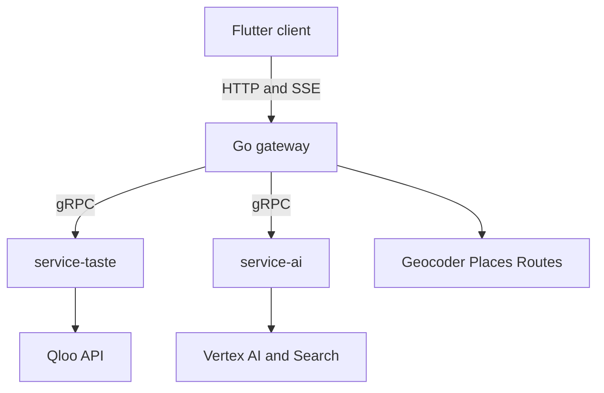

# Door Scout implementation plan

This is the build checklist for the whole system, not only infra. The product is the vacancy-to-tenant leasing agent in [PRODUCT.md](PRODUCT.md). The shape is the five-repo split in [TECH.md](TECH.md): Flutter client, Go gateway, `service-taste`, `service-ai`, and this infra repo for protos, Compose, and Cloud Run.

Today is 12 Oct 2026. The Devpost deadline is 30 Oct 2026, 11:45pm EDT. Submit on 29 Oct. The old Oct 4–8 coverage window has passed, so the checklist follows dependencies, with fixtures unblocking the team until the hackathon key is verified.

Service ownership:

- **infra:** protos, Compose, Cloud Run, fixture pack, Makefile, CI glue
- **service-taste:** Qloo client, resolution, tags, insights, the three-part score, Redis cache
- **service-ai:** Gemini, search grounding, bounded probes, autopilot, memo, outreach, listing blurb, LLM-only baseline
- **server:** geocoding, job orchestration, confirmation pause, Places enrichment, optional site-visit route, Postgres, rate limits, SSE
- **client:** judge-ready Flutter web UI, plus the same screens on desktop

Each epic below has five checklist items, already in implementation order. After the local stack boots on fixtures, client shell work can run in parallel with taste and AI.

## 0. Lock the shape

### 1. Record decisions

- [ ] Write a one-page service map that assigns every PRODUCT.md must-build feature to one service
- [ ] Record the stack adaptations: Flutter web instead of Next.js, server-rendered PDF, Map tiles in the client, Places as pin enrichment, Routes as an optional broker site visit
- [ ] Record the out-of-scope list: login wall on the demo, payments, footfall feeds, listing-site scraping, multi-floor mall planner, custom ML, undocumented Qloo parameters
- [ ] Record the kill rules and the Shelfwise fallback so a failed coverage gate has a named exit that keeps the same service boundaries
- [ ] Name the two-person split: taste, score, agent, and eval on one side; UI, map, drafts, deploy, and Devpost on the other

### 2. Repositories and legal surface

- [ ] Create `client`, `server`, `service-taste`, and `service-ai` next to infra, each with an MIT `LICENSE`
- [ ] Add a README run path and a licence line suitable for the host's About section
- [ ] Add gitignores for env files, keys, notebook outputs, and build artifacts
- [ ] Add an ownership note matching the two-person split
- [ ] Add a secret scan so Qloo and GCP credentials cannot be committed

### 3. Toolchains

- [ ] Pin Go, Python, and Flutter versions in infra
- [ ] Add gofmt, ruff, and `flutter analyze` config
- [ ] Add buf lint and breaking-change checks for protos
- [ ] Add an infra Makefile with `up`, `down`, `test`, `prewarm`, and `eval`
- [ ] Add CI that runs lint and unit tests on each repo

## 1. Contracts and local platform

### 4. Shared domain protos

- [ ] Define vacancy, constraint, geopoint, entity ref, tag, sub-score, ranked candidate, do-not-lease, evidence call, and trace event
- [ ] Define job states: resolving, awaiting confirmation, running, ready, degraded, failed
- [ ] Define error codes: unresolved, empty, rate limited, implausible brand, upstream, validation
- [ ] Version the proto package and enforce buf breaking checks against main
- [ ] Mark each field as a Qloo fact or a model inference in the proto comments

### 5. Taste RPCs

- [ ] `ResolveEntities` for places and brands, with ranked candidates and a confidence
- [ ] `ResolveTags` for constraint phrases
- [ ] `GetBlockProfile` for taste tags, brand candidates, saturation, and demographics
- [ ] `ScoreCandidates` returning the shortlist, the do-not-lease list, and the evidence bundle
- [ ] `GetHeatmap` and `CompareSets` as optional RPCs behind a capability flag

### 6. AI RPCs

- [ ] `ProbeShortlist` for contradiction checks and bounded follow-up probes
- [ ] `LlmOnlyBaseline` for the counterfactual panel
- [ ] `DraftMemo`, `DraftOutreach`, and `DraftListing`
- [ ] `CheckRetailPresence` via search grounding
- [ ] Every response carries model id, prompt version, and cited evidence ids

### 7. Stubs and fixtures

- [ ] Generate Go and Python stubs from `infra/proto` in CI
- [ ] Generate inside Docker so local and CI stubs match
- [ ] Ship a redacted fixture pack for two sample blocks
- [ ] Add a fixture mode that serves those recordings with no network
- [ ] Add a contract test that round-trips the sample messages through both stubs

### 8. Local Compose

- [ ] Compose gateway, taste, AI, Redis, and Postgres
- [ ] Add healthchecks and a deterministic startup order
- [ ] Add `.env.example` listing every variable and which process reads it
- [ ] Add one command that runs the sample vacancy on fixtures and prints the shortlist JSON
- [ ] Document ports, logs, and how Flutter web points at the gateway

## 2. Coverage gate

### 9. Qloo spike

- [ ] Confirm the hackathon base URL, header, and allowed endpoints
- [ ] Spike search, tags, and insights for place, brand, tag, and demographics
- [ ] Spike location query versus radius and write down the real granularity
- [ ] Spike heatmap and compare and record available or unavailable
- [ ] Save redacted raw responses as the first fixtures

### 10. City choice

- [ ] Run three cities by five blocks for resolution rate, brand shift when neighbours change, and tag usefulness
- [ ] Score each block against the kill rules for signal, resolution, and retail plausibility
- [ ] Pick two demo cities and two sample blocks that pass
- [ ] Record the neighbour-entity fallback if location is only city-level
- [ ] If the gate fails, switch the same services to Shelfwise before feature work continues

## 3. service-taste

### 11. Qloo HTTP client

- [ ] Typed methods for verified endpoints only
- [ ] Timeouts, retries, backoff, and honor of rate-limit headers
- [ ] Redacting logs plus metrics for status, latency, and call count
- [ ] Map upstream failures onto the shared error codes
- [ ] Replay tests from the fixture pack

### 12. Entity resolution

- [ ] Search places with neighbour name plus city and return the top five
- [ ] Search brands for a user shortlist
- [ ] Mark low-confidence and ambiguous hits for confirmation
- [ ] Return an explicit miss when nothing resolves
- [ ] Cache successful and negative lookups with a short TTL

### 13. Tag and constraint resolution

- [ ] Map product chips such as no F&B, fitness, and eyewear to verified tag URNs
- [ ] Accept free-text constraints only when tag search returns a confident hit
- [ ] Return unresolved constraints to the caller
- [ ] Keep an allow-list of tag types the product knows how to explain
- [ ] Fixture-test every chip the sample blocks use

### 14. Block profile queries

- [ ] Fetch taste tags from confirmed neighbour ids
- [ ] Fetch brand affinities with the verified location filter
- [ ] Fetch category presence for the saturation check
- [ ] Fetch demographics for the top candidates
- [ ] Run independent calls in parallel under a fan-out cap

### 15. Scoring

- [ ] Compute catchment fit, co-tenancy complement, and cannibalisation penalty from documented fields only
- [ ] Normalize to a stable 0–1 scale and put the formula in the evidence payload
- [ ] Return five ranked candidates and three do-not-lease items with machine-readable reasons
- [ ] Tie-break deterministically and keep the inputs beside each score
- [ ] Unit-test saturation, empty neighbours, an all-saturated block, and ties

### 16. Optional graph extras

- [ ] Call heatmap only when the capability flag and a place-genre tag exist
- [ ] Call compare for the neighbour set versus a candidate when that endpoint is verified
- [ ] Degrade to pins plus a radius when either call is missing
- [ ] Attach demographic mismatch warnings beside the rubric
- [ ] Hide both features from the client when the flag is off

### 17. Cache and prewarm

- [ ] Redis cache keyed by a canonical parameter hash with a 24h TTL
- [ ] Single-flight lock so a refresh cannot stampede Qloo
- [ ] In-memory fallback when Redis is down, with a degraded health bit
- [ ] Prewarm RPC for the two sample blocks
- [ ] Eval bypass that is never served back as a cached demo response

### 18. Taste edge cases

- [ ] Collapse duplicate neighbours to one entity
- [ ] Reject a neighbour that is the vacancy address itself, with a specific error
- [ ] Flag a neighbour that resolves outside the geocoded city
- [ ] Stop before scoring when zero neighbours are confirmed, and explain the miss
- [ ] Allow a partial confirmation at reduced confidence, stated in the evidence

## 4. service-ai

### 19. Vertex client

- [ ] Pin Gemini 2.5 Flash through `google-genai` with a Pydantic schema per RPC
- [ ] Set timeouts, max output tokens, and one retry on invalid JSON
- [ ] Log model, region, and prompt version, and keep credentials out of logs
- [ ] Return a typed error the gateway can degrade on
- [ ] Replay tests with a fake model that returns the fixture schemas

### 20. Grounded retail check

- [ ] Use Google Search grounding to check physical retail for a shortlisted brand
- [ ] Demote online-only and implausible megabrands and attach the source
- [ ] When grounding is unavailable, keep the Qloo rank and label presence unknown
- [ ] Cap grounding calls to the shortlist
- [ ] Cite a brand in grounded prose only when it appears in the Qloo payload

### 21. Probe loop

- [ ] Pass only entities, tags, and scores into the prompt
- [ ] Check contradictions such as high fit plus a saturated category
- [ ] Allow a bounded number of follow-up taste calls for borderline candidates
- [ ] Stop at the probe budget and return the deterministic shortlist
- [ ] Drop any candidate the model adds that is absent from the Qloo set

### 22. Deterministic autopilot

- [ ] Rank from the rubric alone when Vertex errors, times out, or returns invalid output
- [ ] Still return do-not-lease items from the penalty rules
- [ ] Mark the run degraded and skip prose that would invent reasons
- [ ] Use template sentences that only interpolate evidence fields
- [ ] Test with the AI process stopped

### 23. Drafts

- [ ] One-page memo that cites an evidence id for every number
- [ ] Outreach email per shortlisted brand, with a mailto-safe body
- [ ] Listing blurb aimed at the winning category
- [ ] LLM-only baseline stored beside the Qloo result and labeled ungrounded
- [ ] Length caps a non-technical judge can finish quickly

### 24. Draft edge cases

- [ ] Treat venue and brand names as data so instruction-shaped names cannot change the schema
- [ ] Drop a sentence whose evidence id is missing
- [ ] Render broker notes as notes, separate from Qloo facts
- [ ] Regenerate one draft without rerunning Qloo
- [ ] Leave the shortlist available when a draft fails

## 5. Gateway

### 25. HTTP API and jobs

- [ ] `POST /api/v1/analyses` creates a job from address, neighbour text, and constraints
- [ ] `GET` returns state and the confirmation payload while paused
- [ ] `POST` confirm resumes with chosen entity ids and the clarifying answers
- [ ] `GET` result plus `POST` draft endpoints for memo, outreach, and blurb
- [ ] SSE `/events` with a cursor so a refresh can resume the trace

### 26. Geocoding

- [ ] Geocode the vacancy before any taste call
- [ ] Return candidates when the address is ambiguous
- [ ] Reject empty, non-street, and unusable points with a specific error
- [ ] Cache geocodes and follow the provider's attribution rules
- [ ] Store one lat/lng and reuse it for the map, the radius, and location filters

### 27. Orchestration

- [ ] Run resolve, pause for confirmation, then block profile, score, probe, and baseline
- [ ] Enrich pins with Places address, hours, and website when a key exists
- [ ] Parallelize independent taste calls and emit a trace event as each finishes
- [ ] Persist the exact Qloo payloads on the run so later cache updates cannot rewrite history
- [ ] Cancel downstream RPCs when the client aborts the job

### 28. Clarifying questions

- [ ] Ask rent tier and whether F&B is allowed only when the user has not already answered
- [ ] Cap the interview at those two questions, apply defaults, and show the defaults
- [ ] Feed the answers into tag filters and the memo header
- [ ] Let the user change an answer and invalidate only downstream stages
- [ ] Skip the questions on the sample-block path

### 29. Persistence

- [ ] Postgres schema for vacancies, runs, evidence snapshots, and drafts
- [ ] Forward-only migrations
- [ ] List, get, duplicate, and delete a vacancy
- [ ] Re-run creates a new run and a diff against the previous one
- [ ] Seed the two sample blocks

### 30. Diff and watch

- [ ] Diff rank, scores, saturation, and the top pick
- [ ] Manual re-run uses the cache unless the user forces a refresh
- [ ] Keep scheduled re-run off in the public demo
- [ ] Surface an alert only when the recommended pick changes
- [ ] Keep each run immutable

### 31. Gateway resilience

- [ ] Deadlines on every gRPC call and a circuit breaker per dependency
- [ ] Per-IP and global rate limits with a clear JSON error
- [ ] `Idempotency-Key` on create and confirm
- [ ] Validation limits for neighbour count, text length, size, and rent band
- [ ] `/health` reports gateway, taste, AI, Redis, Postgres, and Qloo mode: live, fixture, or degraded

### 32. Site-visit route

- [ ] Optional Routes call that orders the vacancy and the confirmed neighbours
- [ ] Return legs the map can draw
- [ ] Skip routing when the key is missing or there are fewer than two stops
- [ ] Keep the shortlist ready when routing fails
- [ ] Attribute Google data as required

### 33. Leave-one-out harness

- [ ] Assemble about twenty blocks with a known strong tenant hidden
- [ ] CLI-run Door Scout and the LLM-only baseline on each
- [ ] Score whether the hidden category ranks above the baseline picks
- [ ] Write the table, including the failures
- [ ] If fewer than twelve of twenty win, fix the rubric before UI polish

## 6. Flutter client

### 34. App shell

- [ ] Ship Flutter web as the judge target, with the same screens on desktop
- [ ] Add theme, type scale, cards, chips, banners, and drawers
- [ ] Add loading, empty, and error states on every screen
- [ ] Let a sample and a free-entry analysis run with no account
- [ ] Configure the gateway base URL for local and production

### 35. Accessibility and layout

- [ ] Support a keyboard path from address to memo
- [ ] Set focus order, labels, and contrast for a quick audit
- [ ] Honor reduced motion on the trace
- [ ] Lay out for a laptop width and a narrow window
- [ ] Provide a non-map list of the same pins

### 36. Intake

- [ ] Address field with geocode suggestions and a selected-point confirmation
- [ ] Neighbour typeahead backed by resolve, shown as confirm chips
- [ ] Chips for size, rent, F&B, category include and exclude, and shortlist versus surprise me
- [ ] Inline validation before submit
- [ ] Two “Try a sample block” actions that skip typing

### 37. Confirmation

- [ ] Show ambiguous place and brand matches with category and city
- [ ] One-click confirm, swap, or remove
- [ ] Show the two clarifying questions only when they are still unanswered
- [ ] Allow back-edit while keeping the address
- [ ] Deliver sample blocks pre-confirmed

### 38. Live trace

- [ ] Render SSE events as a timeline
- [ ] Show stage, elapsed time, and whether the step was cached
- [ ] Resume from the event cursor after refresh
- [ ] Cancel aborts the job
- [ ] Show a banner when the run is on fixtures or degraded autopilot

### 39. Map

- [ ] Pins for the unit, neighbours, and competitors, with a legend
- [ ] Radius ring used by the saturation check
- [ ] Optional heatmap when the capability flag is on
- [ ] Optional site-visit polyline
- [ ] OSM or CARTO tiles with visible attribution

### 40. Shortlist and do-not-lease

- [ ] Five cards with three labeled sub-score bars and shared tags
- [ ] Call out the recommended pick separately within the five
- [ ] Do-not-lease column with the reason, including saturation distance when known
- [ ] Demographic and retail-presence warnings on the card
- [ ] Match the server rank exactly

### 41. Evidence and counterfactual

- [ ] Drawer listing each Qloo call, its parameters, and its result count
- [ ] Show which neighbour audiences carried the affinity
- [ ] Split Qloo facts from model inferences visually
- [ ] LLM-only toggle for the same prompt
- [ ] Copy-evidence as plain text

### 42. Deliverable actions

- [ ] Generate and download the memo PDF
- [ ] Draft outreach with copy and mailto
- [ ] Listing blurb with copy
- [ ] Include the broker note in the memo footer
- [ ] Keep completed actions available when a later draft fails

### 43. Saved vacancies

- [ ] Magic-link sign-in that leaves the demo path open
- [ ] Save, list, open, duplicate, and delete
- [ ] Re-run and a diff view
- [ ] Shareable read link for a finished run
- [ ] Logged-out export of the current run

### 44. Client edge cases

- [ ] Restore an in-flight job from the URL after refresh
- [ ] Collapse double-submit into one job
- [ ] Map 429, 409, and validation errors to specific copy
- [ ] Explain an empty shortlist and offer a constraint edit
- [ ] Fall back from a dead SSE stream to job polling

## 7. Demo quality

### 45. Judge-path copy

- [ ] Landing line: a wrong tenant is a multi-year mistake
- [ ] Button labels that match the three-minute script
- [ ] Show the generic-LLM contrast only from the live baseline text
- [ ] Second sample in the other chosen city
- [ ] Free-entry path that still reaches a shortlist

### 46. Comprehension

- [ ] Use the same plain-English score names in the UI, the memo, and the email
- [ ] Add a dismissible sixty-second coach on the first sample only
- [ ] Add a formula tooltip that matches the scoring code
- [ ] Show radius and area in one consistent unit system
- [ ] Run three non-technical read-throughs and fix any line they cannot explain

### 47. Prewarm and latency

- [ ] Prewarm both samples on deploy and again inside the cache TTL
- [ ] Aim for a cached sample in a few seconds and an uncached run under twenty seconds
- [ ] Keep the trace moving on the slow path
- [ ] Set Cloud Run min instances during the judging window to avoid cold starts
- [ ] Record p50 and p95 for the sample and for free entry

### 48. Brand-side view

- [ ] Given a brand, rank saved vacancies with the same rubric
- [ ] Reuse do-not-lease reasons as why this unit is a poor fit
- [ ] Use the same evidence drawer
- [ ] Keep matches in-app, with no outbound email blast
- [ ] Ship the flag off in the default judge build

### 49. Optional MCP tool

- [ ] Expose one tool that accepts an address and neighbours and returns the shortlist JSON
- [ ] Call the gateway so evidence rules stay in one place
- [ ] Protect it with a documented, rate-limited demo token
- [ ] State in the README that the judge path is the web app
- [ ] Ship the flag off until the core demo is green

## 8. Proof and failure

### 50. Automated tests

- [ ] Keep scoring unit tests and taste fixture tests in `service-taste`
- [ ] Keep AI schema tests and autopilot tests in `service-ai`
- [ ] Add gateway tests with fake taste and AI
- [ ] Add Flutter tests for intake, confirmation, trace, board, and errors
- [ ] Add a Compose smoke script for one sample block

### 51. Failure drills

- [ ] Drill taste down, AI down, Redis down, and Postgres down
- [ ] Drill Qloo 429 and Qloo 500
- [ ] Drill invalid model JSON and an instruction-shaped venue name
- [ ] Drill cancel mid-flight and refresh
- [ ] Write the expected UI for each drill into a one-page runbook

### 52. Honesty rules

- [ ] Label every miss as a miss
- [ ] Keep undocumented Qloo parameters out of every repo
- [ ] Keep illustrative numbers from the product brief out of live screens
- [ ] Make degraded mode visible in the UI and in `/health`
- [ ] Freeze evidence snapshots when the run completes

## 9. Ship and submit

### 53. Containers and Cloud Run

- [ ] Dockerfiles for gateway, taste, and AI
- [ ] Publish the Flutter web build on the public demo host
- [ ] Add Cloud Run manifests and env wiring in infra
- [ ] Store secrets in a secret manager, and allow preview to run on fixtures
- [ ] Restrict CORS to the client origin and keep the Qloo key server-side

### 54. Security pass

- [ ] Enforce input length limits and block user-controlled URL fetch on the gateway
- [ ] Make magic-link tokens short-lived and single-purpose
- [ ] Delete a vacancy along with its runs, drafts, and notes
- [ ] Run dependency and container scans in CI
- [ ] Write a rotation note for the Qloo key and the GCP service account

### 55. Observability

- [ ] Propagate a trace id from Flutter through taste and AI logs
- [ ] Record latency and error rate per outbound dependency
- [ ] Keep a dashboard or saved log query for the judging window
- [ ] Alert on a Qloo error spike
- [ ] Point an uptime check at `/health`

### 56. Docs and Devpost

- [ ] README with architecture, local run, honesty rules, and licence
- [ ] Devpost text mapped to the four judging criteria, including the eval result
- [ ] Screenshots of the sample, the do-not-lease card, the evidence drawer, and the baseline toggle
- [ ] Check team size, originality, and key terms against the rules page
- [ ] Submit at least 24 hours before 30 Oct 2026, 11:45pm EDT

### 57. Judging week

- [ ] Re-verify both sample blocks still resolve
- [ ] Re-run prewarm and the smoke script against production
- [ ] Click the three-minute script on a clean browser profile
- [ ] Check the second sample and one free-entry address
- [ ] Keep a rollback to the previous Cloud Run revision
