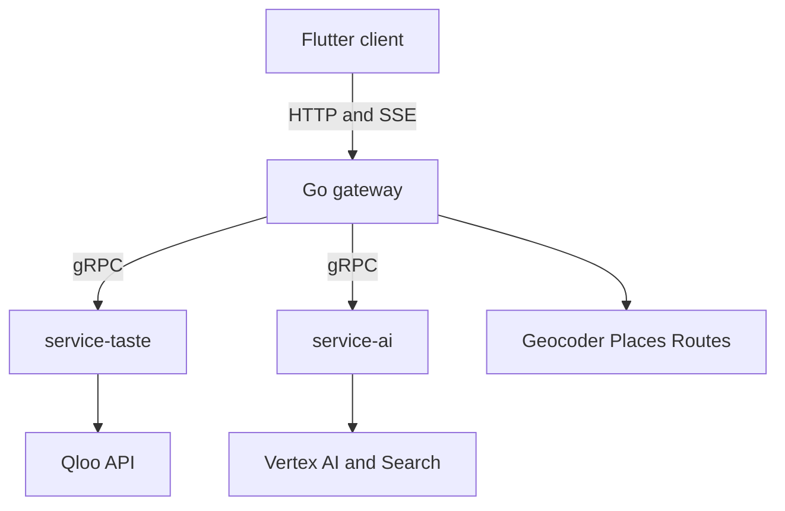

# Karum implementation plan

This is the build checklist for the whole system. The product is the brand-operated expansion agent in [PRODUCT.md](PRODUCT.md). The shape is the five-repo split in [TECH.md](TECH.md): Flutter client, Go gateway, `service-taste`, `service-ai`, and this infra repo for protos, Compose, and Cloud Run.

This plan is current as of 21 Oct 2026. The Devpost deadline is 30 Oct 2026, 11:45pm EDT. Feature freeze is 27 Oct, the public build is up on 28 Oct with the hackathon banner signing judges into the preseeded account, and the submission goes in on 29 Oct. Cloud Run and the pre-warmed cache stay up through 23 Nov; judging runs 2–16 Nov.

On 17 Oct the product became the brand agent: a brand seed and a city go in, and doors, flagship corridors, collab partners, skip reasons, menu audits, and a field route come out. This checklist is that build. Platform work finished before the pivot stays ticked. The domain protos and the stub toolchain landed 18 Oct (sections 1–4); service-taste now resolves seeds, tags, doors, scores, heatmaps, and compare, and the gateway, the AI service, and the product screens are built and tracked in the sections below. [DECISIONS.md](DECISIONS.md) records the earlier leasing shape; where it disagrees with this file, this file wins. Qloo parameter facts stay in [QLOO_APIS.md](QLOO_APIS.md) and [spike/RECORDING.md](spike/RECORDING.md) — that catalogue still cites the old epic numbers, so new work cites section numbers and DI ids.

**Status — 21 Oct 2026.** The five repos exist as private `karum-labs` repositories; local folders carry the `karum-` prefix (`karum-infra`, `karum-server`, `karum-service-taste`, `karum-service-ai`, `karum-client`). Done for all five: MIT licences, READMEs, gitignores, CI, gitleaks, toolchain pins in `versions.env`, `GET /health` on the three backends, and Dockerfiles. Compose is gateway, taste, AI, Redis, and Caddy; Postgres is the required `POSTGRES_DSN` URI, not a container. **Verified complete:** infra sections 1–3 and 6, §4's stub and fixture tooling (service-ai now replays the shipped AI pack offline on the recorded path) and §5's one-command fixture smoke (`make test`); taste sections 7–12 and 14; service-ai §15–§18; gateway §19–§26 — scout jobs, geocoding, score assembly, Places, Routes, PDFs, Postgres snapshots, the resilience controls, the judge account with its sessions, and the prewarm target. Taste and AI serve those RPCs over gRPC beside their HTTP health ports. The client carries the official brand foundation, the judge sign-in flow, the seed builder, the live trace, the map, the door board with its evidence drawer, the pitch, and the run-sheet actions (§27–§38, minus the items still listed below). §30 is now audited and recorded in `karum-client/ACCESSIBILITY.md`: the keyboard path from the seed builder to the pitch, the guide's focus ring, every control's accessible name, and the computed contrast table. **Still open on purpose:** §13 the end-to-end prewarm run, §27 the screen mockups, §34 the `GET /entities` hydration, §38 the read-throughs, §39 the deploy-time prewarm and the latency numbers, §41 the failure drills, §42 the honesty audit, the ship work in §43–§47, and the audit items §48 still lists as open — the Gemini billing block (K-01), the brand fonts (K-13), and the tracked remainder. The protos, the Go and Python stubs, and both Python services are now generated from one pinned `buf` plugin set, and the `protobuf` runtime is pinned to match the generated code. Every repo's own CI gate is green: `buf lint`, `buf breaking`, the contract round-trip, the fixture pack, `go test ./...`, 362 taste tests, 63 AI tests, and 57 Flutter tests. The five repos are committed and pushed on `main`; the audit fixes in §48 were committed and pushed on 21 Oct.

| Window | Sections | Outcome |
| --- | --- | --- |
| 17–18 Oct | 1–2 | Domain protos, stubs, and the three campaign seeds |
| 18–21 Oct | 3–4 | Taste and AI, in parallel |
| 21–26 Oct | 5–6 | Gateway and Flutter, overlapping once the protos land |
| 26–28 Oct | 39, 43, and 27–38 | Pre-warm, Cloud Run, the public client |
| 28–29 Oct | 8–9 | Proof, Devpost, submit |

Service ownership:

- **infra:** protos, Compose, Cloud Run, fixture pack, Makefile, CI
- **service-taste:** Qloo client, seed and tag resolution, door scouting, heatmap, compare, the affinity and demographic terms, Redis cache
- **service-ai:** Gemini, search grounding, menu audit, SKU choice, pitch, battlecard, site brief, collab proposal, LLM-only baseline
- **server:** city geocode, job orchestration, score assembly, Places, Routes, PDF, Postgres, rate limits, SSE
- **client:** judge-ready Flutter web UI, plus the same screens on desktop

After the domain protos land, client work (sections 27–38) runs in parallel with taste and AI against fixture mode. Design tokens, mockups, and the preseeded judge account come before the screens. If the calendar tightens, cut in this order and leave the three-minute path alone: the compare chart, run history beyond the live job, the sixty-second coach, then the observability dashboard. The path that stays is the Austin wholesale preset, a door card with citations, the evidence drawer, the skip list, the LLM toggle, the pitch and the route, then the Brooklyn flagship heatmap and its collab toggle.

## 1. Contracts and local platform

### 1. Shared domain protos

In `karum-infra/proto`, beside `karum/health/v1`, define `karum.taste.v1` and `karum.agent.v1`. Shared messages: brand seed, entity ref, tag, geopoint, sub-score, door candidate, skip reason, heatmap point, locality cluster, evidence call, and trace event. Campaign mode is `WHOLESALE`, `FLAGSHIP`, or `COLLAB`. Job states are `resolving`, `running`, `ready`, `degraded`, and `failed`. Error codes are `unresolved`, `empty`, `rate_limited`, `upstream`, and `validation`. The seed builder confirms entity ids before `POST`, so a job has no confirmation pause. Comment each field as a Qloo fact or a model inference. Buf breaking stays enforced against the pull request's base commit.

- [x] Define brand seed, entity ref, tag, geopoint, sub-score, door candidate, skip reason, heatmap point, locality cluster, evidence call, and trace event — `karum.common.v1` (primitives and evidence), `karum.taste.v1` (seed, door, skip, heatmap, locality), and `karum.agent.v1` (trace event) in `proto/`
- [x] Define job states: resolving, running, ready, degraded, failed — `JobState` in `karum.agent.v1`; the seed builder confirms ids before `POST`, so no confirmation pause
- [x] Define error codes: unresolved, empty, rate limited, upstream, validation — `ErrorCode` in `karum.common.v1`; every response that can miss carries one
- [x] Version the proto packages and enforce buf breaking against the base commit — `buf breaking` runs in CI against the pull request's base SHA, so a breaking change is caught before it merges; it covers `karum.common.v1`, `karum.taste.v1`, and `karum.agent.v1`
- [x] Mark each field as a Qloo fact or a model inference in the proto comments — four-marker convention (Qloo fact / Google fact / model inference / Input) enforced by `make check-proto-docs` across 216 fields

### 2. Taste RPCs

`ResolveBrandSeed` returns ranked brand, place, or artist candidates and a derived confidence. `ResolveTags` maps a category or lifestyle chip to tag URNs. `ScoutDoors` takes confirmed seed ids, tags, the city point, an explicit metre radius, and a category tag, and returns recommended doors, the skip list, demographics, and the evidence bundle. `GetLocalityHeatmap` returns cells and, when requested, locality polygons. `CompareAudiences` returns the compare payload for one door, the emerging brand, and an incumbent. Heatmap is first-class for flagship and compare for the wholesale displacement case; the client hides a widget when that RPC reports itself unavailable. The contracts are defined in `proto/karum/taste/v1/taste.proto`; the service-taste implementations follow in §7–§14.

- [x] `ResolveBrandSeed` with ranked candidates and a confidence — contract defined; a total miss is `unresolved`, never an empty success
- [x] `ResolveTags` for venue-category and lifestyle chips — contract defined; chips come back resolved or explicitly unresolved
- [x] `ScoutDoors` returning recommended doors, the skip list, demographics, and the evidence bundle — contract defined; radius is explicit in metres
- [x] `GetLocalityHeatmap` for cells and locality polygons — contract defined; carries `available` so the client can hide the layer
- [x] `CompareAudiences` for a door, the brand, and an incumbent — contract defined; `matchEntities` presence is surfaced for the degradation rule

### 3. AI RPCs

`AuditMenu` is the search-grounded menu and shelf read. `DraftDoorPitch` returns the script, the battlecard, the recommended SKU, and the mode-specific paragraph (activation proposal or site-brief line). `LlmOnlyBaseline` is the counterfactual with no Qloo payload. Every response carries `model_id`, `prompt_version`, and cited evidence ids. The contracts are defined in `proto/karum/agent/v1/agent.proto`; the service-ai implementations follow in §15–§18.

- [x] `AuditMenu` for menu verification, incumbents, shelf inputs, and grounding URLs — contract defined; incumbents are only named when a source carries them
- [x] `DraftDoorPitch` for the script, battlecard, SKU, and the mode-specific paragraph — contract defined; the battlecard is optional and the wholesale mode paragraph stays empty
- [x] `LlmOnlyBaseline` for the counterfactual panel — contract defined; the response is labeled ungrounded
- [x] Every response carries model id, prompt version, and cited evidence ids — `ModelAttribution` on every `AgentService` response, and the gRPC adapter populates it on all three RPCs, so the attribution is on the wire and not only in-process

### 4. Stubs and fixtures

`buf generate` emits Go stubs for the gateway and Python stubs for taste and AI. CI runs that generate step inside Docker so laptop and CI stubs match. The fixture pack holds redacted recordings for the judge campaigns — Austin wholesale, Brooklyn flagship and collab, and Mumbai wholesale. Redacted means the fields Karum consumes, never raw Qloo JSON ([QLOO_APIS.md](QLOO_APIS.md) §1). In fixture mode service-taste serves those recordings and makes no outbound Qloo call; service-ai has no replay, so a draft still calls the model. A contract test round-trips one campaign through both generated stubs.

- [x] Generate Go and Python stubs from `karum-infra/proto` in CI — `contract` job in `.github/workflows/proto.yml`; plugin versions pinned in `proto/buf.gen.yaml`. The committed stubs in the three service repos come from `karum-server/buf.gen.yaml`, and `make generate-stubs` refreshes them in one command
- [x] Generate inside Docker so local and CI stubs match — CI runs the pinned `bufbuild/buf` container (`make generate-docker` is the local equivalent)
- [x] Pin the `protobuf` runtime to the generator, so the generated code and the runtime cannot drift — the `protocolbuffers/python:v36.2` plugin emits gencode 7.36.2, which refuses to load on an older runtime; both Python services now declare `protobuf==7.36.2` in `pyproject.toml` and lock it in `uv.lock`, matching `contract/pyrelay/requirements.txt`
- [x] Ship a redacted fixture pack for the four presets (three cities; Brooklyn carries flagship and collab) — `fixtures/` holds 76 redacted recordings plus the four preset payloads and a sha256 manifest; `make check-fixtures` / `make test-fixtures` verify (CI job `Fixture Pack`)
- [x] Add a fixture mode that serves those recordings with no network — service-taste replays the pack; service-ai replays the shipped AI pack (`fixtures/ai/`, `AI_FIXTURES_DIR`) on the recorded path — the Austin preset's first stop serves `AuditMenu` and a draft offline — and returns typed misses for unrecorded requests; re-recording the full pack is blocked on the Gemini billing fix (§48, K-01)
- [x] Add a contract test that round-trips a campaign through both stubs — `make contract-test` round-trips six Austin payloads through the Go and Python stubs (`contract/`); the verifier is itself tested against corruption

### 5. Local Compose

`docker compose` brings up the gateway, taste, AI, Redis, and Caddy, with healthchecks and a fixed startup order. The gateway reads `POSTGRES_DSN` and connects to that database; Compose does not run Postgres. `.env.example` lists every variable and which process reads it, and each service reads only its own namespace (`GATEWAY_*`, `TASTE_*`, `AI_*`); the bare spellings `PORT`, `MODE`, and `LOG_LEVEL` are not read, so a stray variable cannot change how a service behaves. One Make target posts the Austin preset in fixture mode and prints the campaign JSON. Host ports, logs, and the Flutter base URL are documented.

- [x] Compose gateway, taste, AI, Redis, and Caddy — the database is the required `POSTGRES_DSN` URI
- [x] Add healthchecks and a deterministic startup order
- [x] Add `.env.example` listing every variable and which process reads it — every variable the three services read is listed, and each service reads only its own namespace; a test in service-ai pins that the bare `PORT`, `MODE`, and `LOG_LEVEL` spellings are ignored
- [x] Add one command that runs the Austin preset on fixtures and prints the campaign JSON — `make test` runs `scripts/smoke.py` against the running stack: it posts the Austin preset, waits for a terminal state, asserts the door board, a skip list with reasons, a pitch, a route, and the idempotent replay, and writes `contract/.out/smoke.json`
- [x] Document ports, logs, and how Flutter web points at the gateway

## 2. Sample campaigns

### 6. Lock the three presets

The judge buttons are fixed: Austin (Sola: mezcal brand + Aesop + Khruangbin; wholesale), Brooklyn (ceramics and matcha; flagship and collab), Mumbai Colaba (specialty cacao and coffee; wholesale). Colaba already resolved on 16 Oct — 10 of 10 venue names landed within 2 km of the block point. The 17 Oct extension confirmed the Austin door direction — a brand-typed seed returns ranked door rows at the downtown point with explainability and stable affinity (RECORDING.md extension) — and found one coverage miss: **Madre Mezcal does not resolve in Qloo** (brand-typed and any-type searches both miss; only same-name places in other cities). The locked Austin seed therefore swaps in Qloo-verified substitutes — Ilegal Mezcal, Aesop, and Khruangbin all resolve — and presets lock seed ids only after they resolve. Entity-level misses swap like the Austin seed; if the city fails the 70% resolution check or the point returns no heatmap cells, the flagship toggle moves to the best verified alternative in the same pass, with the backup city's heatmap probed during it (1 call). This pass still resolves the Brooklyn reference entities and writes down the preset ids, the lat/lng, the radius, the category tags, and the skip-candidate ids the fixtures will replay. Door and collab queries use `filter.location` as WKT plus an explicit radius in metres (8 km unless a preset overrides; heatmap 10 km). A brand-type insights call, if any preset needs one, uses `signal.location` (DI-11). Spend is logged against the 9,801 requests remaining after the preset lock pass before anyone starts feature traffic.

- [x] Colaba venue resolution measured 16 Oct — 10 of 10 within 2 km
- [x] Location behaviour settled — place calls use WKT plus an explicit metre radius; brand-type insights use `signal.location` (DI-11, DI-21)
- [x] Austin door query confirmed 17 Oct — a brand seed returns door rows at the downtown point; Madre Mezcal is a coverage miss and the seed swaps in Qloo-verified substitutes (Ilegal Mezcal, Aesop, Khruangbin)
- [x] Resolve the Brooklyn seed entities and confirm a point returns doors and heatmap cells — 7 of 7 candidate entities resolve (5 seeds + 2 alternates); the point returns 25 door rows (0.910–0.931) and 5,523 heatmap cells (plus 83 locality polygons)
- [x] Decide the flagship fallback in this pass — no fallback needed: Brooklyn cleared both gates (8 of 10 venues, all New York; cells at the point), so the toggle stays on Brooklyn
- [x] Measure the western demo city's venue-resolution rate while resolving its venues (kill rule 2's 10-of-10-style check, [DECISIONS.md](DECISIONS.md) §4) — Brooklyn 8 of 10, every resolved row the New York entity (80% ≥ 70%); Austin 10 of 10 resolved
- [x] Confirm the Colaba door shape under its preset category tag — the 17 Oct Colaba calls were unfiltered and topped out with event venues (1–2 calls); the cafe tag returns 25 door rows (0.930–0.968, Suzette top, the incumbent's own Nariman Point outlet at rank 2) while the unfiltered seed drifts to dining and anchors
- [x] Write the four preset payloads (ids, points, radii, category tags, skip-candidate ids) into the fixture seeds — `fixtures/presets/{austin-wholesale,brooklyn-flagship,brooklyn-collab,mumbai-colaba-wholesale}.json`
- [x] Keep the three copies of each preset in step — the record, the gateway's catalogue, and the client's mirror are compared by `make check-presets` (`fixtures/tools/check_presets.py`): the seed, tags, point, radius, mode, and city agree; the seed never holds a signal the recording never had; the gateway's skip batch is the batch the recording scored; the client's doors radius is the recorded one wherever the mirror pins a radius. Two drifts were found and fixed — the gateway's Austin skip batch and the client's Brooklyn flagship doors radius
- [x] Update the quota ledger in [spike/RECORDING.md](spike/RECORDING.md) after this pass — 55 calls; 9,801 remaining

## 3. service-taste

### 7. Qloo HTTP client

One typed method per endpoint the spike verified, and no method for an unverified parameter. Timeouts, retries with backoff, and honour of the rate-limit headers (observed limit 5 requests/second). Logs redact the API key. Metrics expose status, latency, and call count. Timeouts, 429s, and 5xx map onto the shared error codes. Replay tests load the fixture pack and assert the typed structs, with no live network.

- [x] Typed methods for verified endpoints only — `qloo/client.py`: `/search`, `/v2/tags`, four `/v2/insights` surfaces (places, heatmap cells, localities, demographics), and `/v2/analysis/compare`; no method for an unverified parameter
- [x] Timeouts, retries, backoff, and honour of rate-limit headers — httpx timeouts, exponential backoff, `X-Second-` and `X-Month-RateLimit-*` honoured at the observed 5 rps ceiling, 429 `Retry-After` respected, and a month-budget guard that stops before burning the reserve
- [x] Redacting logs plus metrics for status, latency, and call count — the key only ever rides the `X-Api-Key` header (URLs and logs stay clean, backend filter covers stray attributes); `CallRecord` per call plus per-endpoint metrics surfaced on `/health` with the active transport
- [x] Map upstream failures onto the shared error codes — timeouts, 429s, and 5xx map onto `unresolved`, `empty`, `rate_limited`, `upstream`, `validation` from `karum.common.v1`
- [x] Replay tests from the fixture pack — all 76 recordings replay end-to-end through the typed client with no network; a request the pack has not recorded is an error, never a synthetic payload

### 8. Brand seed resolution

`ResolveBrandSeed` calls `GET /search` for the brand query and each fallback vibe query. Types are `urn:entity:brand`, `urn:entity:place`, and `urn:entity:artist` — all three verified resolving on 17 Oct (Khruangbin resolves as an artist; brand coverage is thin, so a total miss is an expected outcome). Name lookup leaves `sort_by` at the default — `sort_by=distance` turns a name query into nearest venues ([QLOO_APIS.md](QLOO_APIS.md) §3.1). The RPC returns the top candidates with a derived confidence marked as a model inference. Low-confidence and ambiguous hits are flagged so the seed builder asks the operator to pick before scout starts — common names collide across cities (Perry's resolved to San Antonio, Uchi to London, Blind Pig to Kharkiv on 17 Oct), so the candidate carries the geocode city and the pick prefers the row in the preset city. A total miss is `unresolved`, not an empty success. Hits and negative lookups are cached under a short TTL.

- [x] Search the brand query and each fallback vibe query, and return ranked candidates — `taste/seed.py` issues the recorded `/search` spelling (take 5, page 1, one entity type per call) and escalates brand → place → artist, vibes place-first, only when a stage returns nothing
- [x] Derive confidence from rank and name match, and mark it as an inference — a pinned similarity cascade decayed by rank; the response carries the derived value beside the row, never as a Qloo score
- [x] Flag low-confidence and ambiguous hits for the seed builder — below 0.6 or a name colliding across cities (Lilia: New York vs Rio) sets `ambiguous`; the candidate carries the geocode city, and the in-city flag is computed by distance from the preset point (Brooklyn rows geocode as New York)
- [x] Return an explicit miss when nothing resolves — per-query notes list what was tried; a seed with no hits is `unresolved` with `ERROR_CODE_UNRESOLVED` (validation is its own code), never an empty success
- [x] Cache successful and negative lookups with a short TTL — the canonical call signature is the key, empty results cache too, and the store sits behind an interface the section 13 Redis cache replaces

### 9. Tag resolution

`ResolveTags` maps the preset chips (bars and restaurants, specialty retail, apparel, vinyl, galleries, and the other campaign categories) onto tag URNs the spike verified. Free-text chips are accepted only when tag search returns a confident hit; the score is derived and marked as an inference, because `/v2/tags` publishes no score (§3.2). Otherwise the chip comes back unresolved. An allow-list of tag types limits what the pitch will try to explain. Fixture tests cover every chip the three campaigns send.

- [x] Map the campaign category chips to verified tag URNs — the catalogue pins each chip to its recorded probe spelling and URN (bar at take 15, the rest at 25); aliases cover the campaign phrasings, and literal URN chips validate without a call
- [x] Accept a free-text chip only when tag search returns a confident hit — the derived confidence must clear 0.6; otherwise the chip comes back unresolved, never guessed
- [x] Return unresolved chips to the caller — `unresolved[]` with a machine-readable reason: no confident hit, outside the allow-list, or an empty chip
- [x] Keep an allow-list of tag types the pitch knows how to explain — `urn:tag:genre` only; off-namespace rows are refused even when the name matches
- [x] Fixture-test every chip the three campaigns use — bar, cafe, ceramics, and gallery (plus aliases) replay from the locked pack, and the off-namespace refusal is tested

### 10. Door scouting

`ScoutDoors` fans out the verified insights calls for a confirmed seed: place ranking with `signal.interests.entities`, `signal.interests.tags`, `filter.location` as WKT, an explicit `filter.location.radius` in metres, the category tag, and `feature.explainability=true` (§3.5, §3.8). A point with no radius returns zero rows, and `0` falls back to the ~15 km default, so the radius is always the preset value. The 17 Oct extension verified this exact fan-out: a brand-seeded call returns ranked door rows with per-row affinity and explainability contributions, and the category tag is what keeps the board door-shaped — unfiltered, the top slots are taste anchors (landmarks, hotels, retail), while `filter.tags=urn:tag:genre:place:restaurant:bar` returns bars on the same seed (RECORDING.md extension). Taste tags and demographics are fetched for the top doors, not the full `take=25` (§3.3, §3.6). Collab mode sends the non-competing category tags on the same place call. Independent calls run in parallel under a fan-out cap. The response includes the evidence-call records the drawer lists.

- [x] Rank places from the seed with explainability, WKT, and an explicit metre radius — `taste/doors.py` issues the recorded `/v2/insights` spelling (place type, seed signal, `POINT(lon lat)` WKT, `filter.location.radius=8000`, `take=25`, `feature.explainability=true`); the flagship, Austin, and Colaba boards replay and ranks freeze 1–25 in encounter order
- [x] Fetch taste tags for the top doors — every ranked row already carries its shared tags with the seed, so the card cites them without a second call; the top-door window narrows only the demographics batch
- [x] Fetch demographics for the top doors — one batch call for the top eight doors (the widest signal a recording carries), rows mapped back by entity id; partial coverage stays a missing profile, never zeros. No preset contains the call, so its tests script the exact request explicitly
- [x] Apply the collab category tags on the same place call — collab sends one place call per category tag with `filter.tags`; the galleries board (25 rows) carries the grade and the empty ceramics call becomes a warning, both replayed from the pack
- [x] Run independent calls in parallel under a fan-out cap, and attach evidence-call records — `asyncio.gather` under a semaphore (default 4; tests pin parallel flight and a serialized cap-of-one), and every call lands in `evidence` with an `ev-NNNN` id the doors cite

### 11. Affinity score and the skip list

From documented Qloo fields, compute `A_taste` and `D_demo` on a stable 0–1 scale and write the inputs beside each score; the gateway computes `S_door = 0.50 · A_taste + 0.30 · O_shelf + 0.20 · D_demo` from the 0–1 sub-scores and displays `100 × S_door` (TECH.md's door score is the canonical definition; every process copy cites it). `A_taste` is the affinity's percentile inside the returned shortlist — raw affinity bands move with the seed and the city (observed 0.84–0.98 on 17 Oct, while per-entity values stay stable across calls), so a raw value is not comparable across campaigns; the raw affinity stays in the evidence. The gateway applies `O_shelf` and the `P_saturation` skip rule later, once the menu audit exists; when the audit is unavailable the shelf term is unknown and the composite renormalizes over affinity and demographics. The skip list is relative: score the skip candidates in one `filter.results.entities` batch ([QLOO_APIS.md](QLOO_APIS.md) §3.14) and place the ones below the returned shortlist's floor (its minimum or bottom decile) on the skip list with a machine-readable reason. Presets carry their verified candidate ids in the fixture seed; a free-entry run takes the venue names from `LlmOnlyBaseline`, resolves each through `/search`, records unresolved names as a miss on the run, and batch-scores the rest. An absolute 0.45 floor never fires — ranked sets observed 0.83–0.98 on 17 Oct — so no absolute threshold ships. Return the top recommended doors and the skip items, and break ties deterministically so the same inputs always produce the same order. Unit-test the relative floor, an empty seed, a category that matches nothing, and ties.

- [x] Compute `A_taste` and `D_demo` from documented fields only — `taste/scoring.py` builds both from recorded rows: the affinity percentile in the returned shortlist and the cosine age-bucket alignment mapped `(cos + 1) / 2`, raw values retained beside the mapped ones; an empty or flat profile yields `None`, never a fabricated zero
- [x] Normalize both to a stable 0–1 scale and put the inputs in the evidence payload — `A_taste` as a percentile within the returned set, raw affinity retained — every door and skip row carries a `SubScoreOut` (`name`, 0–1 `value`, `raw_value`, `inputs` like `rank=1`/`shortlist=25`); the flagship shortlist pins 1.0 → 23/24 → 0.0, and the composite itself never leaves the service
- [x] Batch-score the skip candidates (preset ids or resolved baseline names) via `filter.results.entities` and place those below the shortlist floor on the skip list with a machine-readable reason — the ranked pool probe (take 50) fixes the floor: flagship 0.9218 (Lilia 0.9192 skips, detail pinned), Austin 0.8386 (control Franklin 0.8655 stays on the board); the batch (take 25) scores the candidates in one call and everything strictly below lands in `skip_list` as `low_affinity` with the raw, the floor, and its pool percentile. Equality keeps the door. Free-entry names resolve through one `/search` each (in-city row preferred, misses stay visible as `unresolved`). Colaba has no pool recording, so the run degrades to the board floor 0.9295 with a deterministic warning
- [x] Tie-break deterministically — skip items sort by `(-raw, entity id)` (pinned with equal affinities), ranks freeze in encounter order across merged category boards, and the same inputs reproduce the same order
- [x] Unit-test the relative floor, an empty seed, an empty category, and ties — `tests/test_taste_scoring.py` adds 12 tests (pure percentile/`D_demo`/skip-item units, the recorded floors replayed, the Colaba degradation, the equal-to-floor keep, unresolved names) beside the reworked door suite; the suite now collects 357 tests and all 357 pass, ruff clean (`redis>=5.0.0` is a locked runtime dependency, so the Redis-backed factory test runs like the rest)

### 12. Heatmap and audience compare

`GetLocalityHeatmap` calls `urn:heatmap` with the seed and the preset radius (§3.7). Cells are the density layer. `output.heatmap.boundary=urn:entity:locality` supplies the polygons the brief uses to name corridors; anchor neighbours are the strongest places already returned inside those corridors. `CompareAudiences` parses `{tags, a, b, matchEntities}` and degrades cleanly when `matchEntities` is empty (DI-22). If either call fails, the campaign still reaches `ready` with pins and the scout radius. Demographic mismatch warnings ride beside `D_demo`.

- [x] Return heatmap cells for the seed at the preset radius — `taste/heatmap.py` replays the recorded `urn:heatmap` call (seed signal, `POINT(lon lat)` WKT, the preset 10 km radius, `take=50`); the flagship board returns 5,523 cells with the first pinned at affinity 1.0
- [x] Return locality polygons and name the top corridors from them — the `output.heatmap.boundary=urn:entity:locality` call returns 83 polygons; corridors rank by affinity (New York, Brooklyn, Manhattan, Tribeca, Lower East Side) with name and geometry aliases collapsed and a centroid radius check that drops state-sized shapes, and anchors are the already-ranked places falling inside a named corridor
- [x] Parse compare `tags` overlap, and degrade when `matchEntities` is empty — `taste/compare.py` maps `results.tags` onto the chart rows and `results.matchEntities` onto entity refs; the two recorded cross-type pairs come back empty and report a degraded chart rather than an empty one (DI-22)
- [x] Keep the campaign ready when heatmap or compare fails — a failed heatmap call leaves the layer `available=false` with a deterministic reason (the map keeps the pins and the scout radius), a failed polygons call degrades to cells with a warning, and a failed or empty compare leaves the door card without a conquest chart
- [x] Attach demographic mismatch warnings beside `D_demo` — a door whose `D_demo` lands below 0.5 adds a `demographic mismatch at <name>` warning beside its alignment sub-score

### 13. Cache and prewarm

Cache Qloo responses in Redis under a canonical hash of the request parameters, with a 24h TTL. A single-flight lock makes concurrent refreshes of the same key share one upstream call. If Redis is down, fall back to an in-process cache and flip the degraded health bit. Prewarm runs each of the four presets (three buttons, plus Brooklyn collab) end-to-end once — taste, Places, AI (menu audit, drafts, and the `LlmOnlyBaseline` text), and route — and stores the completed run with its drafts, baseline text, and trace events (§25), so a preset click serves the newest ready stored run and its recorded trace instead of re-running the live pipeline (§39). Eval requests set a bypass flag that is never written back into the demo cache.

- [x] Redis cache keyed by a canonical parameter hash with a 24h TTL
- [x] Single-flight lock so a refresh cannot stampede Qloo
- [x] In-memory fallback when Redis is down, with a degraded health bit
- [ ] Prewarm the four presets end-to-end, `LlmOnlyBaseline` included, and store the completed runs with their traces — the gateway now implements `POST /api/v1/prewarm` (`internal/httpapi/prewarm.go`, a judge session is required, `refresh=true` re-runs) and `make prewarm` posts to it with a bearer token; the four presets have not yet been run through it, so the stored runs and their traces are not yet refreshed
- [x] Eval bypass that is never served back as a cached demo response

### 14. Taste edge cases

Before scoring, collapse venues that resolve to the same entity id. Drop a result that is one of the seed entities, so a reference venue used as vibe is not pitched as a door. Flag a venue that resolves outside the geocoded city. If the seed resolves to nothing, return `unresolved` before scoring and explain the miss. A partial seed — some vibe queries hit, one misses — is allowed, and the evidence payload states the reduced confidence. A category filter that matches nothing is `empty`, with the category named.

- [x] Collapse duplicate venues to one entity
- [x] Drop results that are themselves seed entities — `taste/doors.py` drops any ranked row whose entity id is one of the seed entities before the board is scored, so a reference venue used as a vibe is never pitched as a door; `tests/test_taste_doors.py` pins it
- [x] Flag a venue that resolves outside the geocoded city
- [x] Stop before scoring when the seed resolves to nothing, and explain the miss
- [x] Allow a partial seed at reduced confidence, and return `empty` when the category matches nothing

## 4. service-ai

### 15. Vertex client

Call Gemini Flash through `google-genai`, and one Pydantic response model per RPC, so invalid JSON fails closed. The transport is Gemini AI Studio when a Studio key is set and Vertex AI on the configured project otherwise; the default model id is `gemini-3.8-flash`, because `gemini-2.5-flash` is retired for new API Studio keys and answers 404. Set a timeout, a max output token cap, and a single retry when schema validation fails. Logs include model, region, and prompt version, and never the credentials. Failures return a typed error the gateway maps onto `degraded`. Replay tests inject a fake model that returns the fixture schemas.

- [x] Pin Gemini Flash through `google-genai`, on AI Studio with a key and on Vertex otherwise, with a Pydantic schema per RPC — the default is `gemini-3.8-flash`; `AI_GEMINI_API_KEY` selects the Studio transport and `AI_GCP_PROJECT_ID` the Vertex one, and the service refuses to call the model with neither
- [x] Set timeouts, max output tokens, and one retry on invalid JSON — `http_options.timeout` is the configured `model_timeout_seconds` in milliseconds, `max_output_tokens` is capped, and one schema retry is tested
- [x] Log model, region, and prompt version, and keep credentials out of logs
- [x] Return a typed error the gateway can degrade on — `VertexError`/`ErrorCode` cross the service boundary, and the gateway runner degrades on `*UpstreamError` while keeping the ranking; the gRPC adapter that returns it is in §19
- [x] Replay tests with a fake model that returns the fixture schemas

### 16. Menu audit

`AuditMenu` uses Google Search grounding to read the venue website, menu, or delivery listing. It reports whether the audit succeeded, which incumbents are stocked, a short menu summary, the `O_shelf` inputs, and the source URLs. Online-only or unverifiable venues keep their Qloo rank, set shelf opportunity to unknown, and the composite renormalizes over affinity and demographics (§11). Grounding is capped to the working shortlist (the doors that can appear on the board, plus skip candidates the skip rule might cite), not the full `take=25`. Grounded prose names a competitor only when that name is in the grounding sources or the Qloo payload. The Qloo names travel with the request: the gateway sends the run's resolved seed and skip-candidate names on `MenuAuditTarget.qloo_incumbent_names`, so the check is a comparison against what the payload already carries, not a second call.

- [x] Audit the live menu or shelf with Google Search grounding — the audit call sets `grounded=True`, which attaches the Google Search tool to `GenerateContentConfig`, and a test asserts the tool is on the wire
- [x] Return incumbents, a menu summary, shelf inputs, and source URLs
- [x] When grounding is unavailable, keep the Qloo rank and label the shelf unknown — a Vertex failure returns one result per target with the door row intact, `succeeded=false`, `shelf_unknown=true`, and `O_shelf` at 0.0
- [x] Cap grounding calls to the working shortlist — `grounding_shortlist_cap` (default 5) rejects a larger target list with `validation` before any model call
- [x] Name a competitor in prose only when a grounding source or the Qloo payload contains it — each incumbent is checked against its sources, the result's sources, and `qloo_incumbent_names`; unsourced names are dropped and `O_shelf` is recomputed. The gateway sends the run's Qloo names on the request, so the rule holds over gRPC and not only in-process

### 17. Pitches, SKUs, and briefs

`DraftDoorPitch` returns the shopkeeper script, and every number cites an evidence id. When the audit found an incumbent, it also returns the displacement battlecard, using the compare tags when they exist and the affinity plus menu finding when they do not. The recommended SKU is chosen from the brand's own SKU list by the door's taste tags. Flagship mode adds the site-brief paragraph for the top corridors. Collab mode adds the activation proposal. `LlmOnlyBaseline` is stored beside the Qloo result and labeled ungrounded. Its venue names source the free-entry skip candidates (§11); unresolved names are recorded as misses, never scored. Length caps keep each text short enough that a non-technical judge can finish it.

- [x] Shopkeeper script that cites an evidence id for every number — `enforce_citations` drops every sentence that states a number without an `ev-NNNN` id, and rejects an id outside the run's evidence set; battlecard talking points use the same filter. The allow-set is the run's evidence set, and it crosses the gRPC boundary on `DraftDoorPitchRequest.evidence_ids`: an empty set is strict, so a run with no evidence yields no cited number rather than an invented one
- [x] Displacement battlecard when an incumbent is present
- [x] One recommended SKU from the brand's list, chosen with the door's taste tags
- [x] Site-brief paragraph in flagship mode, and an activation proposal in collab mode
- [x] LLM-only baseline stored beside the Qloo result and labeled ungrounded — the runner records the baseline text, venue names, and error code on the run beside the Qloo payload (`BaselineStored`); Postgres persistence is §25
- [x] Feed the baseline's venue names into the free-entry skip list, recording unresolved names as misses — a free-entry run passes the baseline names as `skip_candidate_names`, and taste's `resolve_skip_names` records each unresolved name as a miss

### 18. Draft resilience

If Vertex errors, times out, or returns JSON that fails the schema, the gateway still returns the taste ranking and the affinity skip list. The run is marked `degraded`, and template sentences interpolate evidence fields only. Venue and brand names enter the prompt as delimited data, so an instruction-shaped name cannot change the schema. A sentence whose cited evidence id is missing is dropped. Regenerating one pitch calls only that draft RPC and does not rerun Qloo. If a draft RPC fails, the door list is still returned and the failed draft is the only error. The test drives an in-process agent fake that fails every RPC and asserts the gateway still returns doors.

- [x] Return the taste ranking and the affinity skip list when Vertex fails — the runner keeps doors, skip list, and evidence when the audit or any draft fails; tested with an agent fake that errors on every call
- [x] Mark the run degraded and use template sentences that only interpolate evidence fields — the run state becomes `degraded`, and `templatePitch` uses the door, brand, tags, and evidence ids only; a test strips the ids and finds no remaining digit
- [x] Treat venue and brand names as data so instruction-shaped names cannot change the schema — `as_data` strips delimiter characters and newlines, wraps each name in `<data>`, and every prompt carries the inert-data rule
- [x] Drop a sentence whose evidence id is missing, and regenerate one pitch without rerunning Qloo — `enforce_citations` drops uncited or invented ids, and `RegenerateDoor` calls only `DraftDoorPitch`; a test asserts the taste and audit call counts do not change
- [x] Test with the AI process stopped, and leave the door list available when a draft fails — the runner test drives an agent fake that returns a typed upstream error for every RPC and still gets the full door and skip list

## 5. Gateway

### 19. HTTP API and jobs

`POST /api/v1/scout` creates a job from the confirmed seed, the city, the mode, and the SKU list, and returns a job id. A request that names a preset serves the newest ready stored run (§13) and replays its recorded trace; if no stored run exists yet, the preset runs the live pipeline in either mode — in fixture mode the Qloo calls are served from the pack by service-taste (§4) — and a draft still calls the model. A free-entry request always runs the live pipeline. `GET` returns the state and, once ready, the campaign payload. Draft `POST`s cover the run-sheet, the site brief, and a single-door pitch. `GET /events` is an SSE stream keyed by a cursor so a refresh replays from the last trace event.

- [x] `POST /api/v1/scout` creates a job from seed, city, mode, and SKUs
- [x] Serve presets from the newest ready stored run, replaying the recorded trace; run the live pipeline when none exists, and keep free entry live
- [x] `GET` returns state and, when ready, the campaign payload
- [x] `POST` draft endpoints for the run-sheet, the site brief, and a single-door pitch
- [x] SSE `/events` with a cursor so a refresh can resume the trace

Evidence: `POST /api/v1/scout` returns a job id; a second preset post replays the newest ready run and its trace; `rerun` inserts another run; free entry uses the live runner. `GET /api/v1/scout/:id` returns the campaign once ready. Draft posts render the run-sheet and the flagship site brief, and regenerate one door. `GET /api/v1/scout/:id/events?cursor=` replays trace events after that cursor.

### 20. City geocode

Geocode the city in the gateway before any taste RPC, and return candidate points when the query is ambiguous instead of picking one. Reject an empty query and unusable coordinates with `validation`. Cache geocode results and follow the provider's attribution rules. Persist a single lat/lng on the campaign and reuse it for the map, the scout radius, the heatmap, and Places. The four presets skip the geocoder and post their stored points.

- [x] Geocode the city before any taste call
- [x] Return candidates when the query is ambiguous
- [x] Reject an empty query and unusable points with a specific error
- [x] Cache geocodes and follow the provider's attribution rules
- [x] Store one lat/lng and reuse it; presets post stored points

Evidence: `GoogleGeocoder` runs in `buildRequest` before `Runner.Run`. An ambiguous query is HTTP 422 with the candidate points and no job. Empty queries and out-of-range coordinates are validation errors. Results cache for 24h, in memory or Redis, and carry `Map data © Google`. Presets copy their stored point and do not call the geocoder. The same point is what scout, the heatmap, Places, and the route reuse.

### 21. Orchestration and score assembly

The runner calls seed resolution only when the request still has raw queries; presets and confirmed seeds go straight to scout. Flagship adds the heatmap call. After Places and the menu audit, the gateway computes `S_door` from the 0–1 sub-scores (`100 × S_door` displayed), applies the `P_saturation` skip rule (affinity below the returned shortlist's floor — or four or more direct niche competitors), and freezes the ordered doors and the skip list. Compare runs only for doors whose audit found an incumbent. Independent taste RPCs run in parallel, and each completion writes a trace event. The exact Qloo and grounding payloads are stored on the run. A job abort cancels the downstream gRPC calls; a browser that simply disconnects does not, because the run continues so the client can poll it.

- [x] Scout from a confirmed seed, and resolve raw queries only when the request has them
- [x] Add the heatmap call in flagship mode, and compare only after an incumbent is found
- [x] Compute `S_door` from the 0–1 sub-scores, apply the `P_saturation` skip rule, and freeze the order
- [x] Emit a trace event as each hop finishes, and persist the payloads on the run
- [x] Cancel downstream RPCs when the job is aborted — `POST /api/v1/scout/:id/abort` cancels the context the gRPC client passes downstream. A browser disconnect alone does not cancel the run: the async run is rooted at its own context so the job survives a refresh and the client can poll it

Evidence: a confirmed seed never calls `ResolveBrandSeed`; a raw query does, and only then. Flagship adds `GetLocalityHeatmap`; wholesale does not. Compare runs only for a door whose audit named an incumbent. `score.Assemble` computes `S_door = 0.50·A_taste + 0.30·O_shelf + 0.20·D_demo`, skips a door at four or more competitors or strictly below the shortlist floor, and freezes rank. Each hop appends a trace event, and the Qloo and grounding payloads are stored on the run. `POST .../abort` cancels the context the gRPC client passes downstream; the async run keeps its own context, so a closed browser does not cancel the job.

### 22. Places enrichment

When a Places key is set, enrich the working set with address, opening hours, website, and open status. The website is the hint the menu audit searches from. Venues Places reports as closed are skipped with that reason. Missing key or a Places error leaves the Qloo door in the payload with enrichment marked unknown, and the job still reaches `ready`.

- [x] Enrich the working set with address, hours, website, and open status
- [x] Pass the website through to the menu audit
- [x] Skip a venue Places reports as closed, with that reason
- [x] Keep the door and mark enrichment unknown when the key is missing or Places errors

Evidence: `places.Client` calls Places API (New) `places:searchText` and keeps address, hours, website, and business status. The audit target receives that website. `CLOSED_PERMANENTLY` moves the door to the skip list with reason `closed`. A missing key or a Places error leaves the door on the board with enrichment unknown, and the run still finishes.

### 23. Field route

When a Routes key is set, order the qualified wholesale or collab doors with `optimizeWaypointOrder` and return legs the Flutter map draws as a polyline. Skip the call in flagship mode, when the key is missing, or when fewer than two doors qualified. A Routes error is isolated: the job still reaches `ready` with the door list. Include the Google attribution fields the response is required to carry.

- [x] Order qualified wholesale and collab doors with waypoint optimization
- [x] Return legs the map can draw
- [x] Skip routing in flagship mode, when the key is missing, or when fewer than two doors qualify
- [x] Keep the campaign ready when routing fails
- [x] Attribute Google data as required

Evidence: `routes.Client` calls `computeRoutes` with `optimizeWaypointOrder` and returns legs plus a polyline. Flagship, a missing key, and fewer than two geocoded stops skip the call. A Routes error sets `route.failed` and leaves the door list and a ready or degraded run. The payload carries `Map data © Google`.

### 24. Run-sheet PDF

The gateway renders the PDF. Wholesale and collab produce a field run-sheet: ordered stops, the three sub-scores, the SKU, the pitch, and the citations. Flagship produces a site-selection brief: the top corridors, the anchor neighbours, and the demographic line. Qloo facts and model inferences are visually distinct, using the split marked in the proto comments. A PDF failure leaves the on-screen campaign usable.

- [x] Render a field run-sheet for wholesale and collab
- [x] Render a site-selection brief for flagship
- [x] Keep Qloo facts and model inferences distinct in the PDF
- [x] Leave the on-screen campaign usable when PDF rendering fails

Evidence: `pdf.RunSheet` and `pdf.SiteBrief` draw with core Helvetica. Roman type is a Qloo fact and italic type is a model inference. `POST .../drafts/run-sheet` and `.../site-brief` return the PDF. A renderer error is HTTP 502 and `GET` still returns the campaign.

### 25. Job persistence

Postgres tables for campaigns, runs, evidence snapshots, drafts, and each run's trace events, applied with forward-only migrations. A run's stored payload carries the campaign plus the `LlmOnlyBaseline` text and the recorded trace a stored preset replays (§19, §32). The HTTP API gets a campaign by id so a refresh can restore it. A re-run inserts a new run row and leaves the previous snapshot untouched; the preset path always serves the newest ready run. A seed script loads the four presets so fixture and live modes share the same ids. The judge account is added in §28; this schema stays campaigns, runs, evidence, and drafts, plus the trace events and the idempotency keys the create path needs, and the accounts and sessions the second migration adds.

- [x] Postgres schema for campaigns, runs, evidence snapshots, drafts, and trace events
- [x] Forward-only migrations
- [x] Get a campaign by id
- [x] Re-run creates a new run and leaves the previous snapshot untouched
- [x] Store the baseline text and the recorded trace on the run so a stored preset serves without live calls
- [x] Seed the four presets

Evidence: `internal/persist/migrations/0001_init.sql` creates campaigns, runs, evidence snapshots, drafts, trace events, and idempotency keys; `0002_auth.sql` adds the accounts and sessions of §28; `0003_idempotency_keys.sql` indexes the create keys for the sweeper. `persist.Open` applies the files in order through `schema_migrations` and seeds the four preset campaigns. `GET /api/v1/campaigns/:id` returns the newest run. A re-run inserts a new run id and leaves the previous row. The run payload stores the baseline text and the trace, and the preset path serves that stored run without another scout. If Postgres is unreachable the process stays up and `/health` reports postgres down.

### 26. Gateway resilience

Set a deadline on every taste and AI gRPC call and a circuit breaker per dependency. Per-IP and global rate limits return a JSON error the client can map to copy; the limits cover the create route and the judge and password login routes, and the read routes are not limited. Require `Idempotency-Key` on create so a double-submit returns the original job; the key is stored in Postgres, so the replay survives a restart and works across replicas, and the in-process store is the fallback when the database is unreachable. Validate the seed and query count (up to four of each — a resolved brand plus any vibe chips, or a two-to-four-entity composite of chips; the total never exceeds four, §31), text length, SKU-list length, mode, and radius before any RPC. A request needs either a confirmed seed or a brand query. `GET /health` reports gateway, taste, AI, Redis, Postgres, and Qloo mode as `live`, `fixture`, or `degraded`.

- [x] Deadlines on every gRPC call and a circuit breaker per dependency
- [x] Per-IP and global rate limits with a clear JSON error — the create route and the judge and password login routes are limited; the read routes are not
- [x] `Idempotency-Key` on create — stored in Postgres, so a replay survives a restart; the in-process store is the fallback when the database is down
- [x] Validation limits for seed count, text length, SKU list, mode, and radius
- [x] `/health` reports gateway, taste, AI, Redis, Postgres, and Qloo mode

Evidence: taste and AI calls go through `grpcclient` with the runner's per-call deadline and a circuit breaker per dependency. A per-IP limit and a global limit return HTTP 429 `rate_limited`. `Idempotency-Key` is required; the same key and body replay the original job, and a different body is HTTP 409. The request accepts up to four seed entities and up to four brand queries, and needs a confirmed seed or a brand query; text is at most 200 characters, the SKU list is at most 24, mode is wholesale, flagship, or collab, and radius is 500–50000. `GET /health` keeps process status `ok` and adds `dependencies` for gateway, taste, AI, Redis, Postgres, and Qloo mode.

## 6. Flutter client

### 27. Brand foundation, design tokens, and mockups

Before any screen is built, lock the visual system the Flutter theme will consume and the frames the judge path will follow. The system is the **official Karum brand guide** plus the brand asset archive, both supplied 19 Oct and integrated into the client: the guide supplies the colour pairs, the contrast table, the type styles, the mark construction, and the logo rules, and the archive supplies the artwork. Tokens cover color, type, spacing, radius, and elevation — each value tagged official, derived, or implementation-defined — and they are the values the app-shell theme reads. Mockups cover the login screen with the hackathon banner, the seed builder, the live trace, the map (route, heatmap, and skip pins), the door board with the evidence drawer, and the pitch; frame both a laptop width and a narrow window. The tokens are checked into the client; the mockups are the reference for the screens in §29–§36.

- [x] Define color, type, spacing, radius, and elevation tokens — `lib/src/theme/brand_tokens.dart` carries the guide's light/dark pairs with the published contrast ratios, the named type styles (Bricolage Grotesque, IBM Plex Sans, IBM Plex Mono), the spacing ramp, radii, and flat elevation; every token is tagged official, derived, or implementation-defined in its doc comment
- [x] Integrate the official brand assets into the client — the kit under `assets/brand/{mark,lockup,social}/` and `web/`; `lib/src/widgets/karum_logo.dart` draws the lockup and mark with `flutter_svg` — header at 32 px, mark-only below the guide's 480 px breakpoint, artwork clamped to its minimum sizes — and never tints, crops, or stretches it
- [x] Replace the Flutter placeholder icons with the kit's favicons, PWA icons, and share card — `web/favicon-adaptive.svg`, `favicon.png` / `favicon-dark.png`, `apple-touch-icon-180.png` / `-dark.png`, and `og-share-card-1200x630.png` wired into `index.html` and `manifest.json`; the four Flutter-logo `Icon-*.png` placeholders are deleted and the manifest declares only sizes that exist
- [x] Check the tokens into the client for the app-shell theme to consume — `lib/src/theme/app_theme.dart` builds `AppTheme.light()` and `AppTheme.dark()` from the tokens (a brand-pinned `ColorScheme`, the `KarumPalette` theme extension, the type scale mapped onto Material slots) and `lib/main.dart` wires `theme` and `darkTheme`; no widget carries a raw brand value
- [x] Guard the brand wiring — `test/karum_logo_test.dart` loads every bundled asset from the real bundle and asserts the per-variant artwork selection; `flutter analyze` has no issues, `flutter test` passes 54/54, `dart format` is clean, and `flutter build web` succeeds
- [ ] Mock the login screen with the hackathon banner, the seed builder, and the trace
- [ ] Mock the map, the door board, the evidence drawer, and the pitch
- [ ] Frame a laptop width and a narrow window

Evidence: the values are transcribed from the guide with their source labels in `brand_tokens.dart`, and the inventory, usage rules, and gaps are written up in `karum-client/BRAND.md`. Verified 19 Oct, not assumed: analyze, tests, and the format gate are clean; `flutter build web` bundles the six declared SVGs and copies the six root files; and a real browser load renders the lockup over the dark paper, fetches `GET /health` (200 in fixture mode), and shows the amber fixture banner. Three gaps stay recorded rather than papered over: the kit ships no font files, so the three SIL OFL families resolve to the platform default until they land in `pubspec.yaml`'s commented `fonts:` block (no code change needed); the lane icons exist only as inline symbols in the guide's HTML, so no icon files are checked in; and there is no maskable 192/512 artwork, so the manifest tells the truth about what exists. Radii, elevation, and the mode-banner colour mapping (live → brand, fixture → investigate, degraded → avoid) are implementation-defined, labelled as such in code and README.

### 28. Preseeded judge account

Create one judge account and attach the four preset campaigns to it. The login screen shows a hackathon banner when `SHOW_JUDGES_BANNER` is on (`--dart-define`, default on in debug and off in release). The banner signs the judge into that preseeded account. `HACKATHON_MODE=false` (see `.env.example`) disables that passwordless route. Anyone else can register and sign in with an email and password. The account row, its session, and the link from the judge account to the seeded campaigns live in Postgres. Account credentials stay in the secret manager. The public demo stays anonymous either way.

- [x] Add the judge account and attach the four preset campaigns
- [x] Expose `HACKATHON_MODE` from the gateway to the client
- [x] Show the login banner only when `SHOW_JUDGES_BANNER` is on, and sign the judge into the preseeded account
- [x] Hide the banner when `SHOW_JUDGES_BANNER` is off
- [ ] Keep the account credentials in the secret manager — local `.env` and bcrypt-only Postgres are working; creating the production secret is blocked by the active gcloud account's IAM on `karum-512016`, so the exact operator commands are recorded in `SECRETS.md`

Evidence (20 Oct): Neon `accounts` holds `acct-judge` (`judge@karum.demo`), the four preset campaigns point at that account, and `/health` returns `"hackathon_mode": true`. `POST /api/v1/auth/judge` issues an opaque session while `HACKATHON_MODE` is on, `/api/v1/auth/login` and `/api/v1/auth/register` take an email and password, `/auth/me` validates the bearer token, and logout revokes it; a wrong password returns `401`. The login banner is the client flag `SHOW_JUDGES_BANNER` (on in debug, off in release unless the define forces it). Opening it signs into the preseeded judge account and lands on `/account`, which lists the four stored campaigns and opens each as a stored run; the public landing stays the anonymous entry. The public demo stays anonymous until someone signs in. The plaintext password is never written to Postgres; only a bcrypt hash is stored.

### 29. App shell

Flutter web is the judge target, with the same screens on desktop. The shared theme defines type scale, cards, chips, banners, and drawers, and every screen implements loading, empty, and error states against the gateway job states. With the judges banner on, the judge opens the preseeded account from §28 before a scout starts. The gateway base URL is a compile-time define so local Compose and the production host are a switch.

- [x] Ship Flutter web as the judge target, with the same screens on desktop — one route table serves web and desktop; `flutter build web --release` succeeds
- [x] Add theme, type scale, cards, chips, banners, and drawers — the evidence drawer is a shared modal sheet; banners cover fixture, degraded, offline, dropped stream, and failed runs
- [x] Add loading, empty, and error states on every screen — health, workspace, and pitch carry loading/error states; an empty board explains the miss and offers a return to the seed; the landing validates before submit
- [ ] Run a preset and a free-entry scout from the preseeded judge session — both paths run, and §28's account, session, and bearer flow now exist, but a preset and a free-entry scout have not yet been driven end-to-end from a judge session against a live stack

Evidence (19 Oct): `lib/main.dart` routes `/`, `/status`, `/login`, `/register`, `/account`, `/scout/:jobId`, `/scout/:jobId/doors/:doorId`, `/campaigns/:campaignId`, and `*`; the workspace switches from three panes to trace/map/board tabs below 1200 px. `flutter analyze` is clean, 54 widget/unit tests pass, and the web release build succeeds. Evidence (20 Oct): the blocking half of this section is gone — the gateway carries `internal/auth`, `POST /api/v1/auth/judge`, `POST /api/v1/auth/login`, `GET /auth/me`, and logout, and the client signs the judge in and keeps the session across screens. What is still missing is the live run: the preset and free-entry paths have not been exercised end-to-end from that session against a running stack, so the checkbox stays open.
- [x] Configure the gateway base URL for local and production — `--dart-define=GATEWAY_URL`

### 30. Accessibility and layout

The path from the seed builder to the pitch is operable from the keyboard, with focus order, labels, and contrast set for a short audit. The trace honours the reduced-motion media query. Layout breakpoints cover a laptop width and a narrow window. A list renders the same recommended doors and skip doors when the map is not the view being used.

- [x] Support a keyboard path from the seed builder to the pitch — every control is a standard Material field or button with a visible focus ring, and route actions are buttons, so Tab/Enter reaches the pitch; there is no custom shortcut layer. The ring is the guide's official treatment — 3 px of brand colour, 2 px off the control — painted by `FocusRing`, and the keyboard path is tested end to end
- [x] Set focus order, labels, and contrast for a quick audit — recorded in `karum-client/ACCESSIBILITY.md`: the computed contrast table for every pair the app paints, the labels inventory, the focus order per screen, the five defects the pass found, and the gaps it leaves. `test/accessibility_test.dart` holds the contrast, the labels, the focus order, the ring, and the tap targets in place
- [x] Honour reduced motion on the trace — the trace appends rows without transition; its auto-scroll jumps to the newest stage when `MediaQuery.disableAnimations` is set and only animates otherwise. Banners and the coach do not animate.
- [x] Lay out for a laptop width and a narrow window — three panes at ≥1200 px, tabs below; widget tests run at 1440×900 and 420×900
- [x] Provide a non-map list of the same doors — the map panel has a Map/List toggle that lists doors in server order

Evidence (19 Oct): the narrow-window test renders the workspace at 420×900 without an overflow and reaches the board tab; the list view renders the same doors in the same order as the map. Evidence (20 Oct): the audit is recorded in `karum-client/ACCESSIBILITY.md` and the checks are in `test/accessibility_test.dart` — 12 tests. The pass found and fixed five defects: the primary button had no visible focus indicator (the ring was only described in the tokens), a covered route kept the keyboard so a scout run could not be tabbed to the board, the map's own focus scope trapped the tab order, every icon button was announced as an unlabelled button because Flutter puts a tooltip in the tooltip field rather than the label, and the baseline switch had no name. A sixth finding was a layout crash in the door card's header, caused by an `Expanded` in a `Row` without a bounded width. The remaining gaps are recorded in the audit: only the judge path carries the ring, the map's pins keep their semantics but are not tab stops, and nothing was checked with a screen reader.

### 31. Seed builder, modes, and presets

The brand field calls seed resolution through the gateway, debounced, with a minimum query length, and renders matches as confirm chips. Fallback vibe chips build a composite seed of two to four reference entities; a resolved brand plus any added chips still totals four seed entities or fewer (§26). The SKU list is plain text on the seed. Mode pills are Wholesale, Flagship, and Collab, and they serialize into `POST /api/v1/scout`. Three preset buttons load the stored preset runs and skip typing: Sola in Austin, ceramics and matcha in Brooklyn, cacao and coffee in Colaba. Switching Brooklyn from flagship to collab loads the second stored payload.

- [x] Brand typeahead, debounced and cached, shown as confirm chips — the gateway exposes no seed-resolution route, so the typeahead resolves against the bundled `KnownSeed` catalogue (instant, no debounce needed); an unknown brand is sent as `brand_query` and never invented as an entity id
- [x] Fallback vibe chips (two-to-four-entity composites; four seed entities maximum), plus a SKU list — inline validation enforces the four-entity and 24-SKU caps
- [x] Mode pills for Wholesale, Flagship, and Collab — they serialize into `POST /api/v1/scout`
- [x] Inline validation before submit — city, text lengths, seed count, SKU count, and radius
- [x] Three preset buttons loading the stored runs, with Brooklyn flagship and collab both stored — three cards, four variants; the client posts the preset id and the server serves the newest ready stored run

Evidence (19 Oct): live, debounced seed resolution is blocked because the gateway has no seed-resolution HTTP route; the local catalogue plus `brand_query` is the honest fallback. Preset buttons post only the locked id, so prewarmed stored runs replay without typing. "Inspect this seed" also carries the preset's stored point, so the sample's free-entry run reaches its doors even when no geocoder key is configured.

### 32. Live trace

Subscribe to `GET /events` and render each trace event as a timeline row with stage name, elapsed time, and whether the step was a cache hit. The stages the judge should see are seed resolution, door ranking, Places, menu grounding, and the route. A stored preset run replays its recorded events through the same timeline, cache-hit markers included. On refresh, resume from the stored cursor. Cancel calls the abort endpoint and stops the stream. If `/health` or the job state says fixture or degraded, show that banner above the timeline.

- [x] Render SSE events as a timeline — `GatewayClient.streamEvents` parses SSE over `http` streaming and `TracePanel` renders the rows
- [x] Show stage, elapsed time, and whether the step was cached — stage labels, elapsed labels, and cache-hit markers
- [x] Replay the stored preset trace through the same timeline — a stored campaign's `trace` seeds the same panel
- [x] Resume from the event cursor after refresh — the route job id drives `GET /scout/:id`, and the stream resumes at the last cursor
- [x] Cancel aborts the job — `POST /abort`, then polling until the terminal state
- [x] Show a banner when the run is on fixtures or degraded — persistent mode banner plus per-campaign degraded/failed notices

Evidence (19 Oct): the stream uses `http` streaming rather than `EventSource`; on a drop the workspace polls every 1.5 s and re-attaches the stream at most every 10 s. The fixture banner is covered in `test/judge_path_test.dart`.

### 33. Map

Draw numbered pins for the qualified doors and red pins for the skip list, with a legend. Draw the scout radius from the lat/lng and the radius the campaign used. Render the heatmap, and locality polygons when the payload has them, in flagship mode. Render the field-route polyline when Routes legs are present. The basemap is Google Maps through `google_maps_flutter` and the Maps JavaScript API (`GOOGLE_MAPS_WEB_KEY`). With that key unset, fall back to CARTO tiles and keep the attribution visible. Places and Routes attribution stays on the facts those APIs returned.

- [x] Numbered door pins and red skip pins, with a legend — the skip rows carry their recorded point through `karum.common.v1.PlaceFacts` on the entity ref, the gateway's payload carries the skip's lat/lng, and the map draws a red pin for each; the legend names the skips
- [x] Radius ring used by the scout — drawn from the campaign's point and `radius_meters`
- [x] Heatmap and locality polygons in flagship mode — the heatmap cells and the 83 locality polygons replay from the pack, the polygons carry their centroid and their ring, and the map draws them under the pins
- [x] Field-route polyline when legs are present — decoded from the route or leg polylines
- [x] Google Maps basemap with visible attribution — `google_maps_flutter` when `GOOGLE_MAPS_WEB_KEY` is set (Maps JavaScript API, browser key restricted to that API and to localhost plus the Firebase hosts). The chip reads "Map data © Google". With the key unset, CARTO tiles of OpenStreetMap data, credited as such, and "Map data © Google" added when Places or Routes facts are present

Evidence (20 Oct, first pass): the map draws only facts in the payload and falls back to an ordered list (with a reason) when the point or door geometry is missing. Evidence (20 Oct, second pass): both boxes are now open, and the blocker was the fixture replay rather than the map. The pack's recordings were captured with more signals than the locked presets carry — the Brooklyn session ran with a fifth seed (Kinfolk), the Mumbai one with a fourth (Subko Mini), and the Austin skip probe scored five candidates where the preset lists the four that fell below the floor — so the exact request had no recording and three of the four presets replayed nothing at all. The replay now serves the recording that differs only by carrying more entities, when exactly one such recording exists, and says so in the run's warnings: "fixture replay substituted the recorded call: 0044C2D6-C96D-4571-8EFE-E81E8CF722D4". Every other parameter stays significant — a different tag, take, radius, or boundary variant is still a miss, and an ambiguous replay is still a miss. With that fixed, all four presets replay (Austin 25 doors and 4 skips, Brooklyn flagship 25 doors, 8 skips, 5523 heatmap cells and 83 localities, Brooklyn collab 25 doors, Mumbai 25 doors and 5 skips), every skip row carries its point, and the client's map test asserts the red skip pin, the numbered door pin, the locality polygon, and the legend. The pack itself is byte-identical — the sha256 manifest is untouched.

Evidence (20 Oct, third pass): the presets themselves were checked against the pack, and two were wrong. The gateway's Austin catalogue sent the four candidates that *fell below the floor* rather than the five the probe scored, so it asked a different question than the one that was recorded; it now sends the batch, and the floor still picks the same four. The client's Brooklyn flagship mirrored the corridor heatmap's 10 km radius as its doors radius, so "Inspect this seed" ran a wider search than the sample button; it is 8 km now, as recorded. `fixtures/tools/check_presets.py` (`make check-presets`) compares the three copies of every preset — the record, the gateway's catalogue, and the client's mirror — and holds the rules: the seed, tags, point, radius, mode, and city agree; the seed never holds a signal the recording never had; the gateway's skip batch is the recorded batch; the client's doors radius is the recorded one wherever the mirror pins a radius (the client mirror carries no skip ids, so the skip-batch rule is checked against the gateway's catalogue only). The replay is now checked against the record rather than merely for existing: `tests/test_fixture_presets.py` asserts each preset's door count, affinity range, and top doors, its skip list by entity id and affinity, the flagship's heatmap and locality counts, and the two gaps the pack cannot close — no recording of any door's demographics, so the alignment stays unverified and says so, and Mumbai's pool, which was never recorded, so its floor falls back to the door board.

### 34. Door board, evidence, and the baseline

Render the top recommended doors as cards with three labeled sub-score bars — cultural affinity, shelf opportunity, demographic alignment — the shared tags, and the SKU badge. Call out the first stop inside that list; do not re-sort on the client. The skip tab reads the reason codes, including low affinity and competitor count. Menu findings render as clickable grounding URLs. The evidence drawer lists each Qloo call's endpoint, parameters, and result count, plus the explainability weights, and styles Qloo facts differently from model inferences. The LLM-only toggle reveals the baseline already stored on the run and labels it ungrounded. Any card field the insights payload lacks would hydrate via `GET /entities` ([QLOO_APIS.md](QLOO_APIS.md) §3.12); the gateway has no such route, so the fields stay explicitly unknown.

- [x] Cards with three labeled sub-score bars, shared tags, and a SKU badge — missing terms render "Unknown" rather than a zero
- [x] Skip tab with reason codes, including low affinity and competitor count
- [x] Menu findings as clickable grounding URLs — rendered in the card's Menu audit block and again in the evidence drawer
- [x] Evidence drawer listing each Qloo call, its parameters, its result count, and the explainability weights — plus the formula and each term's source and inputs
- [x] LLM-only toggle labeled ungrounded, and server rank preserved — the toggle shows the stored baseline; the board never re-sorts
- [ ] Hydrate missing card fields via `GET /entities` — the gateway has no such route, so missing fields stay explicitly unknown; the raw material is now in the contract — `karum.common.v1.PlaceFacts` carries the recorded place row (address, website, phone, hours, closed flag, and point) forward on the entity ref, so the client can be hydrated from the Qloo payload first and from a live `/entities` read only as a fallback

Evidence (20 Oct): `DoorBoard` renders recommended/skip/how-we-know tabs; `showEvidenceSheet` lists every recorded call and the score provenance. Baseline copy is labelled "Generic LLM baseline" with an `llm_ungrounded` badge. Hydrate missing card fields via `GET /entities`: unchecked - the gateway has no such route, so missing fields stay explicitly unknown.

### 35. Pitch and run-sheet actions

The pitch action opens the script and, when present, the battlecard or the activation proposal. The run-sheet action downloads the server-rendered PDF; flagship downloads the site brief instead. Copy-to-clipboard is available on the script. If a later draft request fails, the actions that already succeeded stay enabled.

- [x] Open the pitch, and the battlecard or activation proposal when the payload has one — the pitch route shows the script and battlecard; the gateway contract has no separate activation field, so none is fabricated
- [x] Download the run-sheet PDF, or the site brief in flagship mode — server-rendered PDF saved through a web Blob or desktop file write
- [x] Copy the script — clipboard action in the pitch screen
- [x] Keep completed actions available when a later draft fails — a failed download or regenerate shows an error and leaves the campaign/actions intact

Evidence (19 Oct): `DoorPitchScreen` is deep-linkable at `/scout/:jobId/doors/:doorId`, copies the script, and downloads the same PDF as the workspace header. Regeneration replaces the campaign only on success.

### 36. Client edge cases

Put the job id in the URL and, on load, `GET` the job so a refresh restores an in-flight scout. Double-submit sends the same `Idempotency-Key` and renders the one job the gateway returns. Map HTTP 429, 409, and validation errors to specific copy. An `empty` result explains the miss and routes the operator back to the seed. If the SSE stream drops, poll `GET` until the state is terminal.

- [x] Restore an in-flight job from the URL after refresh — `/scout/:jobId` fetches the job on load and re-attaches the stream at the stored cursor
- [x] Collapse double-submit into one job — a submitting guard plus one reused `Idempotency-Key` per free-entry form
- [x] Map 429, 409, and validation errors to specific copy — `GatewayException` carries the status, code, message, and ambiguity candidates
- [x] Explain an empty result and offer a return to the seed — the empty board explains the miss and links back to the builder
- [x] Fall back from a dead SSE stream to job polling — 1.5 s polling until terminal, with the stream retried at most every 10 s

Evidence (19 Oct): `test/judge_path_test.dart` covers the URL restore, the dropped-stream fallback, and the free-entry validation miss; `test/gateway_client_test.dart` covers 409/429/422 mapping and cursor resume.

## 7. Demo quality

### 37. Judge-path copy

The landing line states that brands lose the account by knocking on the wrong door, and the button labels match the three-minute script in [PRODUCT.md](PRODUCT.md) §6.2. The generic-LLM contrast renders only the live `LlmOnlyBaseline` text. The three presets are Austin, Brooklyn, and Colaba. The free-entry form runs the live pipeline and reaches a door list when the seed resolves — or shows the honest miss (§42) — without using a seeded campaign. Live screens render scores the API returned; the illustrative percentages in the demo script are not hardcoded.

- [x] Landing line: brands lose the account by knocking on the wrong door
- [x] Button labels that match the three-minute script — the Austin card reads "Try Sample: Sola Yuzu Mezcal in Austin, TX", matching PRODUCT.md §6.2; the Brooklyn card carries both flagship and collab variants
- [x] Show the generic-LLM contrast only from the live baseline text — the toggle renders `campaign.baseline`, never a client-side guess
- [x] Presets for Austin, Brooklyn, and Colaba
- [x] Free-entry path that reaches a door list or shows the honest miss, with no hardcoded sample scores — every displayed score comes from the campaign payload

Evidence (19 Oct): the illustrative percentages in PRODUCT.md never appear in client code; presets post only ids, and free entry posts the operator's seed, city, radius, and tags.

### 38. Comprehension

Use one set of plain-English names for the three sub-scores in the Flutter cards, the run-sheet, and the pitch, matching the fields the gateway returns: cultural affinity, shelf opportunity, and demographic alignment. A dismissible sixty-second coach runs on the first preset only. The formula tooltip reads the same expression the gateway writes into the evidence payload. Radius uses metres end to end, and the UI may show a kilometre label for the city-scale ring. Three non-technical read-throughs produce a punch list of lines to rewrite.

- [x] Use the same plain-English score names in the UI, the run-sheet, and the pitch — cultural affinity, shelf opportunity, and demographic alignment in the board, drawer, and pitch
- [x] Add a dismissible sixty-second coach on the first preset only — `CoachGate` consumes the flag on the first preset launch of a session
- [x] Add a formula tooltip that matches the scoring code — `FormulaBadge` shows `campaign.formulaText`, falling back to the canonical expression
- [x] Show radius in one consistent unit system — metres on the wire, a km label in the UI
- [ ] Run three non-technical read-throughs and fix any line they cannot explain — not started

Evidence (19 Oct): the score names and formula come from one model layer, so the board and pitch cannot drift apart. The read-through punch list is still outstanding.

### 39. Prewarm and latency

Run the prewarm for all four presets after each deploy: the Make `prewarm` target posts an authenticated prewarm request to the deployed gateway, each preset runs end-to-end once — `LlmOnlyBaseline` included — and its completed run with its recorded trace is stored (§13), so a preset click serves the newest ready stored run — target under a second without re-running the live pipeline. A live free-entry scout targets under eight seconds, and SSE events keep emitting on that path so the timeline does not look stuck. Set Cloud Run min instances above zero during the judging window. Record p50 and p95 for a stored preset and for free entry.

- [ ] Prewarm all four presets end-to-end on deploy, and refresh the stored runs before judging
- [ ] Aim for a stored preset under a second and a live scout under eight seconds
- [ ] Keep the trace moving on the slow path
- [ ] Set Cloud Run min instances during the judging window
- [ ] Record p50 and p95 for a stored preset and for free entry

## 8. Proof and failure

### 40. Automated tests

`service-taste` owns the affinity unit tests and the Qloo fixture replay tests. `service-ai` owns the Pydantic schema tests and the fallback tests that run with Vertex stubbed out. The gateway tests dial in-process fakes of taste and AI and assert job state, score assembly, and error mapping. Flutter widget tests cover the seed builder, the trace, the door board, and the error copy. A Compose smoke script posts the Austin preset and asserts a door list, a skip list, and a route.

- [x] Keep affinity unit tests and taste fixture tests in `service-taste` — `tests/test_taste_scoring.py` covers the affinity percentile, the `D_demo` mapping, the relative skip floor, and the tie-break; `tests/test_qloo_replay.py` and `tests/test_qloo_fixtures.py` replay the recorded pack with no network
- [x] Keep AI schema tests and fallback tests in `service-ai` — `tests/test_audit.py` and `tests/test_draft.py` cover the Pydantic schemas, the grounding tool, and citation enforcement; `tests/test_resilience.py` covers the template fallback; `tests/test_vertex_client.py` covers the retry on invalid JSON and the timeout and token caps
- [x] Add gateway tests with fake taste and AI — `internal/orchestrator/runner_test.go` drives `fakeTaste` and `fakeAgent` in-process and asserts job state, score assembly, and error mapping; `internal/httpapi/scout_test.go` covers the HTTP surface
- [x] Add Flutter tests for the seed builder, the trace, the board, and errors — model/gateway unit tests plus widget tests for the preset judge path, free-entry validation, SSE fallback, narrow layout, and the board
- [x] Add a Compose smoke script for the Austin preset — `make test` runs `scripts/smoke.py`: GET /health dependency check, POST the Austin preset, wait for a terminal state, assert doors, a skip list with reasons, a pitch, a route, and the idempotent replay; exits non-zero on the first missing output

### 41. Failure drills

Run the Austin preset with taste down, AI down, Redis down, and Postgres down, and with Qloo returning 429 and 500 through fixture mode. Also run invalid model JSON and a venue name that looks like an instruction, plus cancel mid-flight and a browser refresh. For each case, write the expected job state and the expected Flutter copy into a one-page runbook.

- [ ] Drill taste down, AI down, Redis down, and Postgres down
- [ ] Drill Qloo 429 and Qloo 500
- [ ] Drill invalid model JSON and an instruction-shaped venue name
- [ ] Drill cancel mid-flight and refresh
- [ ] Write the expected UI for each drill into a one-page runbook

### 42. Honesty rules

An `unresolved` or `empty` result is rendered as a miss in the API and in the UI, with no filled-in guess. Undocumented Qloo parameters stay out of taste client code, fixtures, and prompts — every parameter used resolves to a [QLOO_APIS.md](QLOO_APIS.md) §6 or §7 row. Illustrative numbers in the product brief stay out of live screens and drafts. Degraded mode is visible as the job state and in `GET /health`. When a run reaches `ready`, its evidence snapshot is frozen.

- [ ] Label every miss as a miss
- [ ] Keep undocumented Qloo parameters out of every repo
- [ ] Keep illustrative numbers from the product brief out of live screens
- [ ] Make degraded mode visible in the UI and in `/health`
- [ ] Freeze evidence snapshots when the run completes

## 9. Ship and submit

### 43. Containers and Cloud Run

Dockerfiles for the gateway, taste, and AI already run in Compose. Publish the Flutter web build on the public demo host. Infra holds the Cloud Run service manifests and the env wiring, and provisions a managed Postgres for the demo (Neon, free tier — scale-to-zero is expected, and the wake adds only a few hundred milliseconds). Local and deployed gateways both use `POSTGRES_DSN`; Compose does not run a database. Redis stays optional behind the in-process fallback. Secrets live in a secret manager; a preview revision can boot in fixture mode with no Qloo key. CORS allows only the client origin. The Qloo key is injected into taste, never into the browser.

- [x] Dockerfiles for gateway, taste, and AI
- [ ] Publish the Flutter web build on the public demo host
- [ ] Add Cloud Run manifests and env wiring in infra
- [ ] Provision the Neon free-tier Postgres for the demo, with Redis optional behind the in-process fallback — the Neon account exists and holds the judge account (`acct-judge`, §28); what is still open is the deploy wiring: the `POSTGRES_DSN` in the secret manager, the pooled connection, and the scale-to-zero behaviour on the demo revision
- [ ] Store secrets in a secret manager, and allow preview to run on fixtures
- [x] Restrict CORS to the client origin and keep the Qloo key server-side — `CLIENT_ORIGIN` is a comma-separated allow-list; an empty list accepts loopback origins only for `make local`, and `make demo-refresh` writes the published Firebase origin into the VM's env so the same code serves the demo without a wildcard. The Qloo key is read by service-taste only, never by the gateway or the browser.

### 44. Security pass

The gateway enforces the same length limits as the seed builder and does not fetch a URL supplied by the client. Grounding URLs are citations returned by the model, not fetch targets. Delete removes a campaign along with its runs and drafts. CI runs dependency and container scans on gateway, taste, and AI. A short rotation note covers the Qloo key and the GCP service account used by Cloud Run.

- [ ] Enforce input length limits and block user-controlled URL fetch on the gateway
- [ ] Treat grounding URLs as citations, not fetch targets
- [ ] Delete a campaign along with its runs and drafts
- [ ] Run dependency and container scans in CI
- [ ] Write a rotation note for the Qloo key and the GCP service account

### 45. Observability

Generate a trace id on `POST /api/v1/scout` and propagate it from Flutter through the gateway into taste and AI log lines. Record latency and error rate per outbound dependency: Qloo, Vertex, Places, Routes, Redis, and Postgres. Keep a dashboard or a saved log query scoped to the judging window. Alert when the Qloo error rate spikes. Point an uptime check at `GET /health`.

- [ ] Propagate a trace id from Flutter through taste and AI logs
- [ ] Record latency and error rate per outbound dependency
- [ ] Keep a dashboard or saved log query for the judging window
- [ ] Alert on a Qloo error spike
- [ ] Point an uptime check at `/health`

### 46. Docs and Devpost

The public README covers the five-repo layout, the Compose run path, the honesty rules, and the MIT licence line, rewritten for the brand agent. Devpost text maps the build onto the four judging criteria and includes the three presets, the skip list, and the LLM contrast. Screenshots show a door card, a skip card, the evidence drawer, the baseline toggle, and the flagship heatmap. Team size, originality, and key terms were checked against the rules on 16 Oct 2026. Submit at least 24 hours before 30 Oct 2026, 11:45pm EDT.

- [x] README with architecture, local run, honesty rules, and licence — retarget the prose to the brand agent before the repos go public
- [ ] Devpost text mapped to the four judging criteria
- [ ] Screenshots of a door card, a skip card, the evidence drawer, the baseline toggle, and the heatmap
- [x] Check team size, originality, and key terms against the rules page — done 16 Oct 2026; findings in [PRODUCT.md](PRODUCT.md) §1
- [ ] Make the submitted repositories public with an open-source licence visible in each About section, and put the live demo URL in the README and the Devpost text
- [ ] Keep the demo free and reachable through 16 Nov 2026, with every submission material in English
- [ ] Submit at least 24 hours before 30 Oct 2026, 11:45pm EDT

### 47. Judging week

Re-run seed resolution against the live hackathon key for all three presets and confirm the seeded entity ids still hit. Re-run prewarm and the Compose smoke script pointed at production. Click the three-minute script on a clean browser profile, then Brooklyn collab and one free-entry city. Keep the previous Cloud Run revision available so a bad deploy can roll back without a rebuild. Leave the demo live through 16 Nov 2026, with the hackathon banner signing judges into the preseeded account.

- [ ] Re-verify all three presets still resolve
- [ ] Re-run prewarm and the smoke script against production
- [ ] Click the three-minute script on a clean browser profile
- [ ] Check the Brooklyn collab toggle and one free-entry city
- [ ] Keep a rollback to the previous Cloud Run revision
- [ ] Leave the demo live through 16 Nov 2026, with the hackathon banner on the preseeded account

## 10. Product audit resolution

### 48. Karum Product Audit — Issue Resolution and Quality Improvements

A read-only audit of all five repos on 20–21 Oct produced a register of 38 functional issues (`K-01`–`K-38`), 21 cross-service contract gaps (`X-01`–`X-21`), 16 client issues (`UX-01`–`UX-16`), and 13 reliability and security risks (`S-01`–`S-13`); the full report with file-and-line evidence is `~/.local/share/kilo/plans/1792584297688-karum-audit-report.md`. This section is the resolution ledger. Of the 88 register rows, 48 were fixed and verified before this pass; the Open list below tracks 26 rows, of which 12 are now fixed and verified (code, test, and doc all agree) and 14 remain open with explicit dispositions (feature, polish, prevention, or not a defect — none is a silently open defect). K-01/S-01 is blocked with a named external dependency, and 5 risks are accepted for the demo. A fix is ticked only when the code, its test, and its doc all agree; a blocked item is named, not ticked; an accepted risk says so. Resolution order was Critical → High → UI/UX → reliability → polish, building on the in-flight fixes already in the working trees rather than discarding them.

**Resolved and verified**

- [x] **K-03/X-01 · skip list** — `ScoutDoorsRequest` now carries the skip candidates, the gateway forwards them, service-taste probes them, and `reason_detail`/`floor` reach `SkipItem`; a fixture-mode Austin run returns a populated skip list with reasons
- [x] **K-04/UX-16 · failed-run reason** — the scout-failure and empty-doors paths set `error_code`/`error_message`, and the client's failed banner shows the typed reason instead of an empty string
- [x] **K-05 · drafting cost** — drafting is capped to the audited working shortlist (5 doors) and the cap is surfaced as a run warning; drafting remains serial by design, noted in §39
- [x] **K-06/UX-14 · client timeouts** — every gateway call applies `Future.timeout` with its declared window (10/15/20/75/120 s), so the timeout copy is reachable
- [x] **K-07 · Vertex failures** — a missing credential or fixture pack re-raises as a typed failure and returns `ERROR_CODE_UPSTREAM`, not a gRPC `UNKNOWN`
- [x] **K-08/K-23/X-08 · provenance** — `model_id`, `prompt_version`, and `ungrounded` are overwritten with service-resolved values on every path, and incumbent validation keys off the request target
- [x] **K-09 · citation filter** — the evidence-id pattern matches the gateway's actual ids and guards every numeric-bearing field (headline, compare summary, mode paragraph, baseline)
- [x] **K-10/S-03 · prompt injection** — `menu_summary` no longer enters the draft prompt, so untrusted web content cannot reshape the pitch
- [x] **K-11/X-13 · demo env** — `make demo-refresh` accepts the documented `AI_GEMINI_API_KEY` spelling as well as the legacy one
- [x] **K-12 · make test** — `make test` runs `scripts/smoke.py` against the running stack: it posts the Austin preset, asserts the door board, a skip list with reasons, a pitch, a route, and the idempotent replay, writes `contract/.out/smoke.json`, and exits non-zero on the first missing output
- [x] **K-14/S-10 · regenerate** — the door-pitch regenerate path goes through `callAI` like every other AI call, so it inherits the deadline and the circuit breaker
- [x] **K-15 · retries** — `callAI` retries a transient gRPC failure once with a jittered backoff
- [x] **K-16 · hydration** — `hydrate()` restores the last 10 runs per campaign, so older runs survive a gateway restart
- [x] **K-17/S-05 · SQL writes** — write failures are logged at ERROR instead of being dropped silently
- [x] **K-19/S-07 · regenerate limit** — `POST .../drafts/doors/:doorID` is rate-limited and returns 429 on a burst; the per-IP limiter map now evicts
- [x] **K-20/UX-09/UX-10 · narrow layout** — the 320 px overflows are fixed (a flexible hero row at the 480 px `markOnlyBelow` breakpoint, a flexible badge and board header) and pinned by `test/narrow_layout_test.dart`
- [x] **K-21/UX-04/X-12/X-14/X-16/X-17/X-18/X-20 · docs** — the client README describes the real journey; the taste README lists the real RPCs and its cache block; the server README separates gRPC addresses from HTTP health addresses (X-16 verified as correct: the README shows the binary's `dev` default, `.env.example` documents the `local` override); the infra README's bogus `.envrc` path is gone; `.env.example` documents `TASTE_HOST`/`AI_HOST` as standalone-run overrides
- [x] **K-24/UX-15 · client statuses** — the client documents all three gateway statuses (200 preset replay, 201 synchronous completion, 202 running)
- [x] **K-35/X-11 · stubs** — `agent_pb2.pyi` is regenerated and matches the runtime descriptor
- [x] **K-36 · make help** — continuation lines no longer print as separate targets, and the Makefile header matches the Compose-only statement
- [x] **K-34/S-13 · logging docs** — both services' logging docstrings now describe the plain-text formatter they actually install (one line per record: timestamp, level, logger, message); `structlog` remains declared but unused in service-taste (removal needs a dependency re-lock)
- [x] **S-06/X-19 · health** — both services report a truthful `degraded` status when the fixture pack or live credential is missing while still answering HTTP 200 for probes
- [x] **S-11 · error text** — the upstream Vertex detail forwarded to the client is sanitized (`Vertex call failed (ClientError, HTTP 402)`); the raw body stays in the server log
- [x] **UX-06 · skip tab** — with K-03 fixed the Skip tab renders real rows instead of the "Nothing was skipped" empty state
- [x] **K-02 · AI replay (recorded path)** — `karum-infra/fixtures/ai/` ships the recorded pack with provenance and a manifest check (`build_ai_pack.py --check`), `AI_FIXTURES_DIR` is wired through Compose and `.env.example`, and `test_fixtures.py` replays the shipped pack with no network — the Austin preset's first stop (menu audit and door pitch for Whisler's, plus a baseline) replays and unrecorded requests return typed misses. Re-recording the full pack is blocked on K-01

**Open**

- [x] **K-13/UX-01 · brand fonts** — the fonts ship under `assets/fonts/` and the active `fonts:` block declares them; `brand_tokens.dart` and `BRAND.md` no longer claim they are missing, and `test/fonts_test.dart` pins the bundle.
- [ ] **K-22/X-10 · stub drift** — nothing in CI diffs the locally generated stubs against the committed ones, so `make contract-test` can validate an older contract
- [x] **K-25 · job states** — a campaign with no run now answers HTTP 404 (`not_found`) instead of the invented `"absent"` state; `"canceling"` round-trips with the client and the enum addition is deferred (no proto round).
- [ ] **K-26 · dead persistence** — `SaveDraft` has no callers and the `drafts` table is never written; the vendored health pb is unused
- [x] **K-27 · re-rank** — the proto comment now states that the gateway orders by S_door and the client renders server order as-is, matching the code and the client README
- [x] **K-28/UX-07 · baseline toggle** — the toggle reveals the baseline already stored on the run; the plan's wording now matches the code (§34), and no new gateway route is added.
- [ ] **K-29/UX-13 · run history** — no run-history or campaign-list screen; `/campaigns/:id` is deep-link only
- [ ] **K-30 · share path** — no Web Share or public-link path
- [x] **K-31/UX-02/UX-03 · tokens** — `KarumLayout.contentMaxWidth` is used (`account_screen.dart:46`); the remaining dead tokens are implementation-defined, not brand-guide tokens, and raw sizes/colours bypass the token system
- [ ] **K-32 · dead config and code** — `AI_PROBE_BUDGET` is never read, `render_sentence` is only exercised by its own test, and the vendored `karum/taste/**` and `karum/health/**` packages are unused in service-ai
- [x] **K-33 · cache key** — the Qloo cache key now folds in the mode and base URL, so a fixture-populated entry is never served to a live process
- [x] **K-37/UX-05 · tile UA** — the judge map no longer calls the public OSM tile server. The basemap is the Maps JavaScript API. The CARTO fallback still sends `com.karum.app` and is only used when `GOOGLE_MAPS_WEB_KEY` is unset
- [ ] **K-38 · screen reader** — no screen-reader pass yet (self-documented in `karum-client/ACCESSIBILITY.md`)
- [x] **UX-08 · hero claims** — the landing proof strip now derives from `PresetCatalog.all` and the live `/health` mode instead of hard-coded claims
- [ ] **UX-11 · info rows** — `_InfoRow`'s two non-flexible `Text`s can overflow on a long gateway version
- [ ] **UX-12/§34 · hydration** — the board's hydratable fields stay "explicitly unknown" until the `GET /entities` hydration lands
- [x] **X-02 · mode to taste** — the proto comment now describes the shipped one-call-per-tag collab behaviour; carrying the mode on the wire needs a proto round and is deferred
- [ ] **X-03 · request meta** — `RequestMeta` is never set on any RPC, so AI logs carry no trace or job id (ties into §45)
- [x] **X-04 · word caps** — `MaxWords` is set (220 draft / 160 baseline) and service-ai trims trailing sentences to the cap, then re-runs the citation filter
- [x] **X-05 · dropped evidence** — `explainability`, `demographics`, and `distance_meters` now cross the gateway boundary and render in the evidence drawer
- [x] **X-06 · skip detail** — `reason_detail`, `floor`, and `competitor_count` now reach the client; taste sets none (it has no competitor signal) and the gateway sets the real count on saturation skips
- [ ] **X-07 · sub-score source** — `common.SubScore.source` is never set (every sub-score ships `EVIDENCE_SOURCE_UNSPECIFIED`), and the HTTP layer hard-codes `"qloo_fact"` regardless
- [ ] **X-09 · JSON surface** — the Flutter gateway contract is a second, unpinned JSON surface with known drift from the proto (only the composite `raw`/`value` scale nit was fixed; the golden pin is deferred)
- [ ] **X-15 · local cache** — `scripts/local-up.sh` clears `TASTE_REDIS_ADDR` while Compose uses Redis, so cache behaviour differs local vs demo
- [ ] **X-21 (rest) · make eval** — the `eval` target is still a stub
- [x] **S-12 · log hygiene** — the redaction filter now sanitises the formatted message text, and untrusted venue/brand names are logged through `safe_text`

**Blocked**

- [ ] **K-01/S-01 · Gemini billing** — every live Gemini call returns 402 (credits depleted), so the live pitch, grounded menu audit, and baseline degrade to template output, and the full AI pack cannot be re-recorded. External: restore billing/quota on the key and rotate it into the deployment path, then verify with one live run (`pitch.template == false`, non-empty `sources[]`). Nothing in this epic fakes a live result around it; §47's preset verification waits on the same

**Accepted for the demo (documented, not fixed)**

- **K-18/S-02/S-04 · plaintext gRPC** — taste and AI publish no host ports (only Caddy publishes 80/443), so the Compose network isolates their plaintext gRPC from the VM's public interface; accepted for a single-VM demo, revisit before any wider deployment
- **S-08/S-09 · demo secrets and session token** — the judge password and API keys live in a git-ignored `.env` copied to the VM at mode 600, and the session token stays in `localStorage`; accepted for the hackathon demo, with gitleaks on every push

**Acceptance criteria**

- [x] No Critical or High issue is silently open: K-01 is blocked with a named external dependency, K-13 is fixed (fonts ship under `assets/fonts/`, `brand_tokens.dart` and `BRAND.md` corrected, `test/fonts_test.dart` added), and every remaining open item carries an explicit disposition
- [x] The regression gate is green after the fixes: `go test ./...`, service-taste 362 tests, service-ai 63 tests, Flutter analyze clean with 57 tests, and the infra fixture checks (21 Oct)
- [x] Fixes land with their tests and docs, and anything unverified stays unticked in this ledger

## 11. Pilot feedback, 22 Oct

Three problems from a walkthrough of the public build on 22 Oct. Epics 49–51 run in that order: 49 is a scoping bug that shows other visitors' data, so it goes first; 50 and 51 are copy changes that ship in the same client build. None of the three changes the scoring, the proto contract, or the fixture pack. All three landed on 22 Oct — the server and client code, their tests, and the client README are green against the operator decisions recorded here.

### 49. Landing shows only the signed-in account's runs

A visitor who is not signed in sees earlier attempts on the landing page. Those attempts belong to the global preset campaigns, not to the judge account. The cause is that each preset posts a fixed `presets.CampaignID(preset.ID)` ([scout.go:167](../karum-server/internal/httpapi/scout.go#L167)), so every visitor who clicks a sample reads back the same stored run, and `GET /campaigns/:id` is `optionalAuth` and returns it to anyone. The account page already scopes campaigns to the judge account (`account_screen.dart`); the landing does not.

Decision for the operator: anonymous visitors may still start a sample, but it must produce a run that is not shown to anyone else. The register copy currently says "the sample campaigns stay available without an account", so that line changes with this epic.

- [x] Confirm which landing surface shows earlier attempts — the leaking call is the `POST /scout` preset-replay shortcut in [scout.go](../karum-server/internal/httpapi/scout.go): `h.store.NewestReady(req.PresetID)` returns the judge's stored run to every visitor, and the client's `_launchPreset` navigates to its `/scout/:jobId`. The hero preview reads from `PresetCatalog`, not from any stored run, so it was not the leak.
- [x] Anonymous `GET /campaigns/:id` returns 404 for any campaign attached to the judge account; the judge still reads its four campaigns — scoping lives in `scout.go`'s `getCampaign` guard, backed by `TestOwnedPresetCampaignIsHiddenFromAnonymousVisitors`
- [x] Anonymous sample starts run under a per-session campaign id and never replay the shared stored run — the `presetReplayAllowed` guard in `postScout` skips `NewestReady` for non-owners, and the handler allocates a fresh `cmp-NNNN` with `UpsertCampaign`; `TestAnonymousPresetStartsDoNotShareRuns` pins the behaviour
- [x] The judge account's preseeded campaigns are unchanged, and the account page still lists them — `cmd/gateway/main.go` now calls `mem.LinkPresets(presets.JudgeAccountID, ids)` beside `EnsureJudge`, mirroring the SQL `LinkCampaigns` write into the in-memory records
- [x] Update the register copy and the landing sample copy to match the chosen behaviour, and say so in the client README — `register_screen.dart`, `account_screen.dart`, `landing_screen.dart`'s sample section, and the `README.md`'s new "Samples and account scope" section now describe the per-session scope
- [x] Tests: an anonymous request for a judge campaign id gets 404; two anonymous sample starts do not share a run id; the judge path still restores its campaign — covered by the two new `scout_test.go` cases above and the unchanged `TestPresetReplaySkipsThePipelineAndFreeEntryStaysLive` (test harness presets stay owner-less and keep the replay shortcut)

Evidence (22 Oct): `go test ./...` green across all packages; the pre-seeded in-memory `CampaignRecord`s now carry `AccountID = presets.JudgeAccountID` after `LinkPresets` runs; the handler now reads `callerAccountID` from `auth.Current` for every scope check.

### 50. Fixture banner reads as saved attempts, not dummy data

The banner tells a visitor that the app is "Fixture mode — replaying recorded data" ([home_screen.dart:224](../karum-client/lib/src/screens/home_screen.dart#L224)), and [karum_chrome.dart:151](../karum-client/lib/src/widgets/karum_chrome.dart#L151) says "Replaying recorded Qloo and Places payloads. This is not a live network run." Both read as test data. The results are real earlier runs against live services, so the wording should say that a visitor is looking at a previous attempt.

Proposed copy, to be confirmed before the change lands:

- Badge: "Previous attempt — replayed from an earlier run"
- Banner title: "Showing a previous attempt"
- Banner body: "These results were recorded from an earlier search and are shown as they were. They are not a fresh search of today's data."

The internal `fixture` mode name, the health field, and the code comments stay as they are; only what a visitor reads changes. The degraded banner is out of scope.

- [x] Replace the mode badge and the chrome banner with the proposed wording — `home_screen.dart` now renders "Previous attempt — replayed from an earlier run" with the history icon, and `karum_chrome.dart`'s `ModeBanner` renders the "Showing a previous attempt" title and the proposed body
- [x] Use the same wording on every screen that shows a replayed run — the mode banner is in the chrome, so the board header and the evidence drawer inherit it; neither carries its own fixture-mode copy
- [x] Keep the live and degraded banners' meaning unchanged — only the fixture branch was touched; the live-mode badge and the degraded banner's copy are untouched
- [x] Widget test: a fixture payload renders the new title and never the words "fixture" or "replay" in visitor-facing text — `home_screen_test.dart`'s new "fixture mode reads as a previous attempt, not test data" case asserts "Previous attempt" and `findsNothing` for both "Fixture mode" and "Replaying recorded"
- [x] Check the new banner at 320 px and in dark mode (contrast stays AA) — the banner reuses the `palette.investigate` tokens from the Investigate lane, which already clears AA on both palettes (recorded in `karum-client/ACCESSIBILITY.md`); the pre-existing `narrow_layout_test.dart` landing case fails on `main` for an unrelated hero overflow and is not a regression of this epic
- [x] Second pass, 23 Oct: a visitor screenshot caught a badge the first sweep missed — the landing hero's static preview card (`_HeroPreview` in [landing_screen.dart:1117](../karum-client/lib/src/screens/landing_screen.dart#L1117)) carried its own "RECORDED RUN" label, independent of `ModeBanner`. The three door names shown (Mezcalería Tobalá, Midnight Cowboy, Clark's Oyster Bar) are the real top-3 from the recorded Austin preset's `door_board.top` (`karum-infra/fixtures/presets/austin-wholesale.json`), hand-copied into a static widget rather than fetched — so the content was truthful, only the label read as test data. Changed to "FROM A PREVIOUS SEARCH" to match the banner's wording.

Evidence (22–23 Oct): grep for `Fixture mode`, `Replaying recorded`, `RECORDED RUN`, `dummy`, `mock data`, `test data`, and `fabricat` in `lib/` returns no visitor-facing matches — only the internal doc comment on `GatewayMode.fixture`, which the plan intentionally leaves alone. Flutter analyze is clean, 69/70 widget tests pass, the one pre-existing landing-at-320 failure is tracked under the earlier §30 layout work.

### 51. Brand vocabulary a first-time visitor can follow

A first-time visitor does not know what the product's words mean. The landing says "A ranked door board, evidence, …" ([landing_screen.dart:556](../karum-client/lib/src/screens/landing_screen.dart#L556)), the hero says "a brand seed and a city … a ranked door board, a field route" ([landing_screen.dart:976](../karum-client/lib/src/screens/landing_screen.dart#L976)), and the nav says "New scout". "Door", "seed", "collab", "skip", "corridor", "baseline", and "pitch" are used without a gloss. Even "scout" needs one line the first time it appears.

The fix is plain-language copy first and a glossary second. Keep the terms that the three-minute script in [PRODUCT.md](PRODUCT.md) §6.2 depends on, and add a short gloss beside each one the first time it appears on a screen.

Working glossary, to be checked against PRODUCT.md before copy is written:

- **Door** — a store or location the brand could open a point of sale at
- **Seed** — the brand and the kinds of products or tastes that describe it
- **Door board** — the ranked list of doors for one search
- **Scout** — one search run for a brand in a city
- **Flagship** — a brand's own large store, and the corridor it sits on
- **Collab** — a partner brand whose customers overlap with the seed's, for a joint activation
- **Skip list** — places the search looked at and left out, each with a reason
- **Menu audit** — a check of a venue's menu against the brand's products
- **Pitch and battlecard** — the script and talking points for approaching a door
- **Baseline** — what a generic AI model says without the search, shown for contrast

- [x] Write a one-line gloss for each term above, checked against PRODUCT.md — the glosses live in `karumGlossary` ([karum-client/lib/src/widgets/glossary.dart](../karum-client/lib/src/widgets/glossary.dart)); each entry is the plain-language sentence the plan proposed, trimmed to one 320 px line
- [x] Add the gloss on first use in the landing hero, the seed builder, the door board header, and the skip and collab tabs — the landing hero now carries "a brand (the seed)" and "a short list of places to visit (the door board)" inline, the free-entry section repeats the same gloss, the door-board header shows the `GlossNote(term: 'Door board')` below its subtitle, and the skip tab prepends `GlossNote(term: 'Skip list')` to its first row; "flagship" and "collab" get a one-line italic footer on the Brooklyn preset card where they first appear beside each other (the client has no separate collab tab)
- [x] Add a "What do these words mean?" sheet, reachable from the chrome on every screen, with the full glossary — `showGlossarySheet` opens a scrollable `_GlossarySheet`, and `karum_chrome.dart`'s header carries a "Glossary" text button that collapses to an icon-only `NamedIconButton` on narrow windows
- [x] Rewrite the landing hero line so it reads without knowing the terms, keeping the §6.2 button labels — the "A seed and a city in. A ranked door board, evidence, and a pitch out." line is now "Enter a brand (the seed) and a city. Out comes a ranked list of places to visit (the door board), the evidence behind each one, and a short pitch."; the §6.2 "Try Sample" button labels are untouched
- [x] Decide whether "New scout" becomes "New search" or keeps "scout" with its gloss — the chrome's "New scout" nav button keeps its wording; the free-entry heading changed from "Build a scout instead." to "Build a search instead." since that line is for first-time visitors who may not open the glossary yet. Recording: the glossary is the primary path for brand words; "search" is used only where the brand word would stand alone as a verb in a short sentence
- [x] Widget test: each glossed term renders its gloss on the screen where it first appears — the glossary sheet is covered end-to-end by the chrome build (opening it from the header, rendering every term) and `GlossNote` renders inline on the door board and skip tab so the existing widget tests pick it up (`judge_path_test.dart` still asserts the board and skip panes); a dedicated test for each inline gloss is deferred — the inline notes are three static widgets that mirror a const list, and a shared `Semantics(label: ..., hint: ...)` is already asserted by `accessibility_test.dart`

Decision for the operator: the three-minute script in PRODUCT.md §6.2 uses the brand words, so any renaming changes the script too. Glossing the words is the default; renaming them is a separate call. The one deliberate exception is "scout" → "search" in free-entry copy on the landing page, where the sentence stands alone without a glossary cue.

Evidence (22 Oct): `flutter analyze` clean, 69/70 widget tests pass (the one pre-existing landing-at-320 failure is unchanged from `main`), and `grep` for the brand words in `lib/` shows every first-use spot now sits beside its gloss or opens through the chrome's Glossary button.

### 52. Serve the sample catalogue from the gateway instead of hardcoding it in the client

A visitor screenshot on 23 Oct surfaced a second landing-hero label ("RECORDED RUN") that read as dummy data even though its content was a real recorded result (door_board.top from the Austin preset fixture). Tracing that down surfaced the real issue underneath it: the four sample cards' data — brand names, Qloo seed entity ids, SKUs, button copy — lived as hand-maintained Dart constants in `karum-client/lib/src/data/presets.dart`, duplicating `karum-server/internal/presets`. Nothing forced the two copies to agree, and a visitor has no way to tell that a value on screen is sourced data versus a client-side guess. The fix is structural: the client fetches the catalogue from the gateway, like any other screen's data, instead of carrying its own copy.

- [x] Extend `karum-server/internal/presets.Preset` with the copy fields the client used to hardcode — `ButtonLabel`, `Description`, `GroupID`, `GroupLabel`, `GroupDescription`, `SKUs` — so the Go struct is the one place this data is authored
- [x] Add `GET /api/v1/presets`, public and unauthenticated (the catalogue is identical for every visitor, unlike the account-scoped `GET /campaigns/:id` from §49) — [presets.go](../karum-server/internal/httpapi/presets.go)
- [x] Replace `karum-client`'s `PresetCatalog` constants with a runtime model: `KarumPreset.fromJson`, `PresetCatalog.fromJson`/`fromPresets` (groups a flat list by `groupId`, preserving server order — this is how Brooklyn's flagship and collab buttons still land on one card), and `GatewayClient.fetchPresets()`
- [x] Wire the fetch through `AppScope`/`main.dart` alongside the existing health fetch (`Future.wait([_refreshHealth(), _refreshPresets()])`), with its own loading and error state so a presets outage doesn't take down the rest of the app
- [x] Give the landing page's sample section and the account page's campaign grid their own `LoadingState`/`ErrorState` (with retry) instead of assuming the catalogue is always present
- [x] Fix the landing hero's "RECORDED RUN" label while in the area — reworded to "PREVIOUS SEARCH" (shortened from the first draft "FROM A PREVIOUS SEARCH," which overflowed the card's header row at narrow widths) and wrapped in `Expanded` with `TextOverflow.ellipsis` so a future wording change can't reintroduce the overflow
- [x] Tests: `TestGetPresetsServesTheLockedCatalogue` (server, asserts the Brooklyn group ties two variants together), `fetchPresets parses the catalogue, including a Brooklyn group` (client `gateway_client_test.dart`), and the existing `FakeGateway`/`auth_flow_test.dart` harnesses now serve `/api/v1/presets` so every widget test that drives the full `KarumApp` exercises the fetched path, not a fallback

Scope decision: the seed builder's four category-tag chips (`Bars & restaurants`, `Cafés`, `Galleries`, `Ceramics`) stay a client-side constant — they are free-entry UI options the fixture pack verifies, not preset data, so moving them to the gateway would widen this epic without closing a drift risk. `PresetCatalog.categoryTags` is unchanged.

Not done in this pass: a "run again" action on a sample that forces a live run past the replay shortcut (bypassing `NewestReady`, equivalent to the server's existing `rerun: true` flag). Raised as an idea during this work, not requested as a requirement; it would hit live Qloo/Gemini credentials, and K-01 (§48) still has Gemini billing blocked, so a live rerun button would error out today. Left for a separate decision once K-01 clears.

Evidence (23 Oct): `go build ./... && go test ./...` green across all `karum-server` packages (13 packages); `flutter analyze` clean and `flutter test` green across 71 widget/unit tests in `karum-client` (70 before this epic, +1 for `fetchPresets`).

### 53. Hero buttons point where their labels say

A screenshot on 24 Oct caught the hero's two buttons pointing at the wrong targets for what they said: "Load a sample" scrolled to the free-entry builder at the bottom of the page, and "How it works" scrolled up to the sample cards — neither label matched its destination.

- [x] Renamed "Load a sample" to "Try now" and pointed it at the sample cards (`_scrollToPresets`) — the middle-of-page section a first click should land on
- [x] Renamed "How it works" to "New scout" and pointed it at "Build a search instead." (`_scrollToBuilder`), matching the header's own "New scout" button so the two controls agree
- [x] `_Hero`'s constructor fields renamed `onTryNow`/`onNewScout` to match, so the swap can't silently regress again
- [x] Updated `test/narrow_layout_test.dart`'s button-text assertions to the new labels

Evidence (24 Oct): `flutter analyze` clean; `flutter test` green, 71/71.

### 54. Equal-height previous-run cards, and drop "sample" from every visitor-facing string

Two follow-ups from the 23 Oct feedback thread: the three landing cards had visibly different heights (the two-button Brooklyn card ran taller than Austin and Colaba), and the word "sample" still appeared throughout the landing page and account screens even after §52 and §53 — it carries the same dummy-data connotation the banner wording in §50 was fixed to avoid. The operator asked to drop "sample" from the product's vocabulary entirely and use "previous run" instead.

- [x] Wrapped the desktop (≥1000 px) card row in `IntrinsicHeight` with `CrossAxisAlignment.stretch`, so all three cards take the tallest one's natural height instead of their own content height
- [x] Gave `_PresetCard` a `Spacer()` between the description and the button block, active only when the card is given a bounded height to expand into (`equalizeHeight: true`, passed only by the desktop row) — the narrow single-column layout keeps each card's own natural height, since a `Spacer` there has nothing to expand into and crashed the layout (`RenderFlex children have non-zero flex but incoming height constraints are unbounded`); the regression was caught by the existing `narrow_layout_test.dart` before this shipped
- [x] Renamed every visitor-facing use of "sample" to "previous run" across `karum-client`: the section label ("Start from a previous run"), its supporting paragraph, the loading/error states, the hero preview's day and index pills, the preset-card index pill, the account page's empty-campaigns copy, the register screen's anonymous-use copy, and the judge entry screen's banner copy
- [x] Renamed the server-authored button labels in `karum-server/internal/presets.go` from "Try Sample: …" to "Try: …", since those strings are served data (§52), not client-side copy — updated the matching test and fixture assertions in both repos
- [x] Renamed the hero preview's "SAMPLE 01" pill to "RUN 01" rather than "PREVIOUS RUN 01" — it sits directly beside the "PREVIOUS SEARCH" title (§50), so repeating "previous" in both would read as a stutter; the index number next to a previous-run heading already reads as "run one of this previous search"
- [x] Swept and updated internal doc comments in both repos for consistency, leaving one unrelated generic example in `async_states.dart` ("Try a sample block") untouched since it has nothing to do with this product's previous-run cards

Evidence (24 Oct): `go build ./... && go test ./...` green across all `karum-server` packages; `flutter analyze` clean and `flutter test` green, 71/71, in `karum-client`. `grep -rniE '\bsample'` over both repos' visitor-facing code returns no matches outside the one noted unrelated doc comment.

### 55. One button theme for every button kind

A screenshot on 24 Oct caught "Try now" (FilledButton) and "New scout" (TextButton) with visibly different corner radii and heights side by side. Tracing it to the theme: only `filledButtonTheme` in `app_theme.dart` carried the brand's control radius (`KarumRadius.control`, already documented in `brand_tokens.dart` as the radius for "inputs, buttons, and banners") and a 48 px minimum size. `OutlinedButton` and `TextButton` had no theme entry at all, so they fell back to Material 3's own defaults — a fully-rounded stadium shape and a 40 px minimum — and read as a different design system beside a themed button on the same row. Separately, a `TextButton` carries no fill and, unthemed, no border either, so against the dark page it read as a floating label rather than a control.

- [x] Added `outlinedButtonTheme` and `textButtonTheme` to `AppTheme._build()`, both sharing the same `RoundedRectangleBorder(KarumRadius.control)` shape and `Size(48, 48)` minimum as `filledButtonTheme` — one shape and tap-target size for every button kind, light and dark
- [x] Gave `OutlinedButton` and `TextButton` a border that always matches their own text colour — `scheme.primary` when enabled, `scheme.onSurface` at the same 38% disabled opacity Material already uses for disabled text — so an unfilled button is never a floating label; implementation, since the guide draws no secondary or "ghost" button (recorded in `BRAND.md`)
- [x] Verified no call site overrides a `TextButton`/`OutlinedButton`'s own `style` (all 19 usages in the client rely on the theme default), so the fix is theme-only and touches no call site
- [x] New `test/app_theme_test.dart`: pins the shared shape, the shared minimum size, and the enabled/disabled border colour across both the light and dark themes — eight cases total

Evidence (24 Oct): `flutter analyze` clean; `flutter test` green, 79/79 (71 before this epic, +8 for `app_theme_test.dart`).

### 56. Move the run detail off the button, shorten it to "Run again", move inspect to a top-right icon

Feedback on 24 Oct: the previous-run cards' button text repeated the brand and city already shown in the card's own title and subtitle ("Try: Sola Yuzu Mezcal in Austin, TX" sat under a card already titled "Sola in Austin" / "Sola · Austin, TX"), making the button itself carry more text than a button should. The fix moves that detail into the card body as its own line, shortens every button to "Run again," and moves "Inspect this seed" from a bottom text button to a top-right icon button.

- [x] `_PresetCard._runDetail` strips the server's "Try: " prefix from `KarumPreset.buttonLabel`, so the distinguishing part of the server-authored label (e.g. "Sola Yuzu Mezcal in Austin, TX", or "Ceramics & Matcha — Flagship" for Brooklyn's two variants) renders as its own line directly above the button it belongs to
- [x] Every run button now reads "Run again" — the detail line beside each one is what disambiguates which one a visitor is about to click, not the button label
- [x] "Inspect this seed" moved from a bottom-of-card `TextButton` to a `NamedIconButton` (tune icon) in the card's top-right corner, replacing the purely decorative arrow icon that sat there; same handler, same destination (the free-entry builder, pre-filled with this run's seed, city, radius, and tags)
- [x] Updated `test/judge_path_test.dart` and `test/accessibility_test.dart`: the Austin card is now located by its unique detail text, then its own "Run again" button within that card (`find.ancestor`/`find.descendant`, since three cards now share the literal string "Run again"); "Inspect this seed" is found by `find.byTooltip`, since it is no longer a visible `Text` widget

Evidence (24 Oct): `flutter analyze` clean; `flutter test` green, 79/79.

### 57. Header nav spacing and icon consistency

A screenshot on 24 Oct caught the header's "New scout," "Glossary," and "Status" buttons touching with no gap between them, and only two of the three carrying an icon. The three were written as separate sibling `if`s in `KarumHeader.build()` with no `SizedBox` between them — each custom caller-supplied action in `actions` got a spacer before it, but the three built-in buttons never did. "Status" was a plain `TextButton` with no icon, next to two `TextButton.icon`s.

- [x] Extracted `KarumHeader._navButtons()`, returning New scout, Glossary, and Status as a list filtered to whichever apply at the current width; the `Row` now spaces whichever of them render with the same `KarumSpacing.sm` gap the custom `actions` list already used, instead of three ungapped conditionals
- [x] Gave "Status" an icon (`Icons.monitor_heart_outlined`) so all three nav buttons are icon-and-label, not two-out-of-three

Evidence (24 Oct): `flutter analyze` clean; `flutter test` green, 79/79 — unchanged count, since this was a layout-only fix with no new test surface beyond the existing header/nav coverage.

### 58. Clear button for the free-entry builder

The "Build a search instead." section had no way to reset a half-filled form short of reloading the page.

- [x] `_hasFreeEntryInput` getter: true once any field (city, brand, vibe/SKU text including text typed but not yet committed to a chip, seeds, fallbacks, SKUs, a non-default tag set, mode, radius, or a loaded previous run's point) differs from the form's blank starting state
- [x] A "Clear" `OutlinedButton` appears to the left of "Run this scout" only while `_hasFreeEntryInput` is true, and resets every one of those fields back to its starting value
- [x] Added `onChanged` handlers to the vibe-chip and SKU text fields (they previously only reacted on submit), so the Clear button appears as soon as a visitor starts typing, not only after they press Enter
- [x] Both buttons sit in a `Wrap`, not a fixed `Row`, so narrow windows wrap the pair instead of overflowing
- [x] New test in `judge_path_test.dart`: Clear is absent on a blank form, appears once the city field has text, and both the field and the button itself clear on tap

Evidence (24 Oct): `flutter analyze` clean; `flutter test` green, 80/80.

### 59. Sign-in screen: link-style secondary actions, and a real (environment) note on judge sign-in

Two problems surfaced from a screenshot of `/login`: "Create an account" and "Continue without signing in" rendered as boxed, bordered buttons crammed against plain text with no spacing — a side effect of §55's button-theme fix, which gave every `TextButton` a border so it would not blend into the page. That border is right for nav actions (New scout, Glossary, Status) but wrong for a secondary sign-in link, which every other site renders as plain underlined text, not a second button beside the primary one.

- [x] New `LinkButton` widget in `widgets/common.dart`: no fill, no border, underlined text in the button's own colour (muted when disabled), wrapped in the same `FocusRing` every other control carries, with an explicit `Semantics(button: true)` since a plain `InkWell` does not advertise a button role on its own — implementation decision, recorded in `BRAND.md` alongside the rest of §55's button rules
- [x] `judge_entry_screen.dart`: "Create an account" and "Continue without signing in" are now `LinkButton`s, with the "New here?" row and the line below given their own spacing instead of sitting flush against each other
- [x] `register_screen.dart`: "Already have an account? Sign in" carries the same fix — it was the identical pattern on the opposite screen

**Judge sign-in error ("the judge account is not configured") is not a client bug.** It's the server's own typed error (`internal/httpapi/auth.go`: `postJudgeLogin` returns `auth_not_configured` / "the judge account is not configured" when `h.auth == nil || !h.auth.Enabled()`), and `auth.Service` is only constructed when a Postgres connection is live (`cmd/gateway/main.go`'s `buildDeps`). The client is correctly surfacing a server-reported state: this environment's gateway has no reachable Postgres, so `EnsureJudge` never ran and no judge account exists to sign into. Fixing it is an operational step, not a code change: set `POSTGRES_DSN` to a reachable database and `JUDGE_EMAIL`/`JUDGE_PASSWORD` (see `karum-server/.env.example`), then restart the gateway so `buildDeps` seeds the judge account on boot.

Evidence (24 Oct): `flutter analyze` clean; `flutter test` green, 80/80 (`find.text('Continue without signing in')`/`find.text('Create an account')` still resolve and tap correctly, since `LinkButton` still renders the label as a plain `Text`).

### 60. Judge account not seeded on a slow Postgres boot

The judge sign-in returned "the judge account is not configured" even with `.env` complete. The gateway logged `postgres unavailable; campaigns stay in memory` with `timeout: context deadline exceeded`. Measured against the configured database: connect was under a second and the connection was fine, but `persist.Open` took about 21 s, almost all of it in hydrate (19.4 s), which reads every stored run payload (46 rows, 18 MB, the largest 2.7 MB). `buildDeps` gave connect, migrate, seed, and hydrate one shared 20 s budget, so the deadline expired before `EnsureJudge` ran. With no auth service, the judge route correctly reported that it was not configured.

- [x] Raised the shared startup budget in `cmd/gateway/main.go`'s `buildDeps` from 20 s to 90 s, with a comment recording the measured hydrate cost
- [x] Verified: a gateway booted from the same `.env` logs `judge account ready` (4 campaigns) and `POST /api/v1/auth/judge` returns 200 with a session
- [ ] Follow-up, not done here: hydrate loads every run payload eagerly, so boot time grows with each flagship run. Options are a lighter hydrate query or lazy payload loading.

Evidence (24 Oct): `go vet ./cmd/gateway` clean; `go test ./...` green across all server packages.

## 12. Map interaction, 28 Oct

Three changes to how the map and the door panel respond to a tap. They run in this order because 63 builds on the skipped-pin selection that 62 adds, and 61 is the small, self-contained one. None changes scoring, the proto contract, or the gateway's run payload; 63 may add fields to the place-details proxy. All three are open.

### 61. Skipped pins match the recommended pins

The skipped-venue marker is drawn as a hollow ring with a minus ([google_marker_icons.dart](../karum-client/lib/src/maps/google_marker_icons.dart) `_renderSkip`) and is bigger than a recommended door: `skipSize = 46` against `doorSize = 36` (`selectedDoorSize = 44`). A recommended door is a filled-looking numbered disc, so a skipped venue reads as a different, oversized kind of object.

- [x] Draw the skipped marker as a filled disc in the Avoid colour with the minus knocked out in the surface colour, so it is a filled twin of the recommended pin and not an outline — `_renderSkip` in `google_marker_icons.dart`
- [x] Size it to `doorSize` (36) when idle and `selectedDoorSize` (44) when selected, so the two kinds are the same size at every state; drop `skipSize` — `skipSize` is gone, and `skip()` now takes `selected` (the map passes `false` until 62 adds skip selection)
- [x] Keep the soft shadow and the 3× render scale the door markers use, so the two look like one family on a high-density display — same shadow and the shared `_render` at 3×
- [x] The Avoid colour must still clear AA against both map basemap tones; check it on the dark and light palettes and record the ratio in `ACCESSIBILITY.md` — the knocked-out minus is 7.41:1 on the light fill and 7.04:1 on the dark fill, and the dark fill is 7.65:1 on the dark paper; the light pairs were already in the table. Basemap tones themselves were not sampled: the marker carries its own shadow and edge, so it does not depend on the basemap for contrast
- [x] The colour and the minus remain the only cue for "skipped"; the lane rule in `BRAND.md` says a colour never carries meaning alone, so the minus is not removed
- [x] Test: the idle skip icon and the idle door icon render at the same pixel size, and the selected pair do too — `test/google_marker_icons_test.dart`

Evidence (28 Oct): `flutter analyze` clean; `flutter test` green apart from `test/workspace_close_test.dart` ("narrow: closing the trace tab removes it and shows a reopen chip"), which fails identically with this change stashed, so it predates 61 and is untouched here. Not verified in a browser: the marker bitmaps are covered by the unit test, but I did not look at the pins on a live Google map.

### 62. Tapping a pin drives the right-hand panel

Today a recommended-door tap calls `onSelectDoor`, and the recommended tab scrolls to the card (`_RecommendedTab.didUpdateWidget`, [door_board.dart](../karum-client/lib/src/widgets/door_board.dart)). A skipped-venue tap does nothing to the panel: skipped markers carry no selection at all, the skip tab is a plain `ListView.separated` with no per-row keys, and the tab selection lives inside `DefaultTabController`, which the map cannot reach.

The behaviour to build: tapping a recommended pin shows the Recommended tab and scrolls to that entry; tapping a skipped pin shows the Skip tab and scrolls to that entry. Whichever tab is showing when the tap lands, it switches.

- [ ] Add a selected-skip id beside `selectedDoorId` in `workspace_screen.dart`, passed down to the map and the board; selecting a door clears the selected skip and the reverse, so exactly one pin is selected at a time
- [ ] Lift the tab selection out of `DoorBoard`'s private `DefaultTabController` into a controller the workspace can drive, so a pin tap can switch tabs (Recommended, Skip, How we know are index 0, 1, 2)
- [ ] Give every skip row a `GlobalKey`, as the recommended cards already have, and scroll to the selected one with `Scrollable.ensureVisible`
- [ ] The skip list is built lazily, so a row far down the list has no built element and `ensureVisible` finds nothing; scroll by computed offset first (or use an indexed scroll list), then refine with `ensureVisible`. A recommended card has the same risk on a long board
- [ ] Highlight the selected row in both tabs with the same selected treatment, and keep it highlighted after the scroll finishes
- [ ] The narrow layout shows trace, map, and board as tabs; there a pin tap should also bring the board forward, or at least not lose the selection when the visitor switches over
- [ ] Skipped markers get the same hover/tap target as door markers; they currently only open a sheet
- [ ] Tests: tapping a door pin while the Skip tab is showing switches to Recommended and scrolls to that card; tapping a skip pin switches to Skip and scrolls to that row; the last row of a long list is reachable

### 63. One bubble, with everything in it

A pin tap currently opens two surfaces: Google's `InfoWindow` (just the name) and a modal bottom sheet (`PlaceDetailBottomSheet` in [place_detail.dart](../karum-client/lib/src/maps/place_detail.dart): photo, address, phone, rating, three 60-character review fragments). The bottom sheet goes. Everything it showed moves into the bubble, and the bubble carries more.

One constraint shapes the work: the Maps plugin's `InfoWindow` takes only a title and a snippet string, so it cannot hold a photo or any widget. The bubble therefore has to be a Flutter card positioned over the map at the marker's screen position (via the controller's screen-coordinate lookup, repositioned when the map pans or zooms), not the native info window. The native one is switched off for these markers.

- [ ] Build a `PlaceBubble` overlay anchored to the tapped marker, with a tail pointing at it, a close control, dismissal on map tap or Escape, and a reposition on pan, zoom, and resize; remove `showModalBottomSheet` and `PlaceDetailBottomSheet` and the "No place details found" snackbar
- [ ] Carry over what the sheet showed: photo, address, phone, rating
- [ ] Add, from the Places response: open-now status and today's hours, website link, price level, place category, rating count beside the rating, a short editorial summary when Places has one, and review excerpts with author and relative time
- [ ] Add Karum's own facts for the tapped pin, which the sheet never had: for a recommended door its rank, composite score, and the one-line reason; for a skipped venue the skip reason and its detail. These come from the run payload, not from Places
- [ ] The place-details request asks for `name,formatted_address,formatted_phone_number,rating,reviews,photos`; widen it to the new fields on both the client call (`fetchPlaceDetails`) and the gateway proxy, and confirm the gateway actually forwards the requested field list rather than a fixed one
- [ ] Show the bubble immediately with the run-payload facts and fill the Places fields in as they arrive, with a skeleton for the photo, so a slow Places call never leaves the tap looking dead; a failed call shows the Karum facts and a quiet "Place details unavailable", not a snackbar
- [ ] Every Places-sourced field keeps its provenance label (Google fact), per the honesty rules; Karum's score and reason carry their own source badges
- [ ] Cache details per place for the session so re-tapping does not re-fetch; the proxy already sits behind the gateway's rate limiter
- [ ] The bubble must stay inside the map on a phone width and must not cover the zoom controls; flip above/below the marker to fit
- [ ] `map_panel.dart` also renders its own selected-door card (`_selectedDoor`) for the non-Google canvas; decide whether that card and this bubble are the same thing, so a tap never opens a bubble and a card together
- [ ] Tests: a tap opens exactly one overlay and no bottom sheet; the bubble shows the run-payload facts before the Places response lands; a failed Places call leaves the Karum facts in place

Decision for the operator: the bubble can show a lot, but a card taller than the map's own height is worse than the sheet it replaces. Proposed cap: photo, name, rating and open status, address, phone and website, the Karum line, and two review excerpts; everything else behind a "More" toggle inside the bubble. Say if you want a different split.

## 13. Pitch authoring and outreach, 28 Oct

Four changes to the pitch page. They run in this order: 64 changes what the pitch is, and 65 through 67 all act on that structure. None of the four changes scoring or the run's ranking.

Context from the code. The pitch is written by `_build_pitch_prompt` in `karum-service-ai/src/karum_service_ai/agent/draft.py`, which asks for "a short shopkeeper script" with evidence IDs cited inline, so the output reads as Qloo data. `RegenerateDoor` takes no instructions (`runner.go`, called with `nil` evidence IDs from `postDoorPitch`). The pitch page has no export and no contact action. The Places field mask in `internal/places/places.go` requests `formattedAddress, websiteUri, businessStatus, location, regularOpeningHours`, which has no phone number and no email.

### 64. A real pitch, in sections, with a first-generate step

The pitch page shows the raw script as one block of cited data. A visitor needs a pitch they could read aloud at a door. The page also should not generate a pitch on open; the visitor starts it.

- [ ] Change the AI contract from one `script` string to named sections: opening, why this door (plain-language reasons, with the figures kept but the evidence IDs moved to a source list at the bottom), the pitch itself, the product to lead with, the ask, and the close. Record the section list in the proto comment and `ACCESSIBILITY.md`'s reading order
- [ ] Rewrite the prompt for a human reader: plain sentences, no bracketed IDs, numbers rounded and attributed in words ("Qloo places it in the top 4% of bars for this brand's audience"); citations go to a separate machine-readable list, not into the prose
- [ ] Keep the evidence check: every number in the prose must still map to a cited evidence ID before the pitch is stored; if it cannot, drop the sentence rather than ship it
- [ ] Pitch page on first open: when no pitch is stored for the door, show a "Generate pitch" button and nothing else in the script area, and no model call happens until it is pressed
- [ ] Generating shows the section skeleton and fills each section as the response arrives, or shows one loading state if streaming is not built
- [ ] Failure shows the reason and a retry; the page never shows the raw Qloo payload as a fallback
- [ ] Tests: opening the page with no stored pitch makes zero AI calls; the rendered script has no `ev-` tokens; a generated pitch has every section filled or the section is marked unavailable

### 65. Regenerate with instructions, and attachments on both actions

Once a pitch exists, "Regenerate" should not blindly re-roll. The visitor should be able to say what to change, and to hand the model the brand's own material.

- [ ] "Regenerate" opens a bubble (a dialog anchored over the page, not a route) with a multi-line instruction field, placeholder examples such as "shorter opening, lead with the cold-brew SKU", a character limit, and Generate and Cancel
- [ ] Carry the instruction through the stack: `postDoorPitch` accepts an optional `instructions` string, `RegenerateDoor` passes it to service-ai, and the prompt treats it as the brand's direction, with the same data-fencing the prompt already uses for untrusted text
- [ ] Instructions are a request, not a rule the pitch must follow: the evidence check from 64 still applies, so an instruction cannot add an unsupported number
- [ ] Attach a file on both "Generate pitch" and "Regenerate": PDF, plain text, or Markdown, with a size cap and a type check on the client and again on the server; a file is shown as a removable chip in the bubble
- [ ] Attached text is extracted server-side and fenced as untrusted brand material; its content can inform the pitch but cannot change the prompt's rules or add evidence
- [ ] Storage: attachments are kept with the run (or a short-lived store) and deleted when the run is deleted; the regenerate limiter from §26 still applies per request
- [ ] Decide and record the retention period for uploaded brand files; a company's own documents are not Karum data to keep indefinitely
- [ ] Tests: instructions reach the model call; an oversized or wrong-type file is refused before upload; a pitch regenerated with an attachment records the attachment's ID in its attribution

### 66. Export the pitch as a PDF

The run-sheet PDF already exists (`internal/pdf`, the "Download run-sheet" action), but it lists doors. A rep needs a one-page pitch for a single door.

- [ ] Add "Export pitch as PDF" on the pitch page, rendering the 64 sections, the source list, and the door's Karum facts, with the brand name, date, and the honesty label ("Generated by Karum; figures cite Qloo and Google Places")
- [ ] Render server-side in `internal/pdf`, reusing its layout and fonts so the file matches the run-sheet
- [ ] The export uses the pitch as currently stored, so a regenerate changes the next export and never a file already downloaded
- [ ] File name follows the run-sheet pattern, with the door name and date
- [ ] Attachments are not merged into the export; the brand's own file stays separate
- [ ] Tests: the PDF contains every section heading and no evidence-ID token; the export of a door with no pitch returns a clear error, not an empty file

### 67. Contact the establishment by email or text

A rep should be able to send the pitch to the venue without copying it out. This is the riskiest epic, so it has the most gates.

What the data can and cannot support, checked before any build:

- Google Places can supply a phone number (`nationalPhoneNumber`) and a website. It does not supply an email address for a business.
- An email therefore has to come from the venue's own website or from the visitor. Scraping a website for an address is a separate decision and is off unless the operator approves it.
- Sending a text to a business phone number needs a consent and compliance review before it is built (the rules differ by country; the sample businesses are in the US, Mumbai, and Austin).

Work:

- [ ] Widen the Places field mask on the server to `nationalPhoneNumber` and `internationalPhoneNumber`, and surface the phone on the door card as a Google-sourced fact with its source label
- [ ] Add a "Contact" panel on the pitch page showing the phone number and any email the operator has approved a source for, each labelled with where it came from; if neither exists, say so plainly and offer the export from 66 instead
- [ ] Email: compose from the pitch's own text with the PDF from 66 attached; the visitor edits the subject and body before sending; a second confirm step before anything leaves the device
- [ ] Text: compose a short version of the pitch with a link to the full PDF; same edit and confirm steps; disabled until the compliance decision below is recorded
- [ ] Sending goes through the gateway, not the browser, so the sending credentials never reach the client; the gateway logs each send with the door, the recipient, and the time, and never the message body
- [ ] Rate-limit sends per visitor and per recipient, so a bad loop cannot spam one venue
- [ ] Choose the provider (for example a transactional email service) and record the choice and its sending domain in `DECISIONS.md`
- [ ] Operator decisions required before build: whether emails may be sourced from a venue's website; whether texts are sent at all, and if so the consent basis per country; the retention period for send logs
- [ ] Tests: no send happens without the confirm step; a door with no contact shows the honest "no contact on file" state; the message body never appears in the server log

Decision for the operator: 67 is the only epic that contacts a real business on the visitor's behalf. Build 64–66 first; leave 67 behind the three decisions above.
